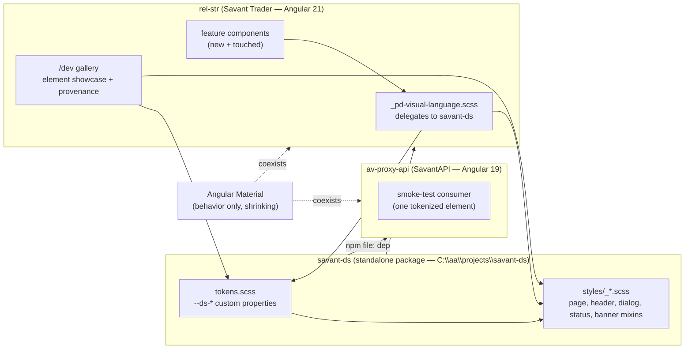

**Topic:** Savant Design System  
**Topic Slug:** savant-design-system  
**Thread:** Design System Foundation  
**Thread Slug:** ds-foundation  
**Issue:** #1026  
**Thread Parent:** #1025  
**Topic Parent:** #1024  
**Domain:** DESIGN-SYSTEM  
**Type:** PRD  
**Status:** Approved  
**Created:** 2026-10-15  
**Last Updated:** 2026-10-15  

# PRD — Design System Foundation

## Problem Statement

UI conventions in Savant Trader grew per-feature. Each new surface re-derives
the same patterns — page shells, header bars, dialog chrome, status states,
P&L accent colors — and each LLM session restyles them slightly differently.
Angular Material supplies the behavioral primitives but its components are
heavy and its theming is a second system sitting beside the hand-rolled one.
SavantAPI (the other Angular app) duplicates the problem entirely. There is
no shared vocabulary, no single place to look at "what our UI elements look
like," and no foundation from which consistent mocks or new pages can be
generated.

## Solution

A standalone **savant-ds** package — framework-light design tokens (CSS
custom properties) plus SCSS pattern mixins — consumed by both apps via an
npm `file:` dependency. It is seeded by extracting the best existing
hand-rolled patterns (the `_pd-visual-language.scss` mixin set and its
reference surfaces), not by a ground-up redesign. A `/dev` gallery page in
ST renders every element the system owns, with provenance notes naming the
surfaces each element generalizes. A thin inventory catalog seeds the next
thread's full inventory and Material-exit hit list.

Angular Material remains the behavioral layer for now; the design system
governs all *new* UI and any component being touched, and existing Material
usage migrates opportunistically along the inventory's ranked hit list. The
Topic's north star is a full Material exit in both apps, with thin Angular
CDK-wrapped components replacing mat-* behavior under DS styling — but no
migration happens in this thread.

## User Stories

1. As a developer, I want a standalone `savant-ds` package outside both app
   repos, so that "usable in another project" is structural, not aspirational.
   - *Verify:* `C:\aa\projects\savant-ds` is a git repo with `package.json`,
     SCSS entry points, and a README documenting consumption.
2. As a developer, I want both apps to install the package via an npm `file:`
   dependency, so that consumption is identical in ST and SA.
   - *Verify:* `"savant-ds": "file:../savant-ds"` resolves in rel-str and in
     av-proxy-api; `npm install` succeeds in both.
3. As a developer, I want design tokens expressed as CSS custom properties
   (`--ds-*`), so that any app or tooling can consume them without a build
   step beyond Sass.
   - *Verify:* a tokens partial defines color (surface, on-surface, accents),
     spacing scale, typography scale, density, and elevation tokens.
4. As a developer, I want P&L/direction accents as named tokens, so that the
   `#4caf50`/`#f44336` literals stop being re-declared per feature.
   - *Verify:* `--ds-up`/`--ds-down` (or equivalent) exist and
     `_pd-visual-language.scss` reads them rather than defining its own.
5. As a developer, I want dark theme handled by token swapping under
   `data-theme="dark"`, so that both apps inherit the existing convention.
   - *Verify:* token partial emits a `[data-theme="dark"]` block consistent
     with `_variables-global.scss`.
6. As a developer, I want the proven visual-language mixins available
   app-wide, so that new pages reuse `page-host`/`page-shell`/
   `content-column`/`header-bar` instead of re-deriving them.
   - *Verify:* savant-ds exports the mixin set documented in
     `_pd-visual-language.scss`; that file delegates to the package (or is
     replaced by direct package imports) rather than owning duplicate
     implementations.
7. As a developer, I want dialog and status patterns (chrome, submitting /
   success / error states, error banner) as shared mixins, so that the
   close-position / stop-loss / order-confirm dialog convergence is captured
   once.
   - *Verify:* `dialog-chrome`, `dialog-status`, `error-banner` equivalents
     exist in savant-ds and are used by the existing dialogs.
8. As a developer, I want a `/dev` gallery page rendering every element the
   system owns, so that "what does our X look like" has a live answer.
   - *Verify:* a route under `/dev` (e.g. `dev/gallery` or `dev/ds`) renders
     each tokenized element — swatches, spacing, type, page shell, header
     bar, dialog states, banner — using the real package, not copies.
9. As a developer, I want each gallery element annotated with "seen in"
   provenance, so that the gallery doubles as the extraction inventory.
   - *Verify:* each element card lists the source surface(s) it generalizes
     (run-dashboard, signal-review, signal-table, savant-trader dialogs…).
10. As a developer, I want an SA smoke-test — one component in av-proxy-api
    consuming savant-ds tokens or a mixin — so that cross-project wiring is
    proven in this thread.
    - *Verify:* av-proxy-api builds and renders one element via savant-ds.
11. As a developer, I want a thin inventory catalog doc, so that the next
    thread's full inventory and ranked Material hit list has a running start.
    - *Verify:* a catalog doc in the topic directory lists each extracted
      element (pattern name, source files, duplication count, extraction
      notes) plus a candidate list of elements not yet extracted.
12. As a developer, I want mockups in planning docs to come from the real
    system — gallery screenshots or inline SVG built on DS tokens — so that
    docs and shipped UI can't drift.
    - *Verify:* the PRD/usage docs state the convention; a mockup in a
      planning doc cites its source.

## System Context

## Technical Context

- **Angular version skew:** ST is Angular 21 / Material 20; SA is Angular 19 /
  Material 19. A compiled Angular library would need partial compilation and
  version-range maintenance. The shared layer is therefore **SCSS/CSS only —
  no build step, no Angular code** — so `file:` consumption works identically
  on both versions.
- **Material coexistence:** Material remains the behavioral layer (dialogs,
  overlays, form fields). DS tokens map onto `--mat-sys-*` where a Material
  component renders DS-styled content, but the DS vocabulary is the authority.
- **daisyUI considered and rejected:** it is a Tailwind plugin — adopting it
  means a second styling platform (Tailwind) alongside the Material exit, and
  its classes do not port to a non-Tailwind app. No Tailwind is added.
- **Where things live:** the package lives at `C:\aa\projects\savant-ds`
  (own git repo). ST references it via `file:../savant-ds`; SA via
  `file:../savant-ds` — the paths resolve the same because both projects sit
  under `C:\aa\projects\`.

## Implementation Decisions

- Package name `savant-ds`; token prefix `--ds-*`; mixin namespace `ds-*`
  (decided in grilling; rename cheap now, expensive later).
- Boundary **C** for the Material exit: DS governs new UI and touched
  components; inventory thread produces the ranked hit list; full exit is
  the Topic end-state.
- The gallery lives under the existing `/dev` route family in ST
  (`AppRoutes.DEV_GALLERY = 'dev/gallery'` exists; either reuse or add a
  `dev/ds` sibling).
- `_pd-visual-language.scss` remains the portfolio-dashboard entry point but
  delegates to savant-ds mixins rather than owning implementations — keeps
  the "feature-internal only" import discipline while making the package the
  source of truth.
- Mockup convention for planning docs: prefer screenshots of the `/dev`
  gallery or inline SVG built on DS tokens; cite the element name in the doc.
- New glossary terms recorded in `CONTEXT.md`: Savant Design System /
  savant-ds, Design Token, DS Gallery.

## Testing Decisions

- The package is mostly declarative SCSS — the meaningful test seam is
  **compilation and consumption**, not unit tests. Verification = both apps
  build and render via the package (a `scripts/verify` entry can assert the
  tokens file resolves and key mixin names exist after `sass` compile).
- Gallery correctness is verified by eye + the UAT pass, consistent with how
  this repo treats visual surfaces.
- Prior art: `scripts/verify/data-pipeline-st-*` offline check scripts —
  same pattern fits a `savant-ds` resolution/compile check.

## Out of Scope

- Full UI element inventory across both codebases (next thread — this one
  seeds the catalog only).
- Ranked Material-exit hit list and any mat-* rewrites.
- CDK-wrapped component library (ds-dialog, ds-select, …) — later thread
  once tokens/patterns stabilize.
- Wiring savant-ds into SA beyond the single smoke-test consumer.
- Figma-style mock tooling (future capability built on the token vocabulary).
- Publishing to a package registry — `file:` only.

## Further Notes

- The user intends the gallery to grow into the "full UI sample element
  buildout"; keep the gallery's data structure (element name → demo +
  provenance) extensible so later threads only add entries.
- `_pd-visual-language.scss` header already declares itself "the duplication
  inventory the future app-wide theme/design-system Topic will generalize"
  (Thread #751 / task #776) — this thread is that generalization.
