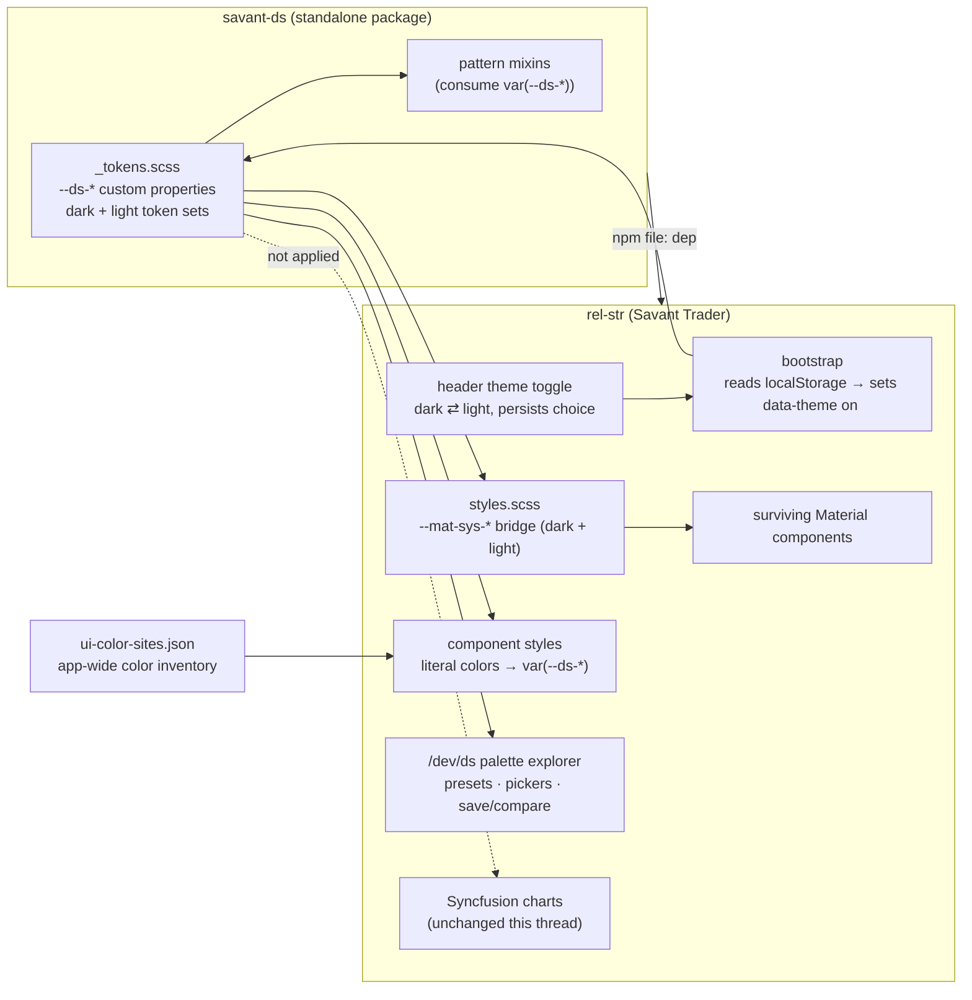

**Topic:** Savant Design System  
**Topic Slug:** savant-design-system  
**Thread:** Theme & Palette  
**Thread Slug:** theme-palette  
**Issue:** #1166  
**Thread Parent:** #1161  
**Topic Parent:** #1024  
**Domain:** DESIGN-SYSTEM  
**Type:** PRD  
**Status:** Approved  
**Created:** 2026-10-21  
**Last Updated:** 2026-10-21  

# PRD — Theme & Palette

## Problem Statement

Savant Trader is light-only. The only theme is a hand-rolled light
`--mat-sys-*` block in `styles.scss`; the `[data-theme="dark"]` convention
exists in the token layer but flips nothing except shadows — there is no
dark palette to swap to, nothing sets `data-theme` in the app, and there
is no theme persistence or user-facing toggle.

Color is also not centralized. A static inventory
(`docs/topics/1024-design-system/ui-color-sites.json`) counts ~3,994
candidate color sites across 195 files, ~2,349 of them hex literals —
direction greens/reds, rgba overlays, and hardcoded greys re-declared per
feature. Any palette change that doesn't sweep those literals leaves light-
tuned colors stranded on dark surfaces.

Finally, there is no brand identity. The visible colors are Material's
indigo-pink defaults; the user wants a modern dark app with bright,
cool/neon accents — while the order- and chart-related colors (buy/sell,
up/down, indicators) that users already read fluently must not change.

## Solution

Ship a **dark-default theme with a light fallback**, driven entirely by
design tokens:

- **Theme mechanism** — `data-theme` on `<html>`, set at bootstrap before
  first paint, persisted in `localStorage`, toggled by a user-facing header
  control. Dark is the default; light is a complete fallback, not a stub.
- **Neutral surfaces + swappable Brand Accent** — surfaces in both themes
  are a hue-free grey ramp. Identity comes from one swappable neon accent
  applied to borders, headings, accent containers, and glow — not to base
  surfaces.
- **Direction Colors as first-class tokens** — `--ds-up`/`--ds-down` drive
  every up/down/long/short element (badges, edges, pills, strips, banners,
  P&L cells). Their current values are preserved by default.
- **Order/chart colors untouched** — buy/sell, up/down, and indicator colors
  stay as they are. Syncfusion chart theming is not changed in this thread.
- **`/dev/ds` palette explorer** — accent preset swatches + free color
  picker, up/down pickers, light/dark preview, full token inspector, and
  named palette save/compare persisted in `localStorage`. The final palette
  is chosen here before rollout.
- **App-wide literal sweep** — hardcoded color literals are migrated to
  semantic tokens, guided and measured by the color-site inventory.
- **Material bridge** — a reasonable dark `--mat-sys-*` set so surviving
  Material components render legibly; it is intentionally minimal since
  `#1163` removes Material.

## User Stories

1. As a user, I want the app to default to a dark theme, so that the
   product has the modern dark look as shipped.
   - *Verify:* with no stored preference, first load renders the dark
     palette; all DS-governed surfaces use the neutral dark-grey ramp.
2. As a user, I want a light/dark toggle in the app header, so that I can
   switch when I want.
   - *Verify:* a header control flips `data-theme` on `<html>` and every
     themed surface updates without a reload.
3. As a user, I want my theme choice to persist, so that I don't re-toggle
   every session.
   - *Verify:* reload restores the stored theme with no visible
     light-then-dark flash; clearing storage returns to the dark default.
4. As a user, I want the brand accent applied to accent elements —
   borders, headings, accent cards, glows — while backgrounds stay neutral
   grey, so that the app reads "neon on dark" rather than "tinted".
   - *Verify:* on `/dev/ds` and migrated surfaces, base surfaces carry no
     hue tint; accent color appears only on designated accent-bearing
     elements.
5. As a user, I want buy/sell, up/down, and indicator colors unchanged, so
   that colors I already read for trading meaning stay stable.
   - *Verify:* `--ds-up`/`--ds-down` default to their existing values;
     trading pages, order surfaces, and charts show no direction-color
     drift.
6. As a developer, I want Direction Colors as tokens consumed by every
   up/down/long/short element, so that one value change re-tints them all.
   - *Verify:* after the sweep, direction literals in component styles are
     replaced by `var(--ds-up)`/`var(--ds-down)` (or roles derived from
     them); changing the token re-tints badges, edges, pills, strips,
     banners, and P&L cells together.
7. As a developer, I want to preview complete palettes on `/dev/ds` —
   accent presets, a free color picker, up/down pickers, and light/dark —
   so that palette selection happens on real DS elements before rollout.
   - *Verify:* gallery controls re-tint every demo element live; the
     picker seeds from the active preset.
8. As a developer, I want to save named palettes and compare them side by
   side, persisted in `localStorage`, so that candidates survive refresh
   and can be evaluated against each other.
   - *Verify:* save → refresh → apply reproduces accent, up/down, mode,
     and token snapshot; compare shows stored vs current values per token.
9. As a developer, I want an inventory of every color site in the app, so
   that token coverage gaps are known before rollout.
   - *Verify:* `ui-color-sites.json` is generated by the inventory script
     with file/line/literal per site and documented scanning limits.
10. As a developer, I want hardcoded color literals swept to semantic
    tokens, so that dark mode and future palette changes reach every
    surface.
    - *Verify:* re-running the inventory after the sweep shows literals
      consumed by token references; only documented exceptions remain
      (e.g., chart-series colors, third-party styles).
11. As a user, I want surviving Material components to stay legible on
    dark, so that un-migrated surfaces aren't broken before De-Materify.
    - *Verify:* a dark `--mat-sys-*` set exists; dialogs, menus, and form
      fields render legibly (functional, not final-designed — they exit in
      #1163).
12. As a user, I want the light theme to be a real fallback, so that
    flipping the toggle produces a coherent app rather than a stub.
    - *Verify:* every themed surface is legible under the light theme
      (the attribute-less `:root` set — see the SHARED emission-model
      deviation) with accent-appropriate contrast.

## System Context

## Technical Context

- **No flash-of-wrong-theme**: `data-theme` must be applied before first
  paint — a tiny synchronous bootstrap read of `localStorage` in
  `index.html`/`main.ts`, not inside an Angular component lifecycle.
- **`color-mix` reliance**: the palette explorer derives accent containers
  and glows via `color-mix`. It's fine for the dev page, but production
  token values should be baked literals unless the browser-support target
  is confirmed — decide at implementation.
- **Syncfusion stays light**: the imported `material.css` theme doesn't
  follow tokens and charts are explicitly out of the recolor scope; chart
  surfaces keep their current colors this thread.
- **Material bridge is temporary**: the dark `--mat-sys-*` set exists only
  to keep un-migrated Material components legible until #1163 removes them.
  Do not invest in perfect Material dark theming.
- **Inventory limits**: `ui-color-sites.json` is a static scan — it
  under-reports runtime-computed, named, and third-party colors. Treat it
  as a coverage baseline, not an exhaustive semantic map.
- **Ambiguity guard**: if a neon-green accent is chosen, it must remain
  visually distinct from the preserved `--ds-up` green — check them
  adjacent on the direction-badge demos before locking.

## Implementation Decisions

- `data-theme` on `<html>` (not a component root) — matches the documented
  token convention; all `:root`/`[data-theme]` CSS applies app-wide.
- Default resolution: stored `localStorage` choice → else `dark`. No
  `prefers-color-scheme` probing — dark is the product default.
- Palette canonical home: `savant-ds` `_tokens.scss` emits both token sets;
  `styles.scss` holds the app-level `--mat-sys-*` bridge for both modes.
- Surfaces are hue-free grey in both themes; only accent-designated
  elements (borders, titles, accent containers, glow) take the accent.
- Direction Colors are user-pickable on `/dev/ds` as an up/down pair; the
  shipped default preserves existing values.
- The explorer's preview bindings are scoped to the gallery host — preview
  state never leaks into app state until the palette is baked into tokens.
- Inventory generator: `scripts/inventory-ui-colors.mjs` →
  `docs/topics/1024-design-system/ui-color-sites.json`.
- New glossary terms recorded in `CONTEXT.md`: Theme, Brand Accent,
  Direction Colors.

## Testing Decisions

- The meaningful seams are **consumption and persistence**, not visuals:
  gallery specs cover localStorage save/restore, palette replace-by-name,
  and compare-state derivation (current spec set — 9 tests — is the prior
  art).
- Sass correctness is verified by compilation of the token partials and
  gallery styles, consistent with how the DS thread has verified mixins.
- Theme plumbing gets a focused spec around the bootstrap/persist/toggle
  service — storage read/write and `data-theme` attribute application are
  unit-testable; visual correctness is verified by UAT on `/dev/ds` and a
  spot-check of representative app pages.
- The literal sweep is verified by re-running the inventory script and
  diffing literal counts, plus targeted visual review of swept surfaces.

## Out of Scope

- SavantAPI (av-proxy-api) theme rollout — ST first; SA consumes the same
  token sets when its rollout thread runs.
- De-Materify (#1163) — Material components get only the minimal legibility
  bridge, not a redesign.
- Shared Card Component (#1162) and Chart Layout System (#1164).
- Syncfusion chart theming and any order/chart semantic color changes.
- Shipping the chosen palette into `savant-ds` as final token values —
  selection happens on `/dev/ds`; baking is part of this thread's rollout
  tasks, defined at blueprint.
- Figma-style mock tooling (a later Topic capability).

## Further Notes

- The palette explorer + inventory already exist on `/dev/ds` as working
  preview code (accent/up/down pickers, preset swatches, save/compare,
  token inspector) — implementation formalizes and ships them, it doesn't
  start from zero.
- Known palette direction from user exploration: neutral dark-grey ramp +
  neon accent; Neon Cyan and Neon Mint are front-runners; purple rejected;
  Arcade Blue darkened once already. Final hexes are locked on the dev
  page, not in this doc.
