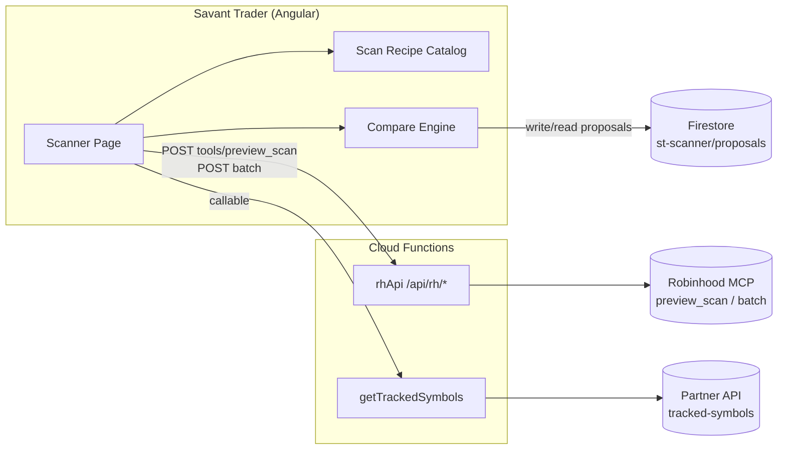

**Topic:** RH Scanner  
**Topic Slug:** rh-scanner  
**Thread:** RH Scanner Page  
**Thread Slug:** rh-scanner-page  
**Issue:** #1100  
**Thread Parent:** #1099  
**Topic Parent:** #1098  
**Domain:** SAVANT-TRADER  
**Type:** PRD  
**Status:** Approved  
**Created:** 2026-10-20  
**Last Updated:** 2026-10-20  

## Problem Statement

The tracked-symbol universe (~925 symbols, owned upstream by the partner API) has drifted: it contains dead tickers (~35 confirmed uncovered by the Robinhood scanner, likely delisted/acquired), symbols with no usable fundamentals (~47), and a long tail of low-quality names (~100+ scoring in the bottom band on ROE/margin/growth). Meanwhile quality names the universe lacks — the quality screen surfaced 254 strong candidates in a live session — never get discovered because there is no scan surface in ST.

Robinhood's scanner exists and is reachable through the deployed `rhApi` function, but ST has no page that runs it. Curation today would be manual symbol-by-symbol work against an undocumented universe.

## Solution

A **Scanner page** in Savant Trader (`trading/scanner`) that:

1. Offers a **curated menu of Scan Recipes** — named, versioned `preview_scan` filter bundles encoding the field-guide findings (unit-corrected thresholds, symbol scoping, sensible columns/sort). No filter DSL, no free-form builder.
2. Runs a recipe via the existing `rhApi` `/api/rh/tools/preview_scan` route and renders results in a table, each row flagged **tracked / untracked** against the current tracked-symbol universe.
3. Runs the comparison in **both directions**:
   - **Discovery** — matched-but-untracked symbols become the *Add candidates* bucket.
   - **Prune** — the full tracked universe is batched through the recipe via `symbol ANY_OF` scopes; tracked symbols that fail become *Drop candidates*, symbols the scanner never returns become *Dead/uncovered*, and symbols with no fundamentals become a distinct *No-data* bucket.
4. Persists each compare run as a **Curation Proposal** in Firestore (`st-scanner/proposals/items/{id}`) — the durable artifact for a future apply-path, and browsable history on the page.

The page is read-only against the Robinhood account: `preview_scan` only, never `create_scan`/`update_scan_*`/`run_scan`. Applying proposals to the tracked universe is explicitly deferred — the proposal is the output.

## User Stories

### Scan menu & results

1. As a trader, I want to pick a scan from a curated recipe menu with a one-line description each, so that I can find trade candidates without knowing the scanner DSL.
   - **Verify:** menu lists the shipped recipes; selecting one shows its description and parameters before running.
2. As a trader, I want to run a recipe on demand and see results as a table (symbol, name, price, % change, plus recipe-specific columns), so that I can evaluate candidates.
   - **Verify:** Run executes `preview_scan` via `rhApi`; rows render formatted values; fraction-scaled fields (margins, ROE, ivRank) display as percentages.
3. As a trader, I want each row flagged `tracked` or `untracked`, so that I can see at a glance which matches are new.
   - **Verify:** every result row carries a membership badge derived from the current tracked-symbol list.
4. As a trader, I want to see "N shown of M matched" plus a truncation indicator, so that I know when the scanner caps are hiding results.
   - **Verify:** when the response is capped (~200 rows / ~400 total items), the page says so explicitly rather than implying completeness.
5. As a trader, I want a stale-RH-session failure to show a clear reauthorization message, so that I don't mistake it for a broken scan.
   - **Verify:** a structured auth failure renders an actionable error state, not a generic error or silent empty table.

### Curated recipes (v1 menu)

6. As a trader, I want quality-fundamentals scans segmented by cap tier (Mega ≥$200B, Large $10–200B, Mid $2–10B), so that I can find fundamentally strong companies at a size I care about.
   - **Verify:** each tier recipe runs the verified screen (ROE ≥ 0.15, NPM ≥ 0.10, EPS > 0, PEG ≤ 2 as expressions + mcap bounds) and returns live results.
7. As a trader, I want 52-week-high and near-high scans, so that I can find momentum breakouts.
   - **Verify:** "At 52-wk high" and "Within 5% of high" recipes return live results consistent with the verified expressions.
8. As a trader, I want 52-week-low and near-low scans, so that I can find breakdowns or capitulation candidates.
   - **Verify:** mirror recipes return live results.
9. As a trader, I want high-IVR and low-IVR scans (optionable, mcap ≥ $2B), so that I can find premium-selling and premium-buying candidates.
   - **Verify:** `ivRank ≥ 0.8` / `≤ 0.2` recipes return live results; non-optionable symbols are absent.
10. As a trader, I want a relative-volume-spike scan, so that I can find unusual activity.
    - **Verify:** recipe (`dayVolume / volumeAvg(30) ≥ 2`-equivalent) returns live results.
11. As a trader, I want daily gainers and losers scans, so that I can see today's biggest movers.
    - **Verify:** percent-change-sorted recipes return live results.

### Universe comparison — discovery

12. As a curator, I want untracked scan matches collected into an **Add candidates** bucket, so that I can review potential additions.
    - **Verify:** bucket membership equals matched-minus-tracked; count matches untracked badges in the table.
13. As a curator, I want to click a candidate and see its row detail, so that I can judge whether it belongs.
    - **Verify:** selecting a bucket item highlights/focuses its result row (or shows its column values inline).

### Universe comparison — prune

14. As a curator, I want to evaluate the entire tracked universe through the quality screen in one action, so that I can find tracked symbols that fail.
    - **Verify:** "Evaluate tracked" batches all tracked symbols through the recipe via `symbol ANY_OF` scopes and reports pass/fail per symbol.
15. As a curator, I want failing tracked symbols in a **Drop candidates** bucket with the metric values that failed them, so that removal is evidence-based.
    - **Verify:** drop bucket lists each symbol with its failing column values (e.g., negative NPM).
16. As a curator, I want tracked symbols the scanner never returns in a **Dead/uncovered** bucket, so that delisted/unsupported names surface separately from low-quality ones.
    - **Verify:** symbols absent from every batch response land in this bucket, not in drop candidates.
17. As a curator, I want symbols that return but carry no fundamentals in a **No-data** bucket, so that provider gaps are flagged for verification rather than auto-dropped.
    - **Verify:** returned-but-blank symbols land here, distinct from score failures.

### Proposals

18. As a curator, I want each compare run saved as a proposal (recipe, timestamp, matched count, buckets), so that curation decisions survive reload and accumulate history.
    - **Verify:** completing a compare writes a doc to `st-scanner/proposals/items`; a history list on the page shows past proposals with counts.
19. As a curator, I want to open a past proposal and browse its buckets, so that I can revisit or act on it later.
    - **Verify:** selecting a history entry renders the persisted bucket lists.

### Safety & integrity

20. As the system, the page must only invoke read/simulation scanner tools — never account mutations.
    - **Verify:** the page's tool-call layer allowlists `preview_scan` (and read tools); a mutation tool name is rejected client-side before any request.
21. As a user, I want the page to work within a reasonable time budget, so that universe evaluation doesn't feel broken.
    - **Verify:** full-universe prune completes via batched calls with visible progress; each leg bounded by the batch budget.

## Implementation Decisions

- **Execution path:** reuse the deployed `rhApi` onRequest surface — `POST /api/rh/tools/preview_scan` for single scans and `POST /api/rh/batch` (≤20 calls, one MCP session, 75s budget) for universe evaluation. The FE attaches the Firebase ID token; `rhApi` is already CORS-allowlisted and owner-gated. **No new Cloud Function surface.**
- **Tracked universe:** existing `getTrackedSymbols` callable (partner API, cached ~10 min TTL).
- **Scan Recipe catalog:** a typed, code-versioned list (id, title, description, filter bundle, columns, sort, optional scope). Recipes encode the field-guide unit corrections — expression filters with fraction thresholds (`0.15`), never enum PERCENTAGE filters.
- **Compare engine:** pure client-side functions over `{matched[]}` and `{tracked[]}` — membership flags, bucket derivation (add / drop / dead / no-data). Highest testable seam.
- **Prune batching:** tracked universe chunked into `symbol ANY_OF` scopes (≤~150 symbols per call) inside one `/api/rh/batch` request.
- **Curation Proposals:** `st-scanner/proposals/items/{id}` docs (anchor-pattern naming), written by the FE on compare completion, read for the history list. Fields: recipe id, ranAt, universe size, matched count, truncated flag, add/drop/dead/no-data symbol lists.
- **Value normalization:** a small display util maps fraction-scaled fields to percentages; raw dollar counts stay raw. Blank fields render as `—`.
- **FE structure:** page + store + components under `savant-trader` feature area per existing conventions; route `trading/scanner` under the Trading nav section.
- **rhApi tool gate:** the deployed executor allowlists the full enabled tool set (including mutations). The page-side call layer constrains itself to scanner read/simulation tools; narrowing the server allowlist is noted as hardening, not required for v1.

## Testing Decisions

- **Good tests = external behavior at seams** — compare engine and recipe catalog are pure TS and get direct jest unit tests (prior art: `gallery-cards.util.spec.ts`, `gallery-card-actions.util.ts` spec style).
- **Compare engine:** membership flags, all four buckets, edge cases (empty universe, fully-uncovered symbol, mixed-scale fields, capped result set).
- **Recipe catalog:** structural validation — every recipe's args conform to the captured `preview_scan` schema (prior art: schema-validation tests + `run-tool-observation` fixtures under `docs/topics/657-rh-mcp/captures/`).
- **Component/store specs:** loading, error, capped-result, and bucket-render states (prior art: gallery facade/component specs).
- **Live verify relay:** a `functions/scripts/verify/rh-scanner-*` script running each recipe through `preview_scan` on the real session (prior art: `run-tool-observation.ts` harness and the `scripts/verify/` relay convention) — catches upstream schema/scale drift.
- **Firestore:** proposal write/read covered by a store spec against a fake; security rules follow the established owner-only pattern.

## Out of Scope

- **Applying curation** — no writes to the upstream tracked universe, no local overlay, no `rh-agent-symbols.enabled` changes. Proposals are the artifact; the apply path is a deferred decision tracked as an open question.
- **Saved-scan listing/replay** (`get_scans`/`run_scan`) — candidate follow-up Thread.
- **Free-form filter builder** — indefinitely deferred (would rebuild Legend's scanner plus the unit-quirk knowledge).
- **`create_scan` / `update_scan_*`** — never invoked by this page; nothing is persisted to the RH account.
- **Auto-refresh** — results are static at request time; manual re-run only.
- **Exhaustive enumeration beyond scanner caps** — mitigated by recipe scoping/tier splits, not by pagination machinery.
- **Symbol onboarding/backfill for add candidates** — upstream `partner-symbol-added` flow, unchanged.

## Technical Context (user-affecting constraints)

- **Static results:** scan output is a point-in-time snapshot; it does not live-update (per Robinhood's Scanner Disclosure).
- **Scanner caps:** ~200 rows displayed, ~400 total matched items observable via the MCP path (UI discloses a 1,500-symbol match cap — the MCP ceiling observed is lower). Broad scans truncate silently unless the page warns; cap-tier/scoped recipes bound result sets.
- **Fundamental field scale quirk:** ROE/NPM-style fields are fraction-scaled (0.276 = 27.6%) and one field was observed mixed-scaled across symbols. Recipes ship correct thresholds; a No-data bucket prevents provider gaps from masquerading as failures.
- **IV coverage:** `ivRank` and friends are undefined for non-optionable symbols — those symbols are silently excluded from IVR scans.
- **Latency:** a single preview takes seconds; a full-universe prune is ~7 batched scanner calls plus session setup — expect tens of seconds, with progress shown.
- **RH session expiry:** cloud credentials can require reauthorization (local OAuth bootstrap + upload flow); the page surfaces this state clearly.
- **Tracked universe freshness:** partner API data cached up to ~10 minutes by the callable.

## System Context

## Further Notes

- Full scanner findings: `docs/topics/657-rh-mcp/rh-mcp-scanner-field-guide.md`; tool reference: `docs/topics/657-rh-mcp/rh-mcp-tools-scanners.md`.
- Empirical session data (tracked-universe quality scores, prune/add lists): `.devin/tmp/symbol-scores.json`, `.devin/tmp/prune-report.json`.
- Open question parked for later: the curation apply-path (upstream mutation vs local overlay vs `rh-agent-symbols.enabled` vs manual proposal application).
