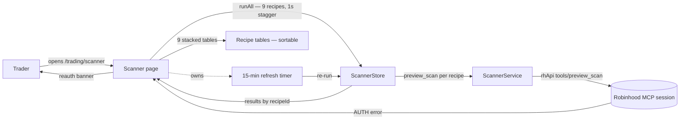

**Topic:** RH Scanner  
**Topic Slug:** rh-scanner  
**Thread:** Auto-Run Scans  
**Thread Slug:** scanner-auto-run  
**Issue:** #1185  
**Thread Parent:** #1183  
**Topic Parent:** #1098  
**Domain:** SAVANT-TRADER  
**Type:** PRD  
**Status:** Approved  
**Created:** 2026-10-21  
**Last Updated:** 2026-10-21  

## Problem Statement

The scanner page (`trading/scanner`, shipped under Thread #1099) runs one recipe at a time: pick a scan from the menu, click Run, read one table. Scanning the whole catalog for trade candidates means nine manual pick-run-read cycles, and there's no at-a-glance view of what every screen is currently surfacing.

## Solution

Turn the scanner page into an **auto-run overview**: opening the page runs every recipe in the catalog automatically and renders each result set as its own table on one vertically scrolling page. A 15-minute refresh cycle keeps results current while the page is open. No recipe picker, no Run button — the page is the dashboard.

Key elements:

1. **Auto-run all recipes on page load** — every catalog recipe fires `preview_scan`, staggered ~1 second apart to protect the live MCP session. Each table fills independently as its call returns.
2. **15-minute auto-refresh + manual controls** — while the page is open, all recipes re-run on a 15-minute cycle. Results persist in the store across navigation away and back within a session. A **Run all** button re-fires the full staggered set on demand, and each table header gets its own **refresh button** that re-runs just that recipe immediately.
3. **One table per recipe, single page scrollbar** — tables stack in catalog order; the whole page scrolls vertically so lower tables are reachable. Each table gets a header line: recipe title/description, row count vs `total_items`, `sorted_by`, and run timestamp.
4. **All wire row fields as columns** — `ticker`, `instrument_id`, `instrument_type`, plus every column the recipe declares. Tracked/untracked badge retained per row.
5. **Multi-level column sort** — the option-chart contract-catalog idiom: click a header to add it as the next sort level (asc), click again to flip (desc), click a third time to remove it; headers show a numbered priority badge (`1↑`, `2↓`). Client-side over the rows returned.
6. **Graceful degradation** — a recipe whose call fails is silently skipped (its table doesn't appear). An AUTH failure surfaces the existing re-authorize banner rather than an empty page.
7. **Clean page** — the recipe picker, compare panel, and proposal-history section come off the page. The only run controls are **Run all** (header) and **per-table refresh** (each table header). The page is pure scan output.

Compare buckets, Evaluate-tracked prune, proposal generation, and the proposal-history list are **out of this thread's scope** — the underlying store/service machinery and components stay in the codebase untouched, but the overview page does not render them. That surface returns when curation re-enters scope.

## User Stories

### Auto-run

1. As a trader, when I open the Scanner page I want every recipe to start running automatically so I never have to pick or click anything.
   - **Verify:** page load issues a `preview_scan` call for every catalog recipe, no picker interaction required; calls are staggered ~1s apart.
2. As a trader, I want each table to fill as its call returns so the fastest recipes are readable while slower ones are still in flight.
   - **Verify:** an early-returning recipe's table shows rows while a still-pending recipe shows a loading state.
3. As a trader, when I leave the page and come back I want the last results still there so I don't re-pay the load cost.
   - **Verify:** navigating away and back within the session shows the previous results immediately without re-firing calls.

### Refresh

4. As a trader, I want results to re-run every 15 minutes while I'm looking at the page so the tables stay current.
   - **Verify:** the staggered call set re-fires 15 minutes after the previous cycle; leaving the page stops the cycle (no calls continue while off-page).
5. As a trader, I want a **Run all** button so I can re-run everything right now.
   - **Verify:** clicking Run all fires the staggered set immediately without waiting for the cycle.
6. As a trader, I want a refresh button on each table so I can re-run just that one scan without touching the others.
   - **Verify:** clicking a table's refresh fires a single `preview_scan` for that recipe only; other tables' data is untouched; the table shows a loading state until its call returns.

### Tables

7. As a trader, I want one table per recipe stacked top-to-bottom on a single scrolling page so I can survey all scans without switching views.
   - **Verify:** tables appear in catalog order; the page has a single vertical scrollbar; no inner table scroll traps.
8. As a trader, I want each table's header to tell me which recipe it is, how many rows came back vs the total matched, how the scan sorted them, and when it ran.
   - **Verify:** header shows recipe title + description, `N of M` rows (`results.length` / `total_items`), `sorted_by`, and run timestamp.
9. As a trader, I want every field the scan returns for a row visible as a column — ticker, instrument id, instrument type, and all recipe-declared columns — so nothing in the response is hidden.
   - **Verify:** all `ScanResultRow` fields render as columns; percent-scaled columns display as percentages; blank values render as `—`.
10. As a trader, I want the tracked/untracked badge per row retained so I can still see which candidates are already in my universe.
   - **Verify:** rows display the tracked badge exactly as the current table does.

### Sorting

11. As a trader, I want to sort each table by multiple columns — e.g. % change then volume — using click-to-cycle headers.
    - **Verify:** clicking a column header adds it to the sort chain ascending; clicking again flips to descending; a third click removes it. A second clicked column applies as tiebreak within the first. This is the same interaction as the option-chart contract catalog.
12. As a trader, I want visible sort priority indicators so I can tell which column is primary, which is secondary.
    - **Verify:** sorted headers show a numbered badge with direction arrow (`1↑`, `2↓`); unsorted headers show nothing.

### Failure handling

13. As a trader, if one recipe's call fails I want the rest of the page unaffected — no error storm, no broken tables.
    - **Verify:** one failing recipe renders 8 healthy tables; the failed recipe's table simply doesn't appear (no error block).
14. As a trader, if my Robinhood session is expired I want to see the re-authorize banner, not an empty page.
    - **Verify:** an AUTH failure on the run set renders the existing reauth banner with a working re-authorize action.

### Removed surfaces

15. As a trader, I don't want a recipe picker or per-recipe Run controls to select scans — the page always runs everything and shows only results; Run all and per-table refresh are the only run controls.
    - **Verify:** no picker or per-recipe run selection UI renders; Run all + per-table refresh buttons do.

## Implementation Decisions

- **Stagger, not parallel:** calls fire ~1s apart rather than simultaneously — 9 concurrent calls on one MCP session is an untested concurrency assumption; staggering keeps load linear and still fills the first table quickly.
- **Page-owned refresh timer:** the 15-minute cycle lives and dies with the page — leaving the page stops it, so no calls burn while unviewed. Store holds the latest result per recipe so re-entry is instant.
- **Store shape:** results keyed by recipe id (per-recipe status: loading/success/failed), not the single-run shape the current page consumed.
- **Sort idiom:** reuse the `SortLevel[]` click-cycle + `compareByField` chain pattern from the option-chart catalog table — proven interaction, numbered priority badges, N-level chain (2-level requirement is a subset).
- **Silent skip:** non-AUTH per-recipe failures drop that table; AUTH failure shows the reauth banner (a blank page otherwise tells the user nothing).
- **Curation removal is page-level only:** the store's single-run/compare/proposal machinery and the compare-panel component are not deleted — they stay for a future curation surface.

## Testing Decisions

- Component specs drive: staggered run-all on init (mock service, fake-timer or delay-assertion), per-table loading→rows transitions, silent-skip on rejection, AUTH banner, 15-minute cycle fire + teardown on destroy, multi-level sort chain + priority badges, all-fields column coverage.
- Store specs: per-recipe result map, refresh merge, failure isolation.
- No live-relay changes required — `rh-scanner-recipes-1098` already exercises every recipe; it remains the wire tripwire.

## Out of Scope

- Live compare/prune evaluation, proposal generation/history, bucket expandos on this page (machinery + components retained in the codebase; UI surface deferred)
- Tracked-symbol universe mutation (applying proposals)
- Server-side or persistent result caching across app restarts
- Free-form filters, saved scan replay
- Any `create_scan`/`update_scan`/`run_scan` mutation — page stays read-only

## Technical Context (user-affecting constraints)

- Each recipe is a live `preview_scan` call against the Robinhood MCP session — the page requires an authenticated session; without one, the reauth banner is the expected state.
- Results are capped at ~200 rows per recipe (scan-preview semantics); the `N of M` header tells you when a recipe matched more than it returned.
- The 15-minute refresh only runs while the page is open — closing the page stops it; reopening shows the last results instantly.
- Scan results reflect whatever Robinhood's scanner returns at run time; a 15-minute-old table can drift from a fresh run.

## System Context

## Further Notes

- This is the second thread under Topic #1098 (RH Scanner). Thread #1099 built the single-recipe page; this thread replaces its interaction model while reusing its service, store internals, contracts, and proposal-history surface.
- Idea issue: #1185. Thread anchor: #1183.
