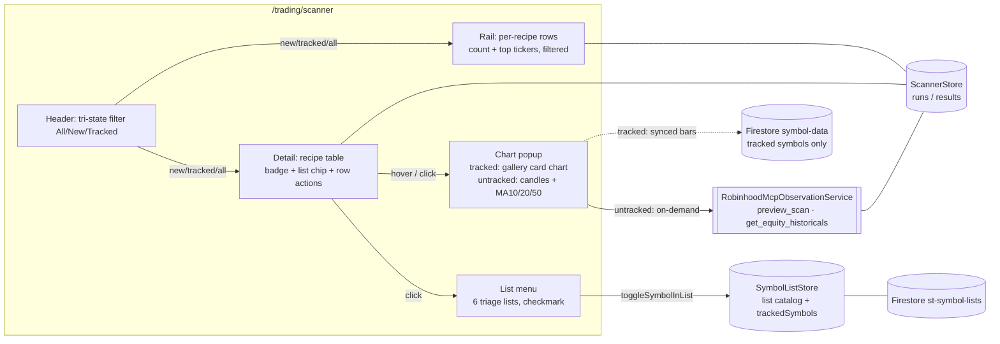

**Topic:** RH Scanner  
**Topic Slug:** rh-scanner  
**Thread:** Scanner Row Actions  
**Thread Slug:** scanner-row-actions  
**Issue:** #1296  
**Thread Parent:** #1295  
**Topic Parent:** #1098  
**Domain:** SAVANT-TRADER  
**Type:** PRD  
**Status:** Approved  
**Created:** 2026-10-27  
**Last Updated:** 2026-10-28  

# PRD — Scanner Row Actions

## Purpose

The auto-run scanner page surfaces trade candidates — mostly symbols that are
**not** in the tracked universe ("new"). Today a scan hit is read-only: to act
on it the user leaves the page, finds the symbol elsewhere, and files it by
hand. This thread makes each result row actionable in place — inspect the
symbol's price action with a hover chart, and file it into a triage list
without leaving the table — plus a page-wide filter so the scoreboard can
isolate the new (untracked) hits the page exists to surface.

## Problem / Audience

- **User:** the trader reviewing morning scan output.
- **Problem:** discovery rows demand two actions that today require
  navigation: *"what does this symbol's chart look like?"* and *"put it on
  my radar"*. Untracked symbols also can't be hidden, so a recipe returning
  200 rows buries the genuinely new hits under already-tracked names.

## Scope

### 1. Hover chart popup (per row)

Each result row carries a chart action. **Hovering or clicking** it opens a
transient popup showing that symbol's chart. Moving the pointer away
closes the popup.

- **Tracked rows** render the actual gallery card chart — the same
  multi-pane daily chart the gallery view shows (trend bands, strength,
  zone panes, signal dots) on synced `symbol-data` bars.
- **Untracked rows** render a **candlestick** chart with proper up/down
  coloring plus **MA 10, MA 20, MA 50** overlays, on bars fetched on
  demand (see Technical Context) and cached for the session.
- Every row gets a working chart — tracked or not.

### 2. Triage-list assignment (per row)

Each result row carries a list action — a small icon button opening a menu
of the **exclusive triage lists**: NEW, PRIMARY, SECONDARY, NEUTRAL, AVOID,
HIDE.

- The symbol's current triage list (if any) is checkmarked in the menu.
- Picking a different list **moves** the symbol (exclusive semantics — it
  leaves its previous triage list). Picking the already-checked list
  **un-assigns** it (removes triage membership entirely — the
  remove-from-list path).
- MONITOR and user-created lists are **not** offered in v1.
- Write failures surface via the existing snackbar path and the menu
  reflects server truth on the next list-catalog emission.

### 3. Current-list chip (per row)

Each row displays which triage list the symbol currently sits in (e.g. a
`PRIMARY` chip) next to the existing tracked/new badge, so membership is
visible without opening the menu.

### 4. Page-wide symbol filter

A tri-state toggle in the scanner page header — **All / New / Tracked** —
filters scan results everywhere:

- the selected recipe's detail table,
- each rail entry's top-ticker preview, **and**
- each rail entry's count readout.

"New" = rows whose symbol is **not** in the tracked-symbols universe (the
existing `tracked` badge = false). "Tracked" = universe members.

## User Stories & Acceptance Criteria

### US-1 — Peek at a scan hit's chart

> As a reviewer, I want to hover a row's chart button and see that symbol's
> recent price action with MAs, so I can judge the setup without leaving
> the scanner.

- Hovering the chart action opens a popup showing the row symbol's chart.
- Moving the pointer off the button/popup closes it.
- Clicking the button produces the same popup (accessible fallback for
  touch/keyboard — focus also triggers it).
- A tracked-symbol row shows the gallery card chart (multi-pane,
  signal dots) on synced data.
- An untracked-symbol row shows a candlestick chart with proper up/down
  coloring and visible MA 10/20/50 lines (data fetched on demand), with
  a loading state while the fetch is in flight.
- A fetch failure shows an error/unavailable state in the popup — never a
  blank frame; an auth-category failure surfaces the page's existing
  reauthorization affordance.
- Re-hovering the same symbol within the session does not refetch.

### US-2 — File a scan hit into a triage list

> As a reviewer, I want to put a new symbol on my Primary (or other triage)
> list directly from the row, so the discovery becomes a tracked workflow
> item without leaving the page.

- Clicking the row's list icon opens a menu showing exactly the six triage
  lists.
- Choosing a list writes the membership; the row's chip updates to show
  the new list on the next catalog emission (no optimistic fake — the
  existing store contract).
- Choosing a different list while already assigned moves the symbol —
  it appears in only one triage list afterward.
- Choosing the currently-assigned list removes the membership (the row's
  chip clears).
- A failed write surfaces a snackbar error and leaves membership
  unchanged.

### US-3 — Isolate the new hits

> As a reviewer, I want to filter the whole page to untracked symbols so
> I can work the discovery set without tracked noise.

- A tri-state control in the page header offers All / New / Tracked.
- "New" hides tracked-universe rows from the detail table **and** removes
  them from rail top-ticker previews and rail counts.
- "Tracked" shows only universe members; "All" shows everything.
- The selection applies to all recipes at once and survives recipe
  switching; it does not need to survive page reload.

## Out of Scope

- **Universe enrollment.** Filing an untracked symbol into a list writes
  list membership only — it does *not* add the symbol to the tracked
  universe (no SA-side add endpoint exists; see Technical Context). The
  symbol stays "new" until the upstream universe picks it up. Desired
  follow-up: list-add enrolls tracking once an endpoint exists (ADR-011).
- MONITOR and user-created lists in the row menu.
- Bulk/multi-row selection and batch list assignment.
- Curation proposals / compare machinery (already in the store, stays
  unsurfaced — unchanged from the auto-run phase).
- Saved scans, filter-builder, direct universe mutation (thread-level v1
  exclusions, unchanged).
- Untracked-symbol rendering of the full gallery pane set (trend bands,
  zone panes, signal dots) — that depth requires synced/computed series
  an on-demand fetch doesn't provide; untracked rows get candlestick +
  MA 10/20/50.

## Technical Context

- **Two chart sources, one popup.** Tracked rows render the gallery card
  chart on synced `symbol-data` bars (the existing
  `GalleryCardChartStore` path). Untracked rows fetch
  `get_equity_historicals` through the same
  RobinhoodMcpObservationService channel `preview_scan` uses,
  session-cached per symbol, rendered as candlesticks with client-side
  MA 10/20/50 — no indicator-callable warm-up (ADR-011).
- **List model already exists.** `st-symbol-lists` registry +
  `SymbolListStore.toggleSymbolInList` provide the exclusive move/un-assign
  semantics, serialized writes, and snackbar failures this feature needs —
  no new write path. The scanner page must additionally open the live list
  catalog (`loadSymbolLists`) to render membership.
- **"New" means untracked-by-universe.** A list-assigned-but-untracked
  symbol still reads "new" — membership and tracking are different axes.
- **Auth taxonomy carries over.** Historicals fetches share the
  session-global auth failure semantics of scan calls.
- **Hover UI constraint.** The popup must tolerate table re-renders and
  the 15-minute refresh wave — closing logic keys on pointer leave, not
  row identity churn.

## System Context

## Success Criteria

- A scan reviewer can chart, filter, and file new hits without leaving the
  scanner page.
- An untracked row's chart renders a real candlestick+MA chart on first
  hover; a tracked row's chart matches the gallery view's card chart.
- Row list actions produce exactly one triage membership per symbol and
  reflect server truth.
- "New" mode visibly reduces rail counts/tickers and table rows to the
  untracked set.
