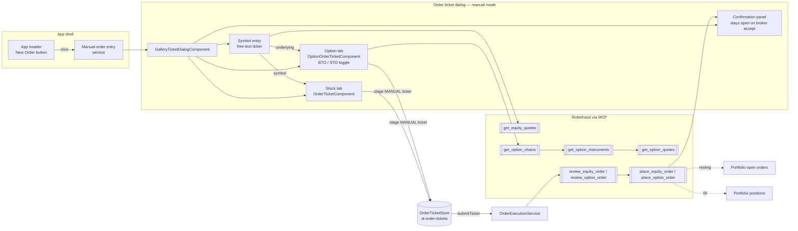

**Topic:** Manual Order Entry  
**Topic Slug:** manual-order  
**Thread:** Header Order Ticket  
**Thread Slug:** header-order-ticket  
**Issue:** #1179  
**Thread Parent:** #1178  
**Topic Parent:** #1177  
**Domain:** ORDER  
**Type:** PRD  
**Status:** Approved  
**Created:** 2026-10-21  
**Last Updated:** 2026-10-21  

## Problem Statement

Every order the app can place today starts from a signal: a card in the gallery, staged by the signal pipeline. There is no way to place an order the signals didn't produce — a ticker the user researched elsewhere, a name they want to own, a contract they already picked on the option-chain page. The ticket infrastructure is instrument-agnostic (`OrderSource.MANUAL` exists in the type model; both equity and option submission paths are live), but nothing creates a manual ticket or exposes an entry point outside the gallery card's Trade button.

## Solution

Add a **New Order** button to the app header — available on every authenticated page, styled like the "New manual order" stroked button on the order page. Clicking it opens the existing order ticket dialog (`GalleryTicketDialogComponent`) in a **manual mode**: the Stock/Option tab group renders as it does for a gallery Trade, but instead of a card-supplied symbol the dialog leads with a symbol entry field.

The user types any ticker — free text, not restricted to tracked symbols — and the dialog fetches the underlying quote (`get_equity_quotes`) to populate the header strip (last/change/prev/bid/ask), exactly as it does for card-driven tickets. The **Stock** tab stages a buy-only equity/ETF ticket (`source: MANUAL`, no `signalContext`) — sell-to-open (shorting) is impossible at RH, so there is no sell side to offer. The **Option** tab stages a single-leg ticket with a **buy-to-open / sell-to-open** position-effect toggle: sell-to-open is live-verified at RH for collateral-backed orders (covered calls against held shares, cash-secured puts), while naked calls are broker-rejected (`400 "This order introduces infinite risk."`) and the error surfaces on the ticket. Contract selection runs standalone, without a run or signal context. Resolving an option contract fetches its quote (`get_option_quotes`) so the user can price the limit; for sell-to-open the review response's collateral fields show what the order will lock up.

Submission, confirmation, and downstream landing are identical to the gallery Trade flow: review-then-place with ticket `ref_id` idempotency, the in-dialog confirmation panel on broker acceptance, and broker-authoritative state thereafter — a resting order appears in the Portfolio Dashboard's open-orders list; a fill appears as a position (equity or option). The retired `/trading/live` order page is not a surface for this feature — staged manual tickets do not need a queue view; the dialog is the whole flow.

## User Stories

1. As a trader, I want a New Order button in the app header on every page, so that I can place an order without first finding a signal card.
   - AC: a stroked button (add icon + label, matching the order page's "New manual order" styling) renders in the app header when signed in; clicking it opens the order ticket dialog; the button is not rendered for signed-out users.

2. As a trader, I want to type any ticker into the dialog, so that I'm not limited to symbols the scanner tracks.
   - AC: the manual dialog presents a symbol field before/independent of ticket staging; entering a symbol triggers `get_equity_quotes` and the dialog header strip shows last/change/prev/bid/ask; an unresolvable symbol shows a visible error and cannot stage a ticket.

3. As a trader, I want the Stock tab to stage a buy order for the symbol I entered, so that I can buy shares or ETF units directly.
   - AC: the staged ticket is `instrumentType: EQUITY` (or ETF), `side: buy`, `source: MANUAL`, with no `signalContext`/`sourceRef`; market and limit order types, quantity or dollar-amount sizing, time-in-force, and market-hours controls match the card-driven ticket; the bucket picker remains available; no sell side is offered (RH rejects zero-held sells — verified: `400 "Not enough shares to sell."`).

4. As a trader, I want the Option tab to offer the same contract selection as the signal flow — expiration → strike → call/put selects plus the paste-a-contract path — so that picking a contract works identically whether or not a signal exists.
   - AC: chain/instrument resolution (`get_option_chains` → `get_option_instruments`) runs for the entered symbol without `runId`/`signals`/`decisions`; a resolved contract fetches `get_option_quotes` and displays mark + estimated premium/credit; the leg stays single (long call or put for buy-to-open; call or put for sell-to-open).

4a. As a trader, I want a buy-to-open / sell-to-open toggle on the Option tab, so that I can write covered calls and cash-secured puts, not just buy options.
   - AC: `positionEffect` is user-selectable between `open`-with-`buy` and `open`-with-`sell`; for sell-to-open the form surfaces the review response's collateral requirement (cash or shares) before submit; a broker rejection (e.g. "infinite risk" on a naked call) lands on the ticket as an ordinary submit failure — no client-side attempt to pre-judge margin eligibility.

5. As a trader, I want submit to behave exactly like the gallery Trade flow, so that one learned flow covers every order.
   - AC: submit runs review-then-place with the ticket's `ref_id`; the confirmation panel renders in-dialog on broker acceptance (submitted/queued/resting/filled) and stays until dismissed; failures land in the existing dead-state/unconfirmed classification on the ticket.

6. As a trader, I want closing the dialog before submit to discard the ticket it created, so that abandoned manual orders don't accumulate as orphaned staged records.
   - AC: same semantics as the gallery flow — a still-STAGED ticket created by this dialog session is discarded on close; a submitted/terminal ticket is unaffected.

7. As a trader, I want my resting and filled manual orders in the places I already monitor, so that nothing is invisible after submit.
   - AC: a resting manual order appears in the Portfolio Dashboard open-orders list (cancelable via the existing cancel path); a fill produces a position row (equity list for stock/ETF, option positions for contracts) without new backend work.

8. As a trader, I want the same guardrails that apply to signal orders, so that a manual order can't bypass the fatfinger checks.
   - AC: trading-config caps apply identically — equity dollar/exposure limits where the existing ticket enforces them, and `optionMaxPremiumCashPercent` on buy-to-open orders; sell-to-open orders are governed by collateral, not premium — the review response's collateral fields are displayed, and RH enforces sufficiency at place time.

## Out of Scope

- **Equity sell** — RH has no short selling (`mx-sell-short`: 400 "Not enough shares to sell" on a zero-held sell); selling a held position is sell-to-close, which is position management, not order entry.
- **Naked option calls** — broker-enforced rejection ("infinite risk"); sell-to-open is limited to what collateral covers (covered calls, cash-secured puts).
- **`/trading/live`** — retired; no queue integration, no changes to its placeholder buttons.
- **Multi-leg options, sell-to-close, exercise, option stops** — deferred (see Topic #942). Note: multi-leg is also broker-blocked today ("Multi-leg options orders aren't supported in the Robinhood Trading MCP yet").
- **Tracked-symbol restriction** — manual orders accept any ticker.

## System Context

## Technical Context

- **No card context.** The gallery dialog receives a staged `ticketId` + `OptionTabSeed` (symbol/runId/signals/decisions) from the card. Manual mode supplies none of that: the symbol is user-entered, `runId`/`signals`/`decisions` don't exist, and staged tickets carry no `signalContext`/`decisionIds`. `OptionOrderTicketComponent`'s provenance inputs become optional or a manual variant builder stages the ticket.
- **Provenance = `source: MANUAL`.** The only origin marker on a manual ticket is `OrderSource.MANUAL`; nothing downstream should require signal fields. The store's `submitTicket` already branches on `instrumentType`, not source.
- **Contract identity is two-step.** RH order tools need a UUID `option_id` — `get_option_chains` (symbol → expirations) → `get_option_instruments` (chain + expiration → `option_id`) — unchanged from the signal flow; only the symbol source differs.
- **Idempotency** is the ticket `ref_id`, unchanged.
- **Broker-authoritative after submit.** Order state lives at RH; the Portfolio Dashboard reads `get_equity_orders`/`get_option_orders`/positions already. No local order queue is required — the in-dialog confirmation is the post-submit surface.
- **Sell-to-open is live-verified but collateral-gated.** Probe captures (Topic #657): a cash-secured put STO was accepted and rested (`opening_strategy: short_put`, `direction: credit`); a naked call STO was rejected `400 "This order introduces infinite risk."` — review is advisory-only, place is the enforcement boundary. Covered calls collateralize against `collateral.equities` (100 shares/contract); CSPs against `collateral.cash` (strike × 100). Passing `chain_symbol` + `underlying_type` on `review_option_order` returns the fee + collateral fields the ticket should display.
- **Option direction is derived, not sent.** `OrderExecutionService.buildOptionOrderArgs` never transmits `direction` — RH derives it from the legs (sell+open resolves to `credit`, verified by `opt-place-csp`). Sell-to-open therefore needs no wire change beyond the leg's `side: sell` + `position_effect: open`, which the `OptionLeg` model already carries.
- **Discard-on-close** mirrors gallery semantics: tickets this dialog session created and left STAGED are removed on close; anything the broker touched survives.

## Implementation Decisions

- **Reuse `GalleryTicketDialogComponent`** with a manual-mode data shape rather than a second dialog — the tabs, quote strip, and confirmation panel are already the desired UX. Manual mode adds the symbol field and drops the card-bound assumptions.
- **Header button → a small entry service** (e.g. `ManualOrderService`) so the header stays presentation-only: it stages nothing until a symbol resolves, opens the dialog, and owns discard-on-close bookkeeping.
- **Stage lazily, as options already do.** No ticket doc exists until the user has a real order drafted — symbol entry alone does not write to Firestore.
- **The retired `/trading/live` placeholders are out of scope** — when that page is removed its two "coming soon" buttons go with it; this thread replaces the capability, not the page.
