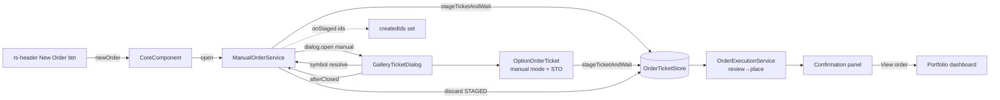

**Topic:** Manual Order Entry  
**Topic Slug:** manual-order  
**Thread:** Header Order Ticket  
**Thread Slug:** header-order-ticket  
**Issue:** #1181  
**Thread Parent:** #1178  
**Topic Parent:** #1177  
**Domain:** ORDER  
**Type:** IMPL  
**Status:** Draft  
**Created:** 2026-10-21  
**Last Updated:** 2026-10-21  

## 1. Objective

A global **New Order** button in the app header opens the existing order ticket dialog in a manual mode: free-text symbol entry, underlying quote fetch, Stock/Option tabs, same review-then-place submit and in-dialog confirmation as the gallery Trade flow. Equity/ETF is buy-only (RH has no short selling — verified); options support buy-to-open and sell-to-open single legs (CSP/covered-call verified; naked calls broker-rejected).

Single area: **FE** — no BE or SHARED work. `OrderSource.MANUAL`, the `OptionLeg` side/positionEffect model, `submitEquityOrder`, and `submitOptionOrder` already exist unchanged.

## 2. Reuse map

| Existing piece | Reuse |
|---|---|
| `GalleryTicketDialogComponent` | Host dialog — gains a `manual` data variant (symbol field, lazy equity stage, portfolio-bound View-order link) |
| `OrderTicketComponent` | Stock tab — unchanged; binds the staged manual ticket like any staged ticket |
| `OptionOrderTicketComponent` | Option tab — provenance inputs become optional; gains BTO/STO toggle + STO collateral preview |
| `OrderTicketStore` | `stageTicketAndWait`, `updateTicket`, `submitTicket`, `removeTicket` — unchanged; `submitTicket` already branches on `instrumentType` only. Gains `discardIfStaged(id)` — the STAGED-only discard guard, now the canonical home shared by both dialog close paths (added during #1188 review) |
| `GalleryCardActionsService.discardStagedTicket` semantics | `OrderTicketStore.discardIfStaged` — gallery's method delegates |
| `signal-order-staging.util` / `option-ticket-staging.util` | `buildTicketId`, `orderTicketTerms`, `DEFAULT_DOLLAR_AMOUNT`, `OCC_SYMBOL_PATTERN` shared; two new manual builders alongside |
| `TradingConfigService` / `EquityPriceService` | Config warmup + quote fetch — same calls the gallery makes. TradingConfigService gains the shared `config` cache + `warmConfig`/`ensureConfig` (added during #1188 review — both consumers had verbatim copies) |
| `OrderExecutionService` | review→place for both instruments — untouched; `direction` stays RH-derived |

## 3. New files

### `services/manual-order.service.ts` (providedIn: 'root')

The single entry point — keeps `HeaderComponent`/`CoreComponent` presentation-thin and owns the session bookkeeping the gallery page owns today.

```ts
class ManualOrderService {
  private dialog = inject(MatDialog);
  private ticketStore = inject(OrderTicketStore);
  private configService = inject(TradingConfigService);
  private priceService = inject(EquityPriceService);
  private snackBar = inject(MatSnackBar);
  readonly config = this.configService.config;   // shared cache (#1188 review)
  private _dialogOpen = false;                  // one manual dialog at a time
  private readonly _staging = new Set<string>(); // per-symbol single-flight

  open(): Promise<void>        // header button → warm config → dialog.open(GalleryTicketDialogComponent, manual data)
  stageEquityTicket(symbol: string): Promise<ManualStageResult | null>
}
// ManualStageResult = { ticket: EquityOrderTicket | EtfOrderTicket; created: boolean }
```

- `open()` loads trading config via `configService.ensureConfig()` (snackbar + bail when `accountNumber` absent — same message as `stageCardTicket`), opens the dialog with `{ manual, tradingConfig: this.config }`, and on `afterClosed` calls `ticketStore.discardIfStaged` for session-created ids.
- `stageEquityTicket` checks `ticketsBySymbol[symbol]` for an existing STAGED `source: MANUAL` equity ticket first — **adopt (reopen) rather than duplicate**, mirroring `tradeCard`'s reopen semantics. Otherwise it fetches the price (already fetched for the quote strip — reuse `priceService.prices()`), sizes shares via `computePositionSize` + `defaultDollarAmount` like the gallery, builds the ticket via `buildManualEquityTicket`, and persists via `stageTicketAndWait`. Returns `{ticket, created}` so the seed can feed `onStaged` — the dialog only ever sees the ticket.
- The session-created id set is tracked via a `createdIds` Set the dialog's `onStaged` callback fills — same pattern as `openTicketDialog`'s `createdTicketIds`.
- **Doc-id collision guard (#1188 review):** after the build, a same-minute ticket already holding the deterministic `{SYM}-BUY-{ts}PT` id is checked — adopt if STAGED-manual (the symbol check raced it), bail with a snackbar otherwise. Without it, `createTicket`'s full-doc overwrite would clobber an in-flight ticket and orphan the live broker order.

### `utils/manual-ticket-staging.util.ts`

Two pure builders alongside the signal builders (one concept per file).

```ts
buildManualEquityTicket(symbol, ctx: {
  accountNumber: string; quantity: string; now: Date;
  buildId: typeof buildTicketId; buildRefId: () => string;
}): EquityOrderTicket | null        // null on invalid user input — same
                                    // contract as buildOptionSignalTicket

buildManualOptionTicket(symbol, contract: OptionContractRef, side: 'buy' | 'sell', ctx: {
  accountNumber: string; now: Date; buildRefId: () => string;
}): OptionOrderTicket | null

normalizeUnderlyingSymbol(symbol): string | null  // exported — the service
                                                  // validates before the
                                                  // quote fetch
```

- Validation: user-entered underlyings normalize to uppercase and must match `^[A-Z0-9][A-Z0-9.\-]*$` (BRK.B/BF-B legal; `/`, spaces, and punctuation-led junk rejected — the symbol lands in the doc id). OCC symbols share `OCC_SYMBOL_PATTERN` with the signal builder.

- Equity: `source: OrderSource.MANUAL`, `side: 'buy'`, `orderType: 'market'`, `timeInForce: 'gfd'`, `marketHours: 'regular_hours'`, quantity-sized (whole shares), **no `sourceRef`, no `signalContext`**. `instrumentType: EQUITY` — ETF detection isn't a signal-flow capability either; both land on `place_equity_order`. Id: `buildTicketId(symbol, 'BUY', now)` — same shape as signal tickets; a same-symbol same-minute re-stage maps to the same id (reopen semantics).
- Option: `source: OrderSource.MANUAL`, `side`/`legs[0].side` from the toggle (`'buy'` BTO / `'sell'` STO), `legs[0].positionEffect: 'open'`, `orderType: 'limit'`, `quantity: '1'`, no provenance. Id: `buildTicketId(symbol, 'OPT-MAN-{BTO|STO}-{occSymbol}', now)` — the `OPT-MAN-` discriminator can't collide with signal ids (`OPT-LONG|SHORT-…`) and separates BTO from STO tickets on the same contract.

## 4. Modified files

### `components/gallery-ticket-dialog/gallery-ticket-dialog.component.{ts,html}`

- `GalleryTicketDialogData` becomes a discriminated union (#1188 review): `{ tradingConfig } & ({ ticketId; option? } | { manual: ManualOrderDialogSeed })` — the two modes can't be mixed at compile time. `ManualOrderDialogSeed = { stageEquityTicket(symbol) => Promise<OrderTicket | null>; onStaged(e: StagedTicketEvent) }` — callbacks keep the dialog decoupled from the service (same rule as `tradingConfig`/`OptionTabSeed`).
- `ticketId` is optional in manual mode; the `ticket` computed returns null until symbol-resolve stages — the close effect's `!ticket` branch keys on `data.manual` so a pre-resolve dialog stays open.
- `onOptionStaged` forwards the emit to BOTH `data.option?.onStaged` and `data.manual?.onStaged` (#1188 review — without it, manual option tickets wouldn't reach the session-created set and would orphan on close).
- Manual mode adds a symbol entry row (input + Resolve button, Enter-key submit) above the tabs. `enteredSymbol = signal<string | null>` drives `displaySymbol`, the quote strip (already reads `priceService.quotes()`), and both tabs' `[symbol]` bindings.
- **Resolve flow (#1189 review revision):** `stageEquityTicket(symbol)` runs first — the service does its own quote fetch for sizing, so a dialog-side `fetchPrices` probe was both redundant and racy (`fetchPrices` dedupes an identical in-flight request; awaiting it can't prove a quote landed, and a stale cached price passes anyway). Success → `manualTicketId.set(id)` + `enteredSymbol.set(sym)` + fire-and-forget `fetchPrices` to warm the quote strip (`quote()` is reactive). The `onStaged({ticketId, created})` emit lives inside the service's seed wrapper, not the dialog — the seed returns a bare ticket and only the service knows created-vs-adopted (`created: true` newly staged; `created: false` an adopted pre-existing STAGED manual ticket, which survives close). Seed returns null (or throws) → inline error, nothing bound, field stays editable. Re-resolve is gated while `ticket()` is bound (silently rebinding would orphan the prior STAGED ticket and could hide a real order's confirmation) — close to change symbols; session-created staged tickets are discarded on close.
- Tab group renders in manual mode whenever `enteredSymbol` is set (the `data.option` seed requirement is bypassed — see option component changes). Before resolution: symbol field + hint only.
- Confirmation `onViewOrder()` navigates to `AppRoutes.PORTFOLIO_DASHBOARD` in manual mode; the card path keeps its `?ticket=` deep link (that page's retirement is a separate cleanup).
- Dialog `data-testid`s: keep `order-confirmation`, add `manual-symbol-input`/`manual-symbol-resolve` for specs.

### `components/option-order-ticket/option-order-ticket.component.{ts,html}`

- `runId` stays `required`; `signals`/`decisions` keep `[]`/`{}` defaults; `manual = computed(() => this.runId() === '')` flips the staging path. **#1189 interim:** with `runId === ''` the template renders a placeholder ("not available yet") — the signal staging path can only fail there, and a dead form that burns MCP calls then errors is worse than an honest placeholder.
- **BTO/STO toggle** — `orderSide = signal<'buy' | 'sell'>('buy')` rendered as a segmented control above the contract selects; label text swaps "Buy to open" / "Sell to open".
- `ensureStagedTicket`: manual mode calls `buildManualOptionTicket(symbol, contract, orderSide(), ctx)` and its adoptable-ticket lookup filters `source: MANUAL` + `legs[0].side === orderSide()` + STAGED (card lookup `findCardTickets` is signal-mode only — there is no card).
- **Fatfinger scope:** `optionMaxPremiumCashPercent` applies to BTO only (it's a debit cap). STO renders the collateral block instead.
- **STO collateral preview** — when `orderSide() === 'sell'` and a contract resolves: a display-only `mcpService.executeTool('review_option_order', { legs, type:'limit', quantity, price, time_in_force, chain_symbol: symbol, underlying_type: 'equity' })` renders `data.collateral.cash.amount` / `collateral.equities` as an info line ("Locks ~$4,000 cash" / "Requires 100 shares held"). Advisory only — failure renders nothing and never blocks; RH enforces at place (the "infinite risk" 400 lands on the ticket as an ordinary submit failure). New network call — the only one in this feature.
- Submit path unchanged: persist fields → `OrderConfirmDialogComponent` → `ticketStore.submitTicket` → `submitOptionOrder` (its pre-submit validation needs no change: leg count, integer qty, priced types).

### `core/comps/header/header.component.{ts,html,scss}` + `core/core.component.{ts,html}`

- Header gains a `newOrder = output<void>()` and a `mat-stroked-button` (add icon, "New Order" label — same `.manual-order-btn` styling language as the retired page's button) inside `@if (isAuthenticated())`, placed before the user label/sign-out cluster.
- `core.component.html`: `<rs-header (openSidenav)=… (newOrder)="onNewOrder()" />`; `CoreComponent` injects `ManualOrderService` and calls `open()`.
- **Documented seam:** this is a deliberate core→feature service import (header is global, the order surface is feature-scoped). The alternative — an `InjectionToken` indirection — is rejected as ceremony for a single call site; revisit if a second consumer appears.

## 5. Data flow



## 6. Edge cases & decisions

- **No account configured** — `open()` snackbars "configure the agentic account" and never opens the dialog (same as card staging).
- **Bad ticker** — quote fetch returns nothing → inline error in the dialog; nothing staged; symbol re-editable.
- **Reopened staged manual ticket** — same symbol re-entry adopts (created:false), so close can't discard a ticket the user built earlier.
- **Discard asymmetry** — adopted tickets survive close; session-created STAGED tickets are removed on close — both tabs tracked through the same `onStaged` emit.
- **Failed option submit reverts to STAGED** — the ticket stays bound and the error renders in place (existing store behavior, unchanged).
- **STO naked-call rejection** — surfaces as the ticket's `error` after `submitOptionOrder`'s classify — no client-side pre-judging.
- **Dialog width/height** — matches the gallery call (`width: '640px'`, `maxHeight: '92vh'`, `autoFocus: false`).

## 7. Out of scope (unchanged from PRD)

- `/trading/live` entirely — its placeholders die with the page; no queue integration for manual tickets.
- Sell equity (impossible at RH), naked option calls (broker-enforced), multi-leg, sell-to-close, exercise, option stops.
- Option-level gating surfacing (`option_level_2` checks) — RH errors land on the ticket; no upgrade-path UX in v1.
