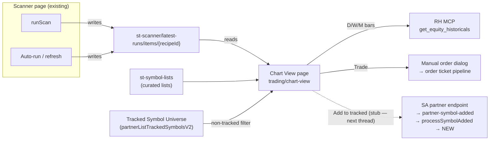

**Topic:** Scanner Chart View  
**Topic Slug:** scanner-chart-view  
**Thread:** Chart View Extension  
**Thread Slug:** chart-view-extension  
**Issue:** #1234  
**Thread Parent:** #1233  
**Topic Parent:** #1232  
**Domain:** CHART-REVIEW  
**Type:** PRD  
**Status:** Approved  
**Created:** 2026-10-23  
**Last Updated:** 2026-10-23  

# PRD: Scanner Chart View — Generic Symbol-List Chart Viewer

## Problem Statement

The RH scanners (Topic #1098) surface dozens to 100+ new high-growth symbol candidates per run, but there is no way to look at them. Scan results live only in the Scanner page's session memory and in compare proposals (delta buckets) — a trader who wants to see a chart of a scan hit has to leave the page, find the symbol elsewhere, and can't chart it at all if it isn't tracked. Meanwhile the chart-review page (`/signals/charts`) — the app's best master-detail chart surface — sits in drydock: the order flow moved to Gallery and the page's signal-run coupling no longer serves a purpose.

The daily job this supports: when the broad market shows strength, review the newest scanner hits — the next potential multi-baggers — evaluate each on D/W/M charts, and promote the good ones into the tracked universe.

## Solution

Repurpose the chart-review page into a **generic symbol-list chart viewer** at a new route, `trading/chart-view`, decoupled from ST signal runs:

- A **list-source selector** feeds the left pane. Scan Recipes appear as a "Scans" group alongside the existing curated-list groups. Selecting a recipe shows that recipe's **Scan Latest Run** — a new one-doc-per-recipe cache persisted automatically every time a discovery scan completes, so the viewer always has a surface without the user re-running anything.
- Scan lists are **filtered to non-tracked symbols by default** — the page's job is finding new names — via a toggle that can be switched off to show every row the scan returned, tracked or not.
- The detail pane renders the **three D/W/M Flex Charts** for the selected symbol, fed by ephemeral RH `get_equity_historicals` data — any symbol charts on demand, no SA onboarding required.
- Actions per selected symbol: **Trade** opens the existing manual-order dialog; **Add to tracked** is the full client pipeline wired to a stubbed seam (coming-soon message) until the SavantApi partner endpoint lands — SA is building it in parallel, and a follow-on Thread wires the real call.

## System Context

## User Stories

1. As a trader, I want to select a scan from a "Scans" group in the list-source dropdown, so that I can browse the symbols that recipe's latest run produced.
   - *Verify:* dropdown lists each recipe with a cached run, labeled with how long ago it ran; selecting one populates the left pane with that run's symbols.
2. As a trader, I want scan lists filtered to non-tracked symbols by default — configurable, not hard-coded — so that I evaluate new names but can still pull up a tracked hit when I want to.
   - *Verify:* a scan whose results include tracked symbols shows only the non-tracked ones while the filter is on; toggling it off shows every returned row; a count communicates how many are filtered (e.g. "23 new of 41 matched").
3. As a trader, I want the scan's run timestamp visible, so that I know how stale the list is.
   - *Verify:* the selected scan's ranAt renders near the pane header; a scan that has never run does not appear as an option.
4. As a trader, I want to click a symbol and see Daily, Weekly, and Monthly charts, so that I can evaluate the setup across timeframes.
   - *Verify:* selecting a symbol loads all three charts from RH historicals; the visible windows match the page's existing D/W/M conventions.
5. As a trader, I want charts for symbols that aren't tracked, so that I can evaluate names before committing to onboarding them.
   - *Verify:* a symbol absent from the tracked universe still renders charts; no ST-pipeline data is required or fetched.
6. As a trader, I want symbols I've already viewed this session to appear dimmed, so that I know what's left to review in a long list.
   - *Verify:* selecting a symbol marks it viewed; viewed symbols render dimmed for the session; nothing is persisted.
7. As a trader, I want to browse my existing curated symbol lists in the same viewer, so that one page serves every list source.
   - *Verify:* the existing Triage / My lists groups still populate the pane; filing chips keep working for tracked symbols exactly as today.
8. As a trader, I want to trade the symbol I'm viewing via the manual-order flow, so that I can act on a name immediately.
   - *Verify:* Trade opens the manual order dialog seeded with the selected symbol — for any symbol, with or without an active ST run.
9. As a trader, I want an "Add to tracked" affordance on non-tracked symbols, so that promotion to the pipeline is a single click.
   - *Verify:* the button exists and shows a coming-soon message this thread; the client seam is in place so the next thread only swaps the stub for the real SA call.
10. As a trader, I want each discovery scan to automatically persist its latest result, so that the viewer is always warm without me re-running scans.
    - *Verify:* completing a runScan or an auto-run/refresh overwrites that recipe's latest-run doc; evaluateTracked runs do not touch it.
11. As a trader, I want to type a symbol manually and see its charts, so that ad-hoc lookups still work.
    - *Verify:* the manual symbol input renders charts for any valid ticker, tracked or not.

## Implementation Decisions

- **Scan Latest Run cache** — new `st-scanner` record kind: `st-scanner/latest-runs/items/{recipeId}` (anchored pattern, one doc per recipe, overwritten per run). Doc carries the full returned row set plus `ranAt`, `totalItems`, `truncated`. Written only by the discovery paths (`runScan`, `previewScanRaw` via auto-run/refresh); `evaluateTracked` never writes it — a prune eval is a different artifact.
- **Route** — the repurposed page lives at `trading/chart-view`, matching the `trading/*` group (`trading/scanner`, `trading/live`). The legacy `signals/charts` route is retired or redirected — confirm at blueprint.
- **List-source model** — the selector gains a "Scans" group (one entry per recipe with a cached run, annotated with ranAt) alongside the existing Triage and My lists groups; scans are read-only sources — they never appear as writable list targets.
- **Non-tracked filter (configurable)** — scan rows are intersected with the tracked-universe complement (same `loadTrackedSymbols` source the store already owns) under a default-on "new symbols only" toggle; tracked symbols are never locked out of the view — the filter is presentation, not a data rule.
- **Ephemeral charts** — RH `get_equity_historicals` (`day`/`week`/`month` intervals, split-adjusted, regular-session) fetched per selected symbol; no ST chart-store or indicator-series dependency for non-tracked symbols. **Tracked symbols render the exact current display** — ST indicators, zone windows, trend-rider and signal dots, all driven by existing pipeline data. **Non-tracked symbols render price/volume plus whatever indicators are derivable from raw bars alone** — the backend indicator series don't exist for them (computing ST indicators client-side is a possible follow-on, not this thread).
- **Actions** — Trade uses the existing manual-order dialog path (`ManualOrderService.open`), ungated from run context. "Add to tracked" is a stubbed seam: the button → service method → transport seam is built this thread; the transport is a coming-soon stub until the SA endpoint ships (next thread).
- **Session-local viewed marker** — dimmed symbols live in component/store state only; zero writes.
- **Decommissioned run coupling** — the page no longer bootstraps a run, checks `isActionableRun`, or reads run signals; the OrderTicketStore hydration required for manual order staging is retained.

## Testing Decisions

- Highest meaningful seam: **component test harness** (TestBed) for the repurposed page — list-source selection, non-tracked filtering, viewed-dimming, action wiring — with stores/services stubbed per the established component-spec pattern.
- **Store/service unit tests** for the cache write seam (only discovery paths write; superseded runs don't ghost-write) and the latest-run read (parse/serialize with the same drift-tolerant contract pattern as `CurationProposal`).
- **Pure-function tests** for row→pane mapping and the non-tracked intersection.
- Prior art: `scanner.service.spec.ts`, `scanner.store.spec.ts`, `symbol-list.store.spec.ts`, chart-review component specs.

## Out of Scope

- The SA partner endpoint and the real Add-to-tracked wire-up — SA-side work in parallel + a follow-on Thread here.
- Filing non-tracked scan symbols into symbol lists (membership without tracking is meaningless until onboarded).
- Running or refreshing scans from the viewer (the scanner page owns runs; the viewer is read-only).
- Prune/`evaluateTracked` results, proposal browsing, and any run history beyond the latest.
- ST-run features: signal dots from runs, run metrics, signal-sourced ticket staging.
- List-management UX (create/rename/delete user lists) — existing surfaces unchanged.

## Technical Context

- **Scan freshness:** a scan list is only as fresh as its last run — the viewer surfaces the timestamp rather than hiding staleness.
- **Row cap:** scans return at most ~200 rows and carry a truncation flag; the viewer may show a truncated subset of the true match count.
- **Chart data:** RH historicals are split-adjusted, regular-session bars; interval is fixed-granularity (no client aggregation needed — `day`/`week`/`month` are native).
- **Untracked symbols:** have no ST pipeline data — charts show price/volume plus whatever indicators are derivable from raw bars alone. Tracked symbols keep the full current indicator display.
- **Add to tracked:** the SA `saveTrackedSymbol` path exists but is gated on SA-project auth; the partner endpoint that removes that friction is being built on the SA side in parallel.
