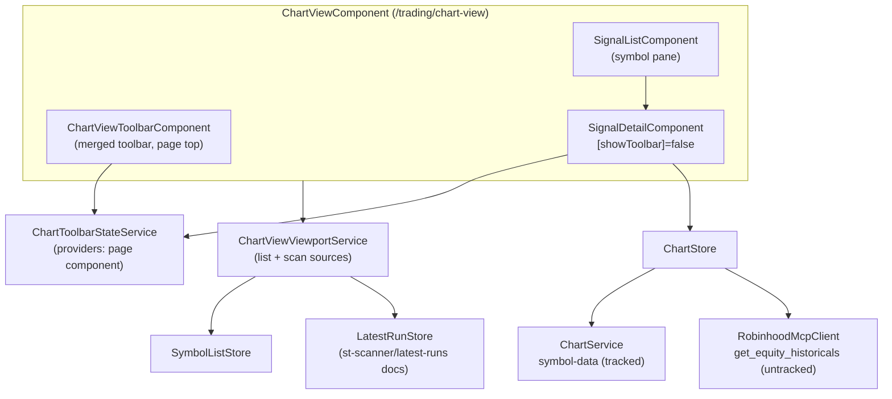

**Topic:** Scanner Chart View  
**Topic Slug:** scanner-chart-view  
**Thread:** Chart View Extension  
**Thread Slug:** chart-view-extension  
**Issue:** #1239  
**Thread Parent:** #1233  
**Topic Parent:** #1232  
**Domain:** CHART-REVIEW  
**Type:** IMPL  
**Status:** Draft  
**Created:** 2026-01-30  
**Last Updated:** 2026-01-30  

# Implementation Plan (FE): Chart View page

Repurpose the drydocked chart-review surface into **Chart View** — a generic symbol-list chart viewer at `trading/chart-view`, decoupled from ST signal runs. The page takes any list source (symbol lists today, Scan Latest Runs once the cache lands), renders three D/W/M flex charts for the selected symbol, and keeps Trade + an Add-to-tracked stub.

Per the PRD: tracked symbols keep the full current indicator display; untracked symbols chart from ephemeral RH OHLCV bars (price/volume + bar-derivable indicators only — the backend ST series don't exist for them). The scan source defaults to non-tracked symbols with a user-visible toggle; tracked symbols are never locked out.

## Architecture

`SignalDetailComponent` stays the detail renderer — its only consumer is the old chart-review page being retired, so no compat constraints. `SignalListComponent` stays the pane. `ChartReviewViewportService` is **not** reused (it's entangled with `TriageStore`); a new lean `ChartViewViewportService` follows the same pattern minus triage state.

## Components & services

### ChartToolbarStateService (new, page-scoped)

Plain `@Injectable` with signals (UiStateService convention — no signalStore for pure view state), listed in `ChartViewComponent.providers`. Hoists the toolbar-owned state out of `SignalDetailComponent` so the page-level toolbar and the detail component share one source:

- `selectedInterval`, `selectedRange`, `showZoomToolbar`, `activeChartInterval`, `logScale`
- `selectedIdsByInterval` — the per-interval indicator selection map (atomic write semantics preserved from `onToggleIndicator`)
- `indicatorScope` / `activeChartIndicatorOptions` / `activeSelectedIndicatorIds` computeds (they only need `uiStateService.chartLayout()` + selection state — both injectable)
- setter methods mirroring existing behavior (`setInterval`, `setRange`, `toggleZoom`, `setActiveChart`, `toggleLogScale`, `applyIndicatorSelection`)

`SignalDetailComponent` reads/writes the service instead of its local signals and gains `showToolbar = input(true)` — chart-view passes `false` so its in-template `app-chart-toolbar` disappears; the charts themselves are untouched. State dies with the page — interval/range/indicator prefs reset per visit, which is correct for triage. Layout/fullscreen stay in `UiStateService`.

### ChartViewToolbarComponent (new)

The merged toolbar, rendered at page top where review-header was. `ReviewHeaderComponent` is deleted entirely (its only consumer is the retired page). Layout, left→right, per the owner's spec:

1. **Scan dropdown** (`app-rh-select-menu`) — one option per recipe with a cached latest run, label `{recipe.title} · {relative ranAt}`; sentinel `—` (no scan source). Disabled-with-empty-label until the cache exists.
2. **List dropdown** (`app-rh-select-menu`) — the existing `filterOptionGroups` (Triage + My lists) plus `ALL` sentinel.
3. **Indicators menu** (`app-indicator-menu`) — bound to `ChartToolbarStateService`.
4. **Symbol + company name** — large text, center-left.
5. **Chart controls** — zoom toggle, symbol nav `‹ n/N ›`, D/W/M pills, range pills, layout toggle, fullscreen, log scale. Plus the filing chips (`app-symbol-list-actions`) — shown only when the selected symbol is tracked.
6. **Right group** — **Trade** (enabled whenever a symbol is selected; always `manualOrderService.open(sym)` — no run gating), **Order** queue pill (gated on count > 0 only), **Add to tracked** (stub → snackbar "coming soon"), **non-tracked toggle** ("New only" pill — applies to scan sources, default ON), symbol input + Load.

Removed vs. review-header: back, signal-history, observation, "From list"/"Manual chart" reason text, dead mode toggle, dead new-symbols button, `run-metrics-strip`.

### ChartViewComponent (new page)

Shell wiring — owns selection, source state, viewed-dim set, manual symbol:

- `providers: [ChartToolbarStateService]`
- Composes: toolbar | `SignalListComponent` (left) | `SignalDetailComponent` (detail)
- `ngOnInit`: `symbolListStore.loadSymbolLists()`, `symbolListStore.loadTrackedSymbols()`, `ticketStore.loadTickets()`, `latestRunStore.load()`
- No `StStore`/`GroupStore`/`TriageStore`/`SignalReviewFacade`/`RunMetricsStripComponent` — no run bootstrap, no signal provenance
- Selection: `selectedSymbol` signal + auto-select-first effect; `manualSymbol` for the input path
- **Viewed dimming**: session-local `Set<string>` — selecting a symbol adds it; pane rows render dimmed. Zero writes.
- Company name: same `st-symbols` doc lookup pattern as chart-review (cache map; untracked symbols resolve null → ticker only)

### ChartViewViewportService (new)

Lean viewport derivation — `SymbolListStore` + `LatestRunStore`, no `TriageStore`:

- `activeSource = signal<SourceKey>` where `SourceKey = 'ALL' | listKey | 'scan:{recipeId}'` (`SymbolListFilter` already admits arbitrary strings — the `NO_MEMBERSHIP` precedent)
- The two dropdowns write the same signal: picking a scan resets the list dropdown to `ALL`'s sentinel position conceptually (UI shows the scan as active), picking a list clears the scan selection. One active source at a time.
- `viewportSymbols`: `'ALL'` → union of list members (existing behavior); list key → members; `NO_MEMBERSHIP` → untriaged; `scan:{id}` → the cache doc's `rows[].ticker`, filtered to non-tracked when the **New only** toggle is on (default), all rows when off
- `isLiveListFilter` gains `scan:` awareness (or a small `isScanSource` guard alongside — whichever is smaller)

`scan:` keys parse back with `recipeId = key.slice(5)`; labels join recipe catalog (`SCANNER_RECIPES`) title + cache `ranAt` for staleness.

### LatestRunStore (new, `signalStore` root)

Reads the cache — `getDocs` on `st-scanner/latest-runs/items`, `parseScanLatestRun` per doc, drifted docs skipped (proposal-read pattern). Exposes:

- `latestRuns = signal<Map<recipeId, ScanLatestRun>>`
- `scanOptions = computed` → dropdown option list: `{ value: 'scan:{id}', label: '{title} · {rel ranAt}' }` for every catalog recipe with a doc (recipes without a cache doc don't appear — nothing to show)
- `rowsFor(recipeId)` selector for the viewport service

`load()` called from page init; no live subscription needed this thread (a refresh lands on next page visit — acceptable; note it).

### Cache write seam

- `ScannerService.saveLatestRun(recipeId, result: PreviewScanResult): Promise<void>` — `setDoc(doc(firestore, stScannerLatestRunDocPath(recipeId)), serializeScanLatestRun({recipeId, ranAt, totalItems, truncated, rows}))`. `truncated` via existing `isScanTruncated`.
- Call sites in `ScannerStore`, discovery paths only, fire-and-forget (cache failure must not fail the run — `.catch` → console.warn; the run result already landed):
  - `launchRecipe` success handler (covers `runAllRecipes` + `refreshRecipe`)
  - `runScan` success — rebuild `PreviewScanResult` shape from `ScanRunResult` (`{results: result.rows, total_items: result.totalItems}` — same reconstruction `runScan` already does for `parseScanRows`)
  - `evaluateTracked` — **never** (prune is a different artifact)

### RobinhoodMcpClient.getEquityHistoricals + ChartStore fork

- `RobinhoodMcpClient` gains `getEquityHistoricals(symbols: string[], interval: 'day'|'week'|'month', startTime: string, endTime?: string): Promise<EquityHistoricalsResult>` following the `previewScan` `ToolSpec` pattern — tool `get_equity_historicals`, args `{symbols, start_time, interval, bounds: 'regular', adjustment_type: 'split'}`, parse maps bars → `OhlcBar` (`{d, o, h, l, c, v}` — map wire `begins_at`→`d`, drop/keep `interpolated` flag per bar handling below).
- `ChartStore.loadCharts` forks on tracked membership (`symbolListStore.trackedSymbols` — loaded on page init):
  - **tracked** → existing `ChartService.loadBars$` path + `indicatorStore.loadIfNeeded` (unchanged — full indicator display)
  - **untracked** → new `RhChartService.loadBars$(symbol)` — three calls (day/week/month, ~10y spans), same `{daily, weekly, monthly, version: ''}` shape; `version=''` means `indicatorStore.loadIfNeeded` is skipped by the existing `if (version)` guard — indicators cleanly absent
  - Optional resilience: empty `symbol-data` result for a tracked symbol falls back to the RH path (covers just-onboarded pre-backfill symbols)
- Interpolated bars (`interpolated: true`) are gap-fill syntheses — keep them (charts tolerate gaps poorly) but it's a one-line decision if they render badly.
- *As-built (#1259):* the client returns the wire `EquityHistoricalsResult` unchanged (parse validates `data.results` only); wire→`OhlcBar` mapping lives in `RhChartService`/`equityWireBarToOhlc` so `session`/`interpolated` wire fields survive to the service boundary. The tracked fork triggers the RH fallback on `version === ''` (the exact "no usable symbol-data" signal), and an EMPTY tracked universe takes the symbol-data path first — pages that never call `loadTrackedSymbols` (QuickCharts, galleries) keep pre-fork behavior.

### Routing & nav

- `AppRoutes.CHART_VIEW = 'trading/chart-view'`; `PAGE_INFO` entry (`title: 'Chart View'`, icon `image_search` or similar)
- `core-routes.ts` — new `loadComponent` route
- Nav section (`core/common/constants.ts`): rename the `chart-review` entry → `chart-view`, text `Chart View`, href `trading/chart-view`
- `signals/charts` → redirect to `trading/chart-view` (keeps bookmarks/muscle memory); `AppRoutes.CHART_REVIEW` and the old components get deleted in the retirement task — check for remaining references first

### Retirement (last task)

Delete `ChartReviewComponent`, `ReviewHeaderComponent`, the `signals/charts` route → redirect, `AppRoutes.CHART_REVIEW`, old nav entry. `RunMetricsStripComponent`/`SignalReviewFacade`/`NewSymbolsDialogService`/`ChartReviewViewportService` lose their chart-review consumer — delete only if no other consumers (verify per item). `TriageStore`'s viewport fields may lose their last reader — flag, don't delete store-level state shared elsewhere.

**As-built (#1260):** deleted `pages/chart-review/`, `components/review-header/`, `components/new-symbols-dialog/`, `chart-review-viewport.service`(+spec), `new-symbols-dialog.service` — all sole-consumed by the page. `signals/charts` redirects to `trading/chart-view`; `AppRoutes.CHART_REVIEW` + `PAGE_INFO` entry + `ViewportMode` type removed; `goToReview` repoints to `CHART_VIEW`. **Kept:** `RunMetricsStripComponent` (dashboard + signal-review), `SignalReviewFacade` (facade/group.store/staging.util), TriageStore `reviewFlags` core — only `viewportMode`/`activeViewportList` + setters deleted (sole readers were the retired files). Nav was already `Chart View` since #1256. No `chart-review.component.spec.ts` existed. Pass 2 repo-wide sweep: dropped the deleted scss from `design-system-foundation-migration-1171.ts` (was an ENOENT crash in run-all) and refreshed stale `chart-review` comments in facade/gallery/viewport services; comments in `chart-view.component.ts` kept as design-history.

## Phases & tasks

**Phase 1 — Page shell + merged toolbar**
- **F1 — Hoist toolbar state.** `ChartToolbarStateService` + `SignalDetailComponent.showToolbar` input; detail reads/writes the service. No page changes — old chart-review keeps working (service is optional-injected? No — detail's only consumer is the page being built; provide the service where needed and default `showToolbar` true for the old page's lifespan).
- **F2 — ChartView page + merged toolbar + route.** `ChartViewToolbarComponent` (list dropdown live; scan dropdown rendered-disabled), `ChartViewComponent`, `ChartViewViewportService` (list sources only), route + nav, Trade/Order/Add-stub/symbol-input wired, viewed dimming. Page is live end-to-end for tracked list sources.

**Phase 2 — Scan source** *(blocked by SHARED S1)*
- **F3 — Cache write seam.** `ScannerService.saveLatestRun` + the two call sites.
- **F4 — Scan source enabled.** `LatestRunStore`, scan dropdown live, `scan:` source resolution, **New only** toggle.
- **C1 — Pane enrichment (post-#1258 QA, CHORE #1313).** Row name + ranked-column detail on pane rows: wire `Name` column → `st-symbols` name map (one `getAllSymbols` read) → ticker-only degrade; detail = recipe `sort.column` via `displayCell`. `SignalListComponent.rowMeta` input carries both.

**Phase 3 — Ephemeral charts + retirement**
- **F5 — RH charts for untracked symbols.** `getEquityHistoricals` + `RhChartService` + `ChartStore` fork.
- **F6 — Retire chart-review.** Redirect route, delete old page + header + dead code, nav rename.

## Test seams

- Pure: `serializeScanLatestRun`/`parseScanLatestRun`, `isScanSource`/`scan:` key parsing, `viewportSymbols` derivation, RH bar→`OhlcBar` mapping
- Service: `ScannerService.saveLatestRun` (mocked Firestore), `RhChartService` (mocked client)
- Store: `LatestRunStore` selectors, `ChartStore` fork (mock both bar services), `ChartToolbarStateService` indicator-selection semantics
- Component: `ChartViewComponent` + `ChartViewToolbarComponent` TestBed — source switching, toolbar wiring, dimming, Trade opens manual dialog
