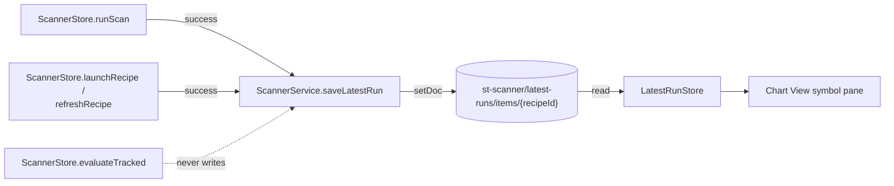

**Topic:** Scanner Chart View  
**Topic Slug:** scanner-chart-view  
**Thread:** Chart View Extension  
**Thread Slug:** chart-view-extension  
**Issue:** #1239  
**Thread Parent:** #1233  
**Topic Parent:** #1232  
**Domain:** CHART-REVIEW  
**Type:** IMPL  
**Status:** Draft  
**Created:** 2026-01-30  
**Last Updated:** 2026-01-30  

# Implementation Plan (SHARED): Scan Latest Run contract

The Chart View page's scan source needs a durable, shallow cache of each recipe's most recent discovery output. This SHARED blueprint defines the `ScanLatestRun` contract, its Firestore collection paths, serialization/parsing helpers, and the security-rules change that permits writes. Nothing here is consumed by the Angular layer yet — the FE blueprint wires writers (`ScannerService`) and readers (`LatestRunStore`).

## Scope

In scope:

- `ScanLatestRun` type + `serializeScanLatestRun` / `parseScanLatestRun` in `shared/scanner-contracts.ts`
- `latest-runs` anchor + path helpers in `shared/st-collections.ts`
- `firestore.rules` write allowlist extension for the `latest-runs` anchor

Out of scope:

- Any Angular service/store read or write path (FE blueprint)
- Any functions-layer code (no BE work this thread)
- Historical run retention — the cache is exactly one doc per recipe, by design
- Prune/evaluate output — `evaluateTracked` never writes this cache (different artifact; prune output already persists as a Curation Proposal)

## Contract

`shared/scanner-contracts.ts` gains:

```ts
/**
 * Scan Latest Run — one cached latest discovery result per recipe
 * (CONTEXT.md). Written by the discovery paths only (runScan /
 * previewScanRaw); never by evaluateTracked. Doc id IS the recipeId —
 * the cache is one layer deep by construction.
 */
export interface ScanLatestRun {
  /** Recipe id — also the Firestore doc id. */
  recipeId: string;
  /** ISO-8601 run timestamp — the staleness signal for the scan source. */
  ranAt: string;
  /** Matching universe size from the wire (`total_items`). */
  totalItems: number;
  /** Results hit a scanner cap — more matches may exist beyond returned rows. */
  truncated: boolean;
  /** The full returned rows — symbol plus every recipe column value. */
  rows: ScanResultRow[];
}
```

Serialization/parsing mirror the `CurationProposal` pair exactly:

- `serializeScanLatestRun(run: ScanLatestRun): Record<string, unknown>` — Firestore-ready doc. `rows` serialize as-is (each `ScanResultRow` is already plain data: `ticker`, `instrument_id`, `instrument_type`, `columns: Record<string, string>`).
- `parseScanLatestRun(data: Record<string, unknown>): ScanLatestRun` — throws on shape drift: scalar fields type-checked; `rows` must be an array where every element is a plain object with `ticker: string` and `columns: Record<string, string>` (validate `ticker`/`columns` strictly; `instrument_id`/`instrument_type` pass through unchecked like other open-string wire fields).

Size budget: ≤200 rows × a handful of short columns ≈ tens of KB — far under the 1 MB doc limit. No row trimming.

## Collection paths

`shared/st-collections.ts`:

- `StScannerKind` widens: `'proposals' | 'latest-runs'`.
- `ST_SCANNER_LATEST_RUNS_ANCHOR = 'latest-runs'`.
- `stScannerLatestRunsPath(): string` → `st-scanner/latest-runs/items`.
- `stScannerLatestRunDocPath(recipeId: string): string` → `st-scanner/latest-runs/items/{recipeId}`.

Doc id = `recipeId` (deterministic) — writers use `setDoc` overwrite, which is what makes the cache shallow: each write replaces the recipe's previous doc wholesale, so no history ever accumulates.

## Security rules

`firestore.rules`, `st-scanner` block — extend the write allowlist so `latest-runs` gets the same authed CRUD `proposals` already has:

```
allow create, update, delete: if anchor in ['proposals', 'latest-runs'] && request.auth != null;
```

Read already allows any anchor for authed users — no read change needed. Update the block comment to mention `latest-runs`.

## Data flow (context — implemented in FE)



## Sequencing

Single task — contract, paths, and rules are one coherent change that either exists or doesn't. The FE cache write seam and the FE scan source each block on this task.
