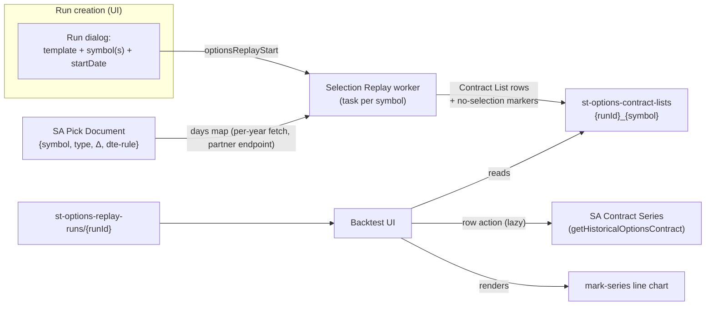

**Topic:** Options Backtest  
**Topic Slug:** options-backtest  
**Thread:** Selection Replay  
**Thread Slug:** selection-replay  
**Issue:** #1241  
**Thread Parent:** #1240  
**Topic Parent:** #1238  
**Domain:** BACKTEST  
**Type:** PRD  
**Status:** Approved  
**Created:** 2026-10-24  
**Last Updated:** 2026-10-26  

# PRD: Options Backtest — Selection Replay

## Problem Statement

A trader who wants to understand how a time-based options ladder actually behaves — "sell one 45DTE 20Δ put every day, hold to expiration" — has no way to see it. The existing backtest simulator replays daily bars and mark-to-markets a portfolio, which answers "what was the P&L curve" but throws away the interesting question: *what did each contract's price actually do across its life?* The live paper engine holds one position per instance at a time and exists for a different purpose (Topic #553).

The job this supports: pick a named strategy template, apply a symbol and a start date, run it, then review the full list of contracts the strategy would have opened — and for any of them, look at the contract's actual daily price series from open to expiration. Later (a separate thread), hypothetical exit rules will be applied to those stored series to find optimal exits; this thread only produces the selection + review layer.

## Solution

A **Selection Replay** run shape alongside the existing backtest machinery — with selection itself consumed from SA rather than computed:

- **Backtest Templates** map to SA **Pick Document** coordinates (`type`, `targetDelta`, `expiry.mode`/`dte`) — e.g., `csp-45-20` ("sell one 45DTE 20Δ put daily, hold to expiration") → `{put, −0.20, nearestDte:45}`. Templates appear as selectable entries in the run dialog.
- A run is **template + symbol(s) + start date**. The entry window is every trading day from the start date through the latest available data day; each position ends at its own expiration — there is no explicit end date, no `initialCash`, no `reportTier`.
- The run fetches the pick doc covering the window and maps each `days` entry to a **Contract List** row — the pick already carries the day's actual `contractId`, expiration, strike, delta, IV, mark, bid/ask, volume, OI, and underlying close. Days the doc reports as misses persist as `no-selection` marker rows.
- The contract list persists on the run — the review artifact. Each day's pick is a distinct position entry even when consecutive days share a contractId.
- A row action opens a **simple mark-series line chart** (backtest-dashboard style), lazily fetching that contract's Contract Series from SA — rel-str persists no contract data.
- No option chains are fetched. No selection math runs locally. No portfolio simulation, equity curve, P&L, or settlement is computed — the contract series *is* the history.

## System Context

## User Stories

1. As a trader, I want to pick a named template (e.g., "45DTE 20Δ put") when starting a run, so that I don't re-enter delta/DTE parameters per run.
   - *Verify:* each available template appears as a selectable entry; its parameters (type, target delta, expiration rule) are visible as its definition.
2. As a trader, I want to apply a symbol and a start date to a template to create a run, so that "template + symbol + start date = instance" is the whole setup.
   - *Verify:* the run dialog for selection templates requires only template, symbol(s), startDate; no initialCash/reportTier inputs appear; submitting creates a run doc and enqueues the work.
3. As a trader, I want the run to produce one row per trading day from the start date through the latest available data, so that the ladder forms exactly as the template describes.
   - *Verify:* a run over N trading days produces N contract-list rows (picks or markers); no trading day is skipped silently.
4. As a trader, I want each row to carry the pick's real entry-day data — contract, strike, expiration, actual delta, IV, mark, bid/ask — so that the list is reviewable without further fetches.
   - *Verify:* every selected row shows contractId, expiration, dte, strike, delta, iv, mark, bid, ask, volume, openInterest, and the day's underlyingClose; reopening the run needs zero upstream calls.
5. As a trader, I want days where the pick doc reports a miss to appear as marked rows, so that gaps in the ladder are visible rather than hidden.
   - *Verify:* a date whose `days` entry is a miss (`status: 'no_chain' | 'no_match'`) — or is absent — produces a `no-selection` row; the table renders markers distinctly from picks; the doc's `missCount` reconciles with the marker count.
6. As a trader, I want the contract list persisted on the run, so that I can review it later without re-running.
   - *Verify:* the list survives across sessions; prior runs' lists remain intact when new runs execute.
7. As a trader, I want a row action that opens a line chart of the contract's mark series, so that I can see its price behavior from entry to expiration.
   - *Verify:* activating the row action renders the contract's daily mark series over its observed life; the entry date is identifiable on the chart.
8. As a trader, I want clear loading, error, and no-data states on the contract chart, so that a missing or sparse series is understandable.
   - *Verify:* a contract whose series fetch fails shows an error state; a contract with no observations shows an empty state; a loading indicator appears while fetching.
9. As a trader, I want to run multiple symbols in one submission, so that I can compare the same template across names.
   - *Verify:* a multi-symbol run produces one contract list per symbol; each is independently viewable.
10. As a trader, I want re-running the same template+symbol+date to create a new run, so that results accumulate rather than overwrite.
    - *Verify:* identical submissions produce distinct run docs.
11. As a trader, I want each day's pick treated as a distinct position entry even when it repeats the prior day's contract, so that the ladder's position count is faithful.
    - *Verify:* consecutive days sharing a contractId produce distinct rows; each row links to that contract's series independently.
12. As a trader, I want to see the pick doc's coverage stats (pickCount/missCount, first/last date, gridVersion) on the run, so that I know how complete the underlying data is.
    - *Verify:* run detail surfaces the pick doc's metadata; a window exceeding the doc's date range reports the uncovered days rather than hiding them.
13. As a trader, I want existing backtest runs and their reports unaffected by this feature, so that the signal-backtest path keeps working.
    - *Verify:* existing `st-trend-rider`/`leap-drop` runs behave identically; replay runs appear in the runs list without breaking existing views.
14. As a trader, I want a symbol whose pick doc doesn't exist to fail visibly, so that an unsupported template×symbol combination is obvious.
    - *Verify:* a missing pick doc produces a clear run status/error naming the missing coordinate — never an empty list presented as success.
15. As a trader, I want adding a template variant (different DTE/delta) to be a small registration step, so that the template set grows without new plumbing.
    - *Verify:* a new variant requires only mapping a name to a pick-doc coordinate — subject to that coordinate existing on the SA grid.

## Implementation Decisions

- **Template mechanism (decided)** — a dedicated `templateRegistry`: `templateId` → pick-doc coordinate (`type`, `targetDelta`, `expiry.mode`, `expiry.dte`) + `side` + display metadata, separate from `strategyRegistry`. Signal strategies and time-based selection are different entry shapes; the dedicated registry is also the home for multi-leg `legs[]` coordinates later (Thread #1270). Runs carry `templateId`, never `strategyId`.
- **Run contract** — a dedicated `optionsReplayStart` callable + per-symbol task worker (thin mirror of the backtest orchestrator shape): `templateId` + `symbol(s)` + `startDate`; no `endDate`, `initialCash`, `reportTier`, or config sweeps. Entry window = `startDate` → latest day covered by the pick doc.
- **Collections (decided)** — dedicated, honest schemas: `st-options-replay-runs/{runId}` run headers + `st-options-contract-lists/{runId}_{symbol}` payloads (flat single-leg `ContractListRow`s). Reusing `st-backtest-*` with a `kind` union was rejected — wrong pipeline and a schema lie. The downstream analyzer is the existing analysis-dataset pipeline (Thread #1059): Phase 2's Result Sets are analysis datasets.
- **Pick-doc transport (decided)** — SA callable endpoint (uniform partner-proxy auth/error semantics); cross-site GCS read rejected.
- **Selection = pick-doc consumption** — one pick-doc fetch per (symbol, template coordinate, **year**) per run (SA serves year shards; `startDate` filters client-side); days → rows 1:1; miss/absent days → `no-selection` markers; `pickCount`/`missCount`/`firstDate`/`lastDate`/`gridVersion` recorded on the run. Pick docs are **direction-neutral** — they identify the contract only; the order side (STO for cash-secured puts) comes from the template and is stamped on each row. This is also what lets pick docs compose for multi-leg strategies later. ADR-010 records this decision and the rejected alternatives (local BS modeled selection + strike walk, daily chains, cross-sectional query, mark-series persistence).
- **Data sources** — pick docs from SA (transport/endpoint per SA's surface — likely GCS file or callable; blueprint pins it); Contract Series via the existing `getHistoricalOptionsContract` path for charting. Underlying closes arrive inside the pick doc itself. **No option-chain endpoint is called; no Firestore contract persistence.**
- **Chart** — simple mark-series line chart in the backtest-dashboard style (not the multi-pane OptionsContractChartComponent), opened via explicit row action; loading/error/empty states required. Carousel/filmstrip viewer deferred to a future thread.
- **Multi-leg** — pick docs compose per-leg (a put credit spread = matching a short-put doc + long-put doc); deferred to Thread #1270. This thread ships single-leg templates only (first family: cash-secured puts).

## Testing Decisions

- **Pure-function tests** for pick-doc → contract-list-row mapping — date enumeration, marker emission for missing days, metadata capture. Highest-value seam.
- **Worker-level tests** with fixture pick docs — full-window run, truncated window (doc range shorter than requested), missing doc → visible failure, multi-symbol fan-out (prior art: existing backtest worker specs).
- **Component tests** for the contract-list table (marker rows, coverage stats, row action) and the chart dialog (loading/error/empty/data states) per the established TestBed spec pattern.
- **No selection-accuracy tests** — selection correctness is SA's surface; our tests assert faithful consumption, not delta precision.
- External-behavior-only tests; fixtures mirror the pick-doc schema exactly (including `gridVersion`).

## Out of Scope

- **Exit rules, Result Sets, and result-set analysis/comparison** — Phase 2, separate thread under this Topic.
- **Equity curve, portfolio P&L, cash tracking, expiration settlement** — there is no simulated portfolio.
- **The live/paper-trading engine** — untouched; the ITM settlement dead-end (#728) is a separate fix under PAPER-TRADING.
- **Local contract-selection math** (Black-Scholes inversion, strike walking, IV estimation) — permanently delegated to SA pick docs; see ADR-010.
- **Option-chain fetching** (`partnerHistoricalOptionsV2` / `OptionsChainCache`) — unchanged, unused here.
- **Multi-leg templates** — later thread (pick docs compose per-leg).
- **Carousel/filmstrip contract viewer** and multi-pane OptionsContractChartComponent wiring — future thread.
- **User-editable templates / Firestore template collections** — templates are developer-curated.
- **SA-side work** (pick-doc generation, grid coverage, contract docs, IV series) — partner dependency, not built here.

## Technical Context

- **SA dependencies (blocking):** pick-doc generation for the needed `{symbol, put, delta, dte}` coordinates over the ingest range; contract docs for series charting. SA's stated ingest scope is up to ~250 symbols with delta coverage 0.05–0.95 for both puts and calls and a DTE range starting at 5 days; pick docs carry `gridVersion` — schema/grid changes upstream need a compat story.
- **Coverage honesty:** `missCount` and absent `days` entries are surfaced as `no-selection` rows — the contract list can only be as dense as SA's pick docs.
- **Fetch cost:** ~1 pick-doc call per symbol per run — trivially cheap; no per-day upstream fetches exist anywhere in the flow.
- **Chart fetch:** row-action fetches one contract's series on demand via the existing service path; repeated opens re-fetch.

## Open Questions

- **Pick-doc grid semantics** — SA's planned ingest covers up to ~250 symbols × delta 0.05–0.95 × puts/calls × DTE 5+; whether that precomputes as a fixed grid or supports on-demand coordinates is under discussion with SA. Determines whether `templateRegistry` stays code-curated or enumerates available coordinates.
- **Pick-day semantics for repeats** — decided: consecutive days picking the same contractId are distinct rows (distinct position entries); the table labels repeats, does not group them.
- **Callable endpoint contract** — exact request/response shape, auth scope, and error conventions of SA's pick-doc endpoint (spike task at implementation).
- **Entry-window tail** — days past the doc's `lastDate` within the requested window: `no-selection` markers vs. truncating the window at `lastDate`. (Currently: markers, consistent with gap honesty.)
