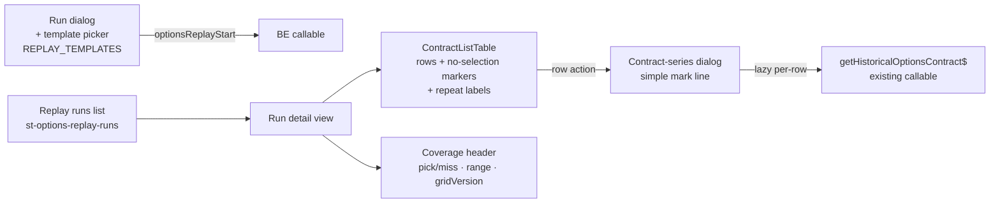

**Topic:** Options Backtest  
**Topic Slug:** options-backtest  
**Thread:** Selection Replay  
**Thread Slug:** selection-replay  
**Issue:** #1242  
**Thread Parent:** #1240  
**Topic Parent:** #1238  
**Domain:** BACKTEST  
**Type:** IMPL  
**Status:** Draft  
**Created:** 2026-10-25  
**Last Updated:** 2026-10-25  

# Implementation Plan — FE: Selection Replay

## Architecture Overview

A dedicated Selection Replay surface — its own runs list + detail view, separate from the signal-sim run/result viewers. The run dialog gains a template picker bound to the shared `REPLAY_TEMPLATES` registry (imported, no callable). Run detail renders the persisted contract list as a table; a row action opens a dialog with the contract's mark series via the existing `getHistoricalOptionsContract$` — lazy, per-row, nothing persisted client-side.

## Modules

### 1. Runs list + run detail (`savant-trader/backtest/` — verify location during impl)

- New `OptionsReplayRunsService` (or feature in the existing backtest store): Firestore listener on `st-options-replay-runs` (recent N, `createdAt` desc) + per-run listener on `st-options-contract-lists` where `runId ==` — same watch pattern as `backtest-run.service.ts`.
- Placement decision for impl: a dedicated **"Selection Replay"** section on the backtest page with its own runs list — keeps the replay namespace visually separate from sim runs (honest model = honest UI). Route/component naming: `options-replay-*`.
- Runs list columns: runId/date, template name, symbols, status, progress (`completedLists/totalLists`), failed count.
- Run detail: one tab/section per symbol's list doc; coverage header from `pickDocMeta` (pick/miss counts, date range, gridVersion, coordinate).
- **As-built (#1283):** dedicated `OptionsReplayStore` signalStore (not a feature in `BacktestRunStore` — different data model) behind `OptionsReplayRunsService` watchers; contract-list query is `where runId == X orderBy symbol` against the #1277 composite index. Section mounted as a second `<section>` on `backtest-dashboard` (sim section untouched); the detail is a **shell** — run header + one status card per run symbol (a symbol whose doc isn't written yet renders `pending` so the grid is complete from enqueue onward). The per-symbol coverage header stays with #1285 where its AC lives; template names resolve from `REPLAY_TEMPLATES` with `templateId` fallback for retired ids; `optionsReplayStart` wiring waits for #1284's dialog. Reuses `getBacktestStatusVisuals` (covers `success`) + `formatBacktestRunId`/`formatBacktestTimestamp`.

### 2. Template picker (run dialog)

- The run dialog gains a **replay mode** (or a separate "New Selection Replay" entry point — impl decision, prefer separate button to keep the sim dialog untouched): template dropdown bound to `REPLAY_TEMPLATES`, symbols multi-select, startDate — submits `optionsReplayStart`, navigates to run detail.
- Template dropdown shows `name` + `description`; no server fetch needed (registry is shared code).

### 3. Contract-list table (`contract-list-table.component`)

Columns: entryDate, contractId, side (STO/BTO), expiration + DTE, strike, delta, IV, mark, bid/ask, volume, OI, underlyingClose.

- **`no-selection` rows render as explicit marker rows** — muted span across pick columns ("no selection — SA grid miss or data gap"), never omitted.
- **Repeat contractIds labeled, not grouped** — a small "↻" repeat badge on pick rows where `repeatsPrevious === true`; each repeated row stays a distinct row (distinct position entry).
- Sort by entryDate (default); contractId secondary sort useful but optional v1.

### 4. Contract-series dialog (`contract-series-dialog.component`)

- Row action (icon button) → dialog with a **simple mark-series line** — one chart, mark line only (no span markers / lower panes; that's the chart viewer's job).
- Lazy per-row fetch via existing `getHistoricalOptionsContract$({ contractId })`; loading spinner → line, or error/empty state naming the contractId.
- Data is fetched on demand and never persisted client-side (PRD).

## Seams / Testability

- `getHistoricalOptionsContract$` injectable — component tests use `useValue` stubs returning fixture series.
- Firestore listeners behind the runs service — component tests mock the service, not Firestore directly.
- Table rendering is pure over `ContractListRow[]` — marker/repeat rendering fully testable with fixture rows.
- Dialog open/close + fetch states testable without a charting lib — assert the series input the chart receives, not rendered pixels.

## Out of scope (re-stated)

- No exit-rule inputs, outcome columns, or P&L anywhere.
- No carousel/filmstrip.
- No changes to existing signal-sim run dialog/result views beyond the replay entry point.
