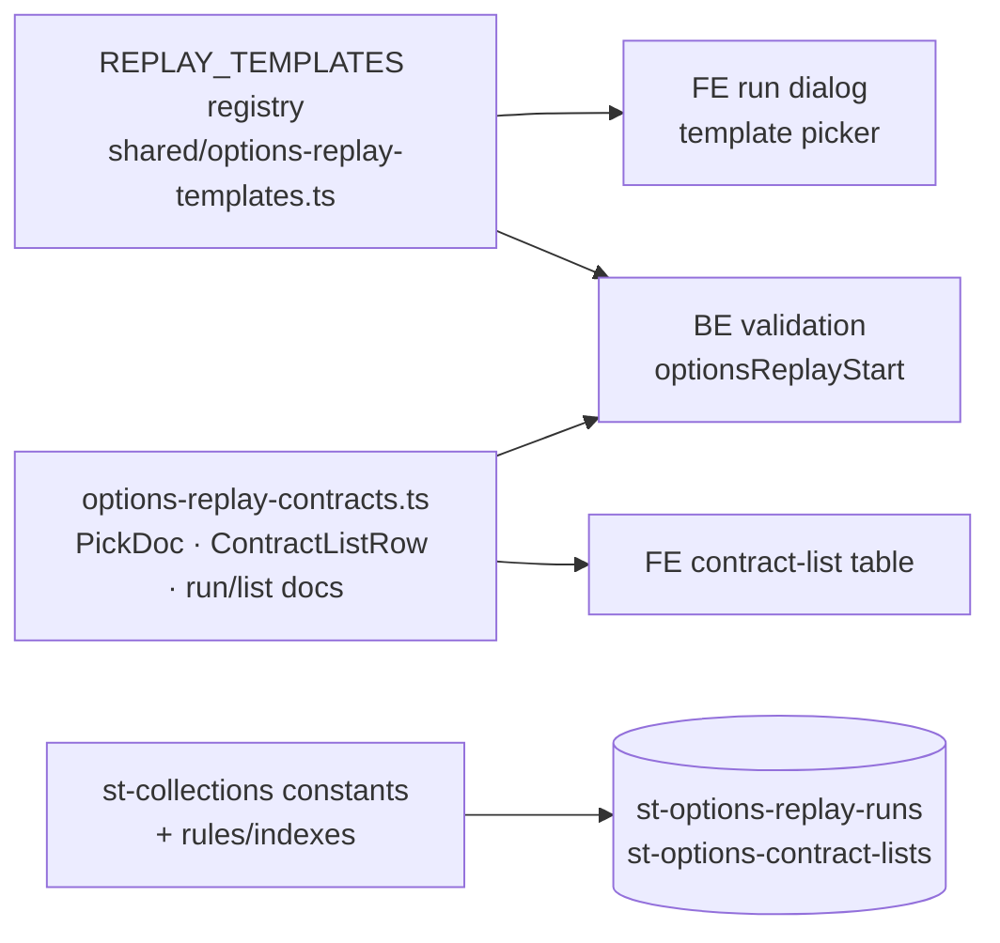

**Topic:** Options Backtest  
**Topic Slug:** options-backtest  
**Thread:** Selection Replay  
**Thread Slug:** selection-replay  
**Issue:** #1242  
**Thread Parent:** #1240  
**Topic Parent:** #1238  
**Domain:** BACKTEST  
**Type:** IMPL  
**Status:** Draft  
**Created:** 2026-10-25  
**Last Updated:** 2026-10-26  

# Implementation Plan — SHARED: Selection Replay

## Architecture Overview

Shared contracts for the selection-replay pipeline: the template registry (consumed by both the FE run dialog and BE validation), the pick-doc wire types (mirror of SA's served shape), the contract-list row/doc schema persisted under `st-options-*`, callable/task payload types, and collection constants + Firestore rules/indexes.



## Modules

### 1. Replay contracts (`shared/options-replay-contracts.ts`, new)

All types the BE worker, FE UI, and SA seam must agree on.

```typescript
/** Expiration selector inside a pick-doc coordinate. */
export interface PickDocExpiry {
  mode: 'nearestDte';
  dte: number;
}

/** Pick-doc coordinate — the SA grid cell a template maps to. */
export interface PickDocCoordinate {
  type: OptionType;                       // 'put' | 'call'
  targetDelta: number;                    // e.g. -0.20 (signed, matching SA convention)
  expiry: PickDocExpiry;
}

/** A curated template entry. `side` stamps direction — pick docs are direction-neutral. */
export interface ReplayTemplate {
  id: string;                             // 'csp-45-20'
  name: string;                           // '45DTE 20Δ put (CSP)'
  description: string;
  side: TradeSide;                        // SHORT for CSP family
  coordinate: PickDocCoordinate;
}

/** SA pick-doc wire shape (mirrors the served JSON verbatim). */
export interface PickDocDay {
  underlyingClose: number;
  contractId: string;
  expiration: string;
  dte: number;
  strike: number;
  delta: number;
  iv: number;
  mark: number;
  bid: number;
  ask: number;
  volume: number;
  openInterest: number;
}

export interface PickDocMiss {          // explicit miss — mirrors SA DayMiss
  status: 'no_chain' | 'no_match';      // no_chain = data hole; no_match = grid miss
  underlyingClose?: number;
  reason?: string;
}
export type PickDocDayEntry = PickDocDay | PickDocMiss;
export function isPickDocPick(e: PickDocDayEntry): e is PickDocDay { /* 'contractId' in e */ }

export interface PickDocument extends PickDocCoordinate {
  symbol: string;
  gridVersion: number;
  firstDate: string;
  lastDate: string;
  pickCount: number;
  missCount: number;
  days: Record<string, PickDocDayEntry>; // keyed by trading date; picks OR explicit misses
  updatedAt?: string;
}

/** Why a day produced no pick: 'miss' (SA no_match), 'gap' (SA no_chain), 'out-of-range' (past doc.lastDate). */
export type NoSelectionReason = 'miss' | 'gap' | 'out-of-range';

/** Pick row — extends PickDocDay verbatim so SA field changes propagate. */
export interface ContractListPickRow extends PickDocDay {
  kind: 'pick';
  entryDate: string;
  side: TradeSide;                    // stamped from the template
  /** The immediately preceding row picked the same contractId — UI label hint. */
  repeatsPrevious: boolean;
}

export interface ContractListNoSelectionRow {
  kind: 'no-selection';
  entryDate: string;
  reason?: NoSelectionReason;
}

/** Contract-list row — discriminated: a day's pick or a no-selection marker. */
export type ContractListRow = ContractListPickRow | ContractListNoSelectionRow;

/** Run status vocabulary — mirrors BacktestRunStatus values. */
export type OptionsReplayRunStatus = 'pending' | 'running' | 'completed' | 'failed' | 'cancelled';
export const OPTIONS_REPLAY_RUN_STATUSES: readonly OptionsReplayRunStatus[] = [...];

/** List-doc status vocabulary — mirrors BacktestPermutationStatus values. */
export type OptionsContractListStatus = 'pending' | 'running' | 'success' | 'failed';
export const OPTIONS_CONTRACT_LIST_STATUSES: readonly OptionsContractListStatus[] = [...];

/** Run header — st-options-replay-runs/{runId}. */
export interface OptionsReplayRun {
  runId: string;
  templateId: string;
  symbols: string[];
  startDate: string;
  status: OptionsReplayRunStatus;
  totalLists: number;
  completedLists: number;
  failedLists: number;
  createdAt: string;          // ISO — BE stamps FieldValue server-side
  updatedAt: string;
  completedAt?: string;
  error?: string;
}

/** Pick-doc provenance recorded on each list doc. */
export interface PickDocMeta {
  coordinate: PickDocCoordinate;
  gridVersion: number;
  pickCount: number;
  missCount: number;
  firstDate: string;
  lastDate: string;
}

/** Per-symbol payload — st-options-contract-lists/{runId}_{symbol}. */
export interface OptionsContractListDoc {
  runId: string;
  symbol: string;
  templateId: string;
  status: OptionsContractListStatus;
  rows: ContractListRow[];
  pickDocMeta: PickDocMeta;
  generatedAt: string;
  error?: string;
}
```

### 2. Template registry (`shared/options-replay-templates.ts`, new)

```typescript
export const REPLAY_TEMPLATES: readonly ReplayTemplate[] = [
  { id: 'csp-45-20', name: '45DTE 20Δ put (CSP)', side: TradeSide.SHORT,
    coordinate: { type: OptionType.PUT, targetDelta: -0.20, expiry: { mode: 'nearestDte', dte: 45 } }, ... },
  { id: 'csp-30-30', name: '30DTE 30Δ put (CSP)', side: TradeSide.SHORT,
    coordinate: { type: OptionType.PUT, targetDelta: -0.30, expiry: { mode: 'nearestDte', dte: 30 } }, ... },
];

export function getReplayTemplate(id: string): ReplayTemplate | undefined;
```

- Code-curated, imported directly by FE (dropdown) and BE (validation) — same pattern as the FE-side indicator registry. No listing callable needed.
- Registry stays code-owned until SA's grid semantics resolve (PRD open question): if pick docs turn out enumerable, the registry may wrap an enumeration rather than hard-register each variant — contract shape unchanged.

### 3. Callable + task payload types

```typescript
export interface OptionsReplayStartRequest {
  templateId: string;
  symbols: string[];          // non-empty
  startDate: string;          // ISO YYYY-MM-DD
}
export interface OptionsReplayStartResponse { runId: string; }

/** Cloud Task payload — one per symbol. */
export interface OptionsReplayPermutationPayload {
  runId: string;
  symbol: string;
  templateId: string;
  startDate: string;
}
```

### 4. Collections (`shared/st-collections.ts`)

```typescript
export const ST_OPTIONS_REPLAY_RUNS_ROOT = 'st-options-replay-runs';
export const ST_OPTIONS_CONTRACT_LISTS_ROOT = 'st-options-contract-lists';
export function stOptionsContractListDocId(runId: string, symbol: string): string; // 'or-…_QQQ'
```

- Flat roots mirroring `st-backtest-*` naming. List doc id is deterministic: `{runId}_{symbol}` — the builder uppercases the symbol, matching peer builders.

### 5. Firestore rules + indexes

- `firestore.rules`: match blocks for both roots mirroring `st-backtest-*` policy — authed read; writes BE-only (`allow write: if false`), same carve-out pattern for user-editable fields if any emerge (none expected v1).
- `firestore.indexes.json`: composite index on `st-options-contract-lists` `(runId, symbol)` — the detail view's per-run list query; `st-options-replay-runs` `(createdAt DESC)` if the runs list needs it (single-field — likely free).

## Decisions

- **Rows are flat single-leg** — no `legs[]`. Multi-leg row shape is Thread #1270's problem; a deliberate migration then, not a half-modeled field now.
- **`repeatsPrevious` is computed at write time** — consecutive days sharing a contractId are distinct rows (each a position entry); the flag lets the table label repeats without re-deriving them.
- **`no-selection` is a row kind, not an omitted day** — gap honesty: the trading-day enumeration comes from local `symbol-data` bars (BE plan), and any trading day absent from `doc.days` produces a marker. Days past `doc.lastDate` within the requested window also produce markers.
- **No pick-doc persistence** — `pickDocMeta` is provenance only; the doc itself is never stored.
- **Direction stamped at write** — `side` comes from the template, not the pick doc; the same coordinate serves STO/BTO templates later.
