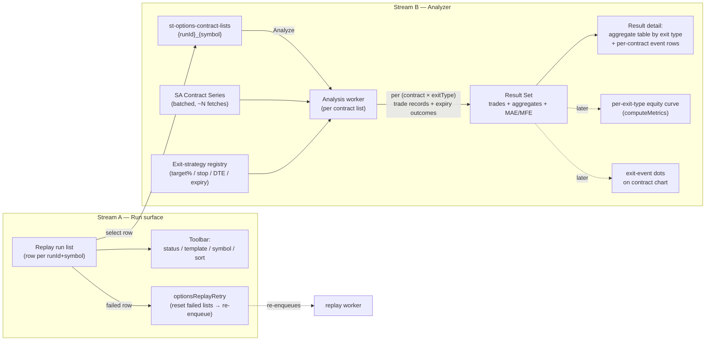

**Topic:** Options Backtest  
**Topic Slug:** options-backtest  
**Thread:** Backtest Analytics  
**Thread Slug:** backtest-analytics  
**Issue:** #1267  
**Thread Parent:** #1266  
**Topic Parent:** #1238  
**Domain:** BACKTEST  
**Type:** PRD  
**Status:** Approved  
**Created:** 2026-11-02  
**Last Updated:** 2026-11-02  

# PRD: Options Backtest — Backtest Analytics

## Problem Statement

Selection Replay (Thread #1240) produces the raw material — a contract list of real picks with real entry-day data — but nothing evaluates what those picks *would have done*. A trader looking at a ladder of 200 CSP contracts cannot answer the questions that actually drive strategy selection: *which exit rule performs best? how bad does the drawdown get before a target hits? what happens to contracts that never reach an exit?*

Meanwhile two gaps compound the problem:

1. The **replay run list is hard to navigate** — no filtering or sorting, one row per multi-symbol run (mixing symbols visually even though the data is separated), and no way to retry a failed selection short of starting a whole new run.
2. The **legacy simulator's analytics already contain most of the machinery** this thread needs — exit-rule evaluation, TradeStation-style metrics, equity curves, and a run → variant → performance-detail UI — but it is wired to its own chain-based contract selection and whole-chain mark fetching. The selection seam is swappable; the analytics below it are largely reusable.

## Solution

Two work streams under one thread, sequenced so the run surface lands first.

### Stream A — Replay run surface

Bring the replay run list to feature parity with the (now hidden) legacy run list's useful controls:

- **One row per `(runId, symbol)`** — a multi-symbol submission renders one row per symbol's contract list, not a comma-joined aggregate row. The data is already per-symbol (`{runId}_{symbol}` doc keys); this is presentation only.
- **Toolbar controls** ported from the legacy `backtest-run-control`, remapped to replay semantics:
  - Status filter (queued / running / complete / partial / error)
  - Template filter (from the `REPLAY_TEMPLATES` registry — the replay analog of the legacy strategy filter)
  - Symbol search
  - Sort (createdAt desc default; extensible to pick/miss counts later)
  - *Deliberately not ported:* config search (no analog), include-archived (no archive concept), date filter (marginal — `startDate` is already a displayed column; revisit only if felt)
- **Rerun failed selections** — a button on failed runs that re-enqueues only the failed per-symbol list docs. Backend: a retry callable that resets `failed` list docs to pending, adjusts run counters, and re-tasks just those symbols. The worker's terminal-skip logic means successful docs are untouched automatically. No new run doc, no duplicate history.

### Stream B — Exit-rule analyzer

An **exit-event matrix** over each contract list — fundamentally different from the simulator's "first exit that fires wins" loop:

- For **every contract** in a contract list, evaluate **every exit rule** in a maintained **exit-strategy registry** independently across the contract's full daily series through expiration.
- Each `(contract, exitType)` evaluation yields a trade-shaped record: entry (pick row's entryMark) → exit event `{fired, exitDate, exitPrice, daysHeld}` — or an expiry outcome record when no exit fired.
- Evaluations never terminate a contract's scan early: when an exit fires for one rule, that *rule's* trade closes, but other rules continue evaluating. The scan runs to expiration.
- **Exit-strategy registry** — a code-maintained list (same pattern as `REPLAY_TEMPLATES`). v1 rule types: target-at-X%-of-premium variants, stop-loss, time exit (e.g., 21-DTE), hold-to-expiration. All registry rules are evaluated on every analysis; adding a rule type is a registry entry + evaluator, not new plumbing.
- **Per-exit-type aggregates** — hit rate, average days-to-exit, average premium captured, expired-vs-exited counts, MAE/MFE distribution per rule. This is the comparison surface: "which exit type wins?"
- **Expiry outcomes** — when no exit fired, record whether the contract expired ITM, its intrinsic value at expiry, and assignment distance (how far the strike sits from the underlying close — "how far from current price are we forced to buy"). Full assignment/share modeling is a documented follow-on, not v1.
- **Per-position excursion metrics** — every (contract × exitType) trade record carries its own MAE (worst mark + date) and MFE (best mark + date) measured over that rule's hold window (entry → its exit, or expiry if none). Per-exit-type excursion is what informs "which exit type do I use" — e.g., how deep the drawdown runs before a 50% target fills vs. a 25% target.
- **Result Set** = the persisted artifact: contract-list reference + per-exit-type trade sets + aggregates. Each exit type's trade set is deliberately shaped so portfolio-level metrics (equity curve, net profit, Sharpe via the reused `computeMetrics`) can be layered on per exit type later — "run analytics by exit type" is the stated end state.
- **Batch series fetching** — analyzing a ~200-row contract list means ~200 contract-series fetches from SA. The analysis worker fetches in bounded-concurrency batches inside the task execution; per ADR-010, contract series is fetched, evaluated, and discarded — only computed outcomes persist.
- **Repeat rows are new positions** — consecutive days sharing a contractId open a fresh position each day (coincidental strike match, not a continuation).

### Reuse plan (adapt vs. build)

**Adapt from the legacy simulator:** `computeMetrics` (verbatim when equity curves land), the `BacktestTrade`/`BacktestPermutationFull` result shape (→ Result Set shape), the exit-condition predicates (re-shaped as non-terminating independent evaluators), the worker/orchestrator fanout pattern (`optionsReplayPermutation` clones), and the permutation → performance-detail UI pattern (→ result-set → exit-type detail).

**Build new:** analyzer worker (payload: contract-list doc id → all exits × all contracts), bounded-concurrency series batch fetcher, exit-strategy registry, excursion capture (MAE/MFE), per-exit-type aggregates, Result Set collection + docs, comparison/result-detail UI, and the retry callable.

**Not reused:** the `paper-trading/engine` passes (built for live daily EOD state transitions over persistent strategy instances — wrong shape for a one-shot batch analysis), chain fetching, strategy adapters/entry-signal logic, and legacy cash accounting (no initialCash in replay semantics).

## System Context

## User Stories

### Stream A — run surface

1. As a trader, I want one replay-list row per symbol even when I submitted multiple symbols in one run, so that QQQ and SPY results are never visually conflated.
   - *Verify:* a 2-symbol submission produces 2 rows, each carrying its own symbol, status, and pick/miss counts; selecting a row opens that symbol's contract list.
2. As a trader, I want to filter the replay list by status and template, and search by symbol, so that I can find a run among dozens.
   - *Verify:* each control narrows the visible rows correctly; controls compose (status + symbol both applied); clearing restores the full list.
3. As a trader, I want to sort the list (default: newest first), so that recent work surfaces.
   - *Verify:* toggling sort field/direction reorders rows; default order is createdAt descending.
4. As a trader, I want a rerun button on a failed run so that I retry only the failed symbol(s) without creating a duplicate run.
   - *Verify:* clicking rerun on a run whose QQQ list failed but SPY succeeded re-enqueues QQQ only; the run doc keeps its runId; SPY's list is untouched; counters/status update live; a second click during pending/running is a no-op.

### Stream B — analyzer

5. As a trader, I want every contract in a list evaluated against every registered exit rule through expiration, so that one analysis pass answers "what would each exit have done?"
   - *Verify:* for an N-row contract list and R registered rules, the Result Set contains up to N×R trade records; each non-expired contract has either an exit event `{date, price}` or an expiry outcome per rule.
6. As a trader, I want an exit that fires for one rule not to truncate other rules' evaluations, so that each exit type is measured independently to expiry.
   - *Verify:* a contract whose 50%-target fills on day 5 still produces a full 21-DTE-exit record and hold-to-expiry record from the same series; no rule's scan stops early because another fired.
7. As a trader, I want per-exit-type aggregates — hit rate, average days-to-exit, average premium captured — so that I can compare rules on one contract list.
   - *Verify:* the Result Set contains one aggregate block per exit type; values reconcile with the underlying trade records (e.g., hit rate = fired count / total contracts).
8. As a trader, I want MAE/MFE recorded per (contract × exitType) — worst/best mark with dates over that rule's hold window — so that I can judge each exit type by how much pain precedes its exit.
   - *Verify:* each trade record carries mae/mfe values + their dates measured from entry through that rule's exit (or expiry if no exit fired); the per-exit-type aggregate block exposes the excursion distribution (e.g., worst MAE across that rule's trades).
9. As a trader, I want contracts with no exit recorded as expiry outcomes — ITM flag, intrinsic value, and assignment distance — so that the "blind hold" tail is visible.
   - *Verify:* a no-exit record reports `expiredItm`, intrinsic value at expiry, and strike-vs-underlying-close distance; OTM expiry reports full premium retained.
10. As a trader, I want consecutive-day rows with the same contractId treated as separate positions, so that each day's pick is a distinct entry.
    - *Verify:* two adjacent rows sharing a contractId each produce their own trade records per exit type.
11. As a trader, I want the analysis unit to be one contract list (symbol) so that the same (template × exitType) can later be compared across symbols, or (symbol × template) across exit types.
    - *Verify:* analysis launches per contract list; the stored Result Set keys carry runId + symbol + templateId so slicing by those dimensions is possible in queries/UI.
12. As a developer, I want the exit registry maintainable like `REPLAY_TEMPLATES`, so that adding a rule is a registry entry + evaluator function, not plumbing work.
    - *Verify:* adding a test rule to the registry makes it appear in every new analysis's output without touching worker or persistence code.

## Non-Goals (v1)

- **Per-exit-type equity curves / Sharpe / net-profit metrics** — designed-for (trade sets are shaped for it) but deferred to a follow-on; v1's comparison surface is the aggregate table.
- **Full assignment modeling** (shares assumed, post-assignment share outcomes) — v1 records ITM flag + intrinsic value + assignment distance only.
- **Exit-event dots on a contract chart** — the visual overlay (multi-contract dots, per-rule show/hide) is explicitly future work; v1's result detail is tabular.
- **Comparison across result sets** (multi-symbol/multi-template side-by-side) — the Result Set keys are designed for it; the comparison UI itself is follow-on.
- **Applying analysis to paper-trading fills** — architecturally there is no hard boundary here: paper trading *is* this backtest carried into real-time (the same exit evaluation running on tomorrow's marks instead of yesterday's series). The analyzer's per-(contract × exitType) evaluation is the machinery paper will eventually consume; wiring live fills is follow-on, not a different model.
- **Portfolio simulation** (cash accounting, position sizing, concurrent-capital limits) — the analyzer models each contract independently, not a funded portfolio.

## Technical Context

- **Contract series is never persisted** (ADR-010). Each analysis fetches ~N contract series from SA inside the worker with bounded concurrency; rate-limit behavior and partial-series failures (missing window, upstream error) must degrade to per-contract error records, not a failed analysis.
- **Entry semantics:** entry mark = the pick row's `entryMark` (EOD pick-day mark); day-0 of each trade is the pick date. This is an assumption to flag on any divergence between pick mark and next-day open.
- **Series availability:** contract series exists only where SA has ingested it; pick-doc history starts 2026-01-01. Analyses over sparse windows produce partial trade records (documented as data-coverage, not bug).
- **Idempotency:** re-running an analysis overwrites the Result Set for the same `(contractList, registryVersion)`; registry changes should carry a version so stale result sets are detectable.
- **Legacy simulator code is preserved** — hidden from the UI but kept as the reuse source; nothing in this thread deletes it.

## Known Follow-Ons

- Per-exit-type equity curves + `computeMetrics` portfolio stats.
- Exit-event dots overlay on contract charts with per-rule show/hide.
- Cross-result-set comparison (symbol × template × exit slicing UI).
- Full assignment modeling.
- Paper-trading fills through the same machinery.
- Date filter / archive semantics on the run list, if felt in use.
