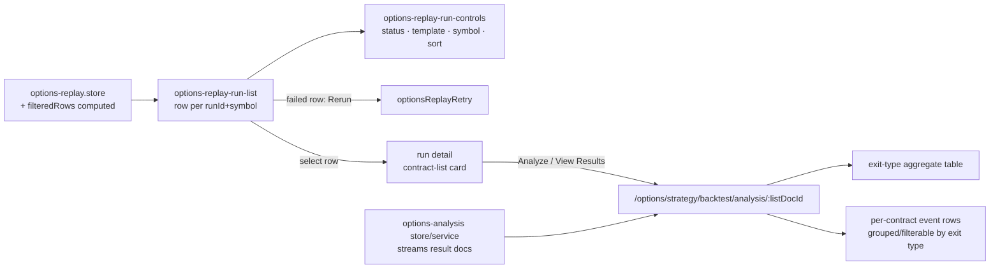

**Topic:** Options Backtest  
**Topic Slug:** options-backtest  
**Thread:** Backtest Analytics  
**Thread Slug:** backtest-analytics  
**Issue:** #1357  
**Thread Parent:** #1266  
**Topic Parent:** #1238  
**Domain:** BACKTEST  
**Type:** IMPL  
**Status:** Draft  
**Created:** 2026-11-02  
**Last Updated:** 2026-11-02  

# Implementation Plan — FE: Backtest Analytics

## Architecture Overview

Two surfaces:

1. **Run surface upgrade** — the replay run list gains the toolbar controls (status / template / symbol search / sort) ported from the legacy `backtest-run-control`, renders one row per `(runId, symbol)`, and shows a rerun action on failed runs.
2. **Results page** — a dedicated route for a contract list's analysis output: per-exit-type aggregate table + per-contract event rows. Replaces the legacy nested-panel pattern with a full page.

## Modules

### 1. `options-replay-run-controls` component (new)

- Inputs: `statusFilter`, `templateFilter`, `symbolSearch`, `sortBy`, `sortDirection`; outputs: matching `*Change` events + `newReplay` passthrough.
- Modeled on `backtest-run-control` shape/material usage but replay-scoped: no config search, no archive toggle, no date filter.
- `templateOptions` from `REPLAY_TEMPLATES` (shared import — no backend fetch).

### 2. `options-replay.store` — derived rows + filters (modify)

- `runRows` computed: for each run, one `ReplayListRow` per `run.symbols[]` entry — `{runId, symbol, templateId, startDate, createdAt, runStatus, symbolStatus: run.listOutcomes?.[symbol] ?? 'pending'}`.
- `filteredRows` computed: applies status filter (matches `symbolStatus` — run status falls back for unsplit status semantics; decide: filter on symbolStatus), template filter, symbol substring (case-insensitive), and sort (createdAt desc default).
- Sort fields v1: `createdAt`, `startDate`, `symbol`. Direction toggle.

### 3. `options-replay-run-list` (modify)

- Renders `filteredRows` (per-symbol rows), each showing symbol, template, startDate, symbolStatus, progress context from the run.
- `rerun` output per row — emits `runId` when symbolStatus is `'failed'` and the row action is clicked; dashboard calls `optionsReplayRetry` and disables the action while run status is pending/running.
- Row click → select `(runId, symbol)` — run detail already filters contract lists to that symbol's doc.

### 4. Analysis start entry point (new, small)

- On the contract-list card in run detail: **Analyze** button (enabled when `status === 'success'`) → calls `optionsAnalysisStart`; when result docs already exist for the list, button reads **View Results** → routes to the results page.

### 5. Results page `backtest-analysis-results` (new route + component)

- Route: `/options/strategy/backtest/analysis/:listDocId` — registered beside the dashboard route.
- Service: `options-analysis-runs.service` streams `st-options-analysis-results` docs where `contractListDocId == :listDocId` (query — the composite index from SHARED).
- **Aggregate table** — one row per exit type (registry label + order), columns: hit rate, avg days-to-exit, avg premium captured, exited/expired/error counts, worst MAE. This is the PRD comparison surface.
- **Event rows** — per-contract records, grouped by exit type (or a flat table with an exit-type filter chip). Columns: pickDate, contractId, entryMark, outcome (exit date+price vs expired+ITM/distance vs error), daysHeld, MAE/MFE w/ dates.
- Loading/empty/error states mirror the contract-list-card treatment.

## Decisions

- **Dedicated page, not dialog/nested panels** — the aggregate table + event rows need full-width real estate; the page is deep-linkable and leaves room for the future chart-dots overlay.
- **Symbol-status rows, not run-status rows** — `listOutcomes` makes per-symbol derivation free; pick/miss counts stay in detail view (avoids streaming every run's list docs for the table).
- **Store-side filtering** — computed signals in `options-replay.store`, same pattern as `backtest-ui.store.filteredRuns`; list component stays dumb.
- **No old-list resurrection** — the legacy `backtest-run-control` is a *pattern source* only; the new component is replay-shaped from day one.
