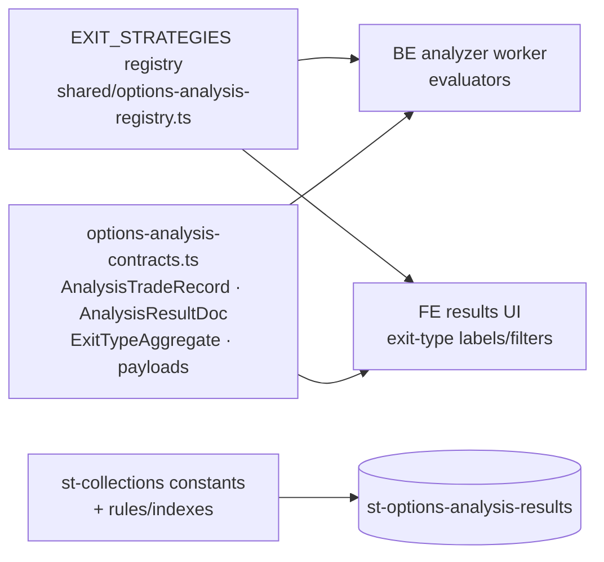

**Topic:** Options Backtest  
**Topic Slug:** options-backtest  
**Thread:** Backtest Analytics  
**Thread Slug:** backtest-analytics  
**Issue:** #1357  
**Thread Parent:** #1266  
**Topic Parent:** #1238  
**Domain:** BACKTEST  
**Type:** IMPL  
**Status:** Draft  
**Created:** 2026-11-02  
**Last Updated:** 2026-11-02  

# Implementation Plan — SHARED: Backtest Analytics

## Architecture Overview

Shared contracts for the analytics layer: the exit-strategy registry (consumed by the BE analyzer worker and rendered by the FE results UI), the analysis trade-record and result-set doc schema persisted under `st-options-*`, callable/task payload types, collection constants, and Firestore rules/indexes additions.



## Modules

### 1. Exit-strategy registry (`shared/options-analysis-registry.ts`, new)

```typescript
/** Evaluator kinds — the BE worker switch-dispatches on these.
 *  ExitStrategyDef is a discriminated union on `kind` (ContractListRow
 *  pattern): each variant fixes its required params so
 *  `{ kind:'absolute-price', params:{} }` can't compile. */
export type ExitStrategyDef =
  | { kind: 'target-pct-premium'; params: { pct: number } }   // mark <= entry×(1−pct/100)
  | { kind: 'absolute-price';     params: { price: number } } // mark <= price
  | { kind: 'stop-pct-premium';   params: { pct: number } }   // mark >= entry×(pct/100), pct>100
  | { kind: 'dte-time';           params: { dte: number } }   // remaining DTE <= dte
  | { kind: 'hold-to-expiry';     params: Record<string,never> }
  // …each intersected with { exitId, label, order }

/** Bumped whenever a rule is added/removed/re-parameterized — results
 *  stamped with it; stale result sets detectable. */
export const EXIT_REGISTRY_VERSION = 1;

export const EXIT_STRATEGIES: readonly ExitStrategyDef[];
export function getExitStrategy(exitId: string): ExitStrategyDef | undefined;
```

Seed entries (provisional — user supplies final list): `target-90`, `price-100`, `price-50`, `stop-200`, `dte-21`, `expiry`. Prior discussion suggests target-25/50/75 may also land; registry shape makes the list a constants edit.

### 2. Analysis contracts (`shared/options-analysis-contracts.ts`, new)

```typescript
/** One (contract-row × exit-strategy) outcome — discriminated union on
 *  `outcome` (ContractListRow pattern). Shared base carries the
 *  denormalized slice keys + pick fields + daysHeld + mae/mfe; variants:
 *  'exit' → +{exitDate,exitPrice}; 'expired' → +{expiredItm,
 *  intrinsicAtExpiry, assignmentDistancePct (PERCENT ×100)}; 'error' →
 *  +{error}, daysHeld=0, mae/mfe=entry-day placeholder. */
export type AnalysisTradeRecord =
  | AnalysisExitTrade | AnalysisExpiredTrade | AnalysisErrorTrade;

/** Per-exit-type aggregate block — the comparison surface. */
export interface ExitTypeAggregate {
  exitId: string;
  contractCount: number;
  exitedCount: number;
  expiredCount: number;
  errorCount: number;
  hitRatePct: number;            // exitedCount / (contractCount - errorCount)
  avgDaysToExit?: number;        // over exited records
  avgPremiumCapturedPct?: number;// (entryMark - exitPrice)/entryMark over exited
  worstMae: number;
  maeP50?: number;               // optional distribution points
  maeP90?: number;
}

/** Persisted result doc — st-options-analysis-results/{listDocId}_{exitId}. */
export interface AnalysisResultDoc {
  contractListDocId: string;     // '{runId}_{symbol}'
  runId: string;
  symbol: string;
  templateId: string;
  exitId: string;
  registryVersion: number;
  status: 'running' | 'success' | 'failed';
  trades: AnalysisTradeRecord[]; // one per contract row (picks only; markers skipped)
  aggregate: ExitTypeAggregate;
  generatedAt: string;
  error?: string;
}
```

### 3. Callable + task payloads

```typescript
export interface OptionsAnalysisStartRequest { contractListDocId: string; }
export interface OptionsAnalysisStartResponse { analysisId: string; } // = contractListDocId for v1
export interface OptionsAnalysisTaskPayload {
  contractListDocId: string;
  runId: string;
  symbol: string;
  templateId: string;
  registryVersion: number;
}
// OptionsReplayRetryRequest/Response live in options-replay-contracts.ts —
// replay-domain payloads stay with the replay feature (as-built).
```

### 4. Collection constants + rules/indexes — **deferred to #1368**

- `ST_OPTIONS_ANALYSIS_RESULTS_ROOT = 'st-options-analysis-results'` in `shared/st-collections.ts`.
- Rules: authed read, deny client writes (mirror contract-lists rules).
- Index: `contractListDocId + exitId` composite (query "all exit results for a list"); `runId + exitId` (cross-symbol slicing).

## Decisions

- **Doc per (list × exit), not one mega-doc** — ~200 trade records/doc stays well under the 1MB limit; a whole-list doc (~1,200+ records) risks it.
- **exitId inside every record AND in the doc key** — self-describing records enable cross-exit aggregation later without joins.
- **Registry in code, not Firestore** — versioned with the codebase; a user-editable rule store is out of v1 scope.
- **Markers excluded from analysis** — `no-selection` rows produce no trade records (they're not positions).
- **Repeat rows are independent positions** — adjacent same-contractId rows each produce their own records per exit type.
