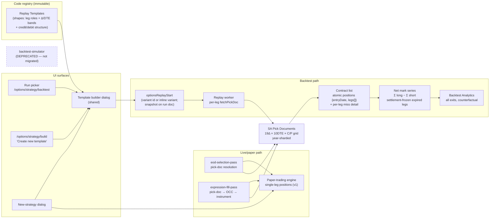

**Topic:** Options Backtest  
**Topic Slug:** options-backtest  
**Thread:** Multi-leg Templates  
**Thread Slug:** multi-leg-templates  
**Issue:** #1271  
**Thread Parent:** #1270  
**Topic Parent:** #1238  
**Task:** N/A  
**Domain:** MULTI-LEG-SPREAD  
**Type:** PRD  
**Status:** Approved  
**Created:** 2026-11-13  
**Last Updated:** 2026-11-13  

# Multi-leg Templates — PRD

**Supporting doc:** [Template registry catalog](1238-1270-1271-CATALOG-BACKTEST-options-backtest-multi-leg-templates.md) — contemplated template shapes and bands, dated 2026-11-13.

## Problem

Option strategies are described three different ways today, and none of them share machinery:

1. **Selection Replay** (`/options/strategy/backtest`) picks from a small code-curated registry (`REPLAY_TEMPLATES`) of *single-leg* recipes — one option type, one delta, one DTE, one side. Spreads, calendars, and condors cannot be expressed.
2. **The Strategy Instance Builder** (`/options/strategy/build`) hand-edits one recipe inline (spread type + target delta + DTE min/max). It is effectively a variant editor for a single recipe family, overlapping the replay picker conceptually while sharing nothing with it.
3. **Contract selection diverges by engine.** Replay resolves contracts through SA Pick Documents; the paper-trading engine's nightly selection pass and the noon expression-fill pass scan live/EOD chains and score candidates independently. The same strategy can pick different strikes backtested vs. live purely because two different pickers ran.

The result: multi-leg strategies can't be backtested at all, live strategies can't be templated, and backtest-vs-live comparisons are polluted by selection drift.

## What we're building

A shared **template vocabulary** for option strategies — one model serving both backtest replay and live/paper strategy instances — plus the migration of every in-scope selection path onto Pick Documents.

Three levels, each with a distinct name:

- **Replay Template** — an immutable named *shape* in a code-generated registry: leg roles with delta/DTE **bands** and a credit/debit structure. E.g., "put credit spread: short leg 15–35Δ, long leg 5–15Δ, legs share expiry." Templates are never edited or deleted at runtime; the library is extended in code. No Firestore collection, no per-user tier (single-user app). **Long option legs span the full grid** (all deltas, all DTEs) — a LEAP-style template is just the long-call/long-put template with far-dated variant values, not a separate template.
- **Template Variant** — one concrete point inside a template's bands, every leg pinned to a specific pick-doc grid value (e.g., "20Δ/5Δ @ 45DTE"). Variants are what a run actually resolves. One-off custom variants may travel **inline** on the run request without registering a named template — composing and running never requires persistence.
- **Application** — a variant bound to a symbol and schedule → a backtest run (historical positions for analytics) or a live/paper strategy instance (engine positions).

Credit/debit structure is explicit leg configuration, not local strike math: for same-type same-expiry legs the higher-|Δ| leg is the pricier one (short it = credit); for calendars/diagonals the family recipe fixes debit structure by expiry (long the far leg, short the near). Strike resolution always happens upstream in the Pick Document — the system never walks chains or computes strikes.

A leg may also be a **stock leg** — long or short the underlying itself, marked at the underlying price. Stock legs need no Pick Document and always resolve, which makes hybrid structures expressible as pure position data — e.g., a covered call is `long stock + short call`, a buy-write variant differs only by entry timing. Position atomicity therefore means "every *option* leg picked that day"; stock legs never produce a miss.

## User stories

### US-1 — Named template library with multi-leg shapes

As a trader, I want a library of named strategy templates covering single-leg, vertical, condor, and calendar families, each defined by leg roles with delta/DTE bands and an explicit credit/debit structure, so that I can reuse proven strategy shapes instead of hand-specifying every leg.

**Acceptance:**

- The registry contains curated templates where every template declares `legs[]` (kind — option or stock — plus role, option type, delta band, DTE band, side) plus its credit/debit structure.
- Verticals, condors, calendars, diagonals, straddles/strangles, and covered-call-style hybrids (stock leg + option leg) are all expressible — option legs need not share type or expiry.
- Every band value validates against the pick-doc grid (deltas 5–95 step 5; DTEs 7, 14, 21, 30, 45, 60, 90, 120, 180, 365). Long option legs span the full grid — there is no separate LEAP template.
- Credit and debit vertical variants are representable for both puts and calls by leg-side configuration alone.
- Naked short templates (short call, short strangle) are included — backtest records carry no margin risk, and keeping naked recipes out of *live* execution is a separate blocking mechanism, not a registry omission (see Follow-ons). Short legs carry low-delta bands by convention.

### US-2 — Concrete variants at run time

As a trader, I want to select a template and concrete delta/DTE values within its bands — or submit a fully custom variant inline — so that a run resolves real, on-grid contract coordinates.

**Acceptance:**

- A variant pins every leg to a specific grid delta and DTE; values outside the template's bands or off the grid are rejected at submit time.
- The run request accepts either a variant reference or an inline variant definition (no registry entry required).
- The resolved variant (full leg definitions) is stamped onto the run doc so the record is self-describing forever.

### US-3 — Template builder dialog with three entry points

As a trader, I want a template builder dialog reachable from the run picker, `/options/strategy/build` ("Create new template"), and inside the new-strategy dialog, so that I can compose a variant without leaving my current flow.

**Acceptance:**

- All three entry points open the same builder dialog.
- From the new-strategy dialog, the builder opens over it; on completion the new-strategy dialog reappears with the new variant applied/selected.
- The builder composes a variant (template + concrete leg values), can run/submit it inline immediately, and can emit paste-ready JSON ("Copy JSON") so a variant can be saved into the code registry — persistence is a commit + deploy, never a runtime write.

### US-4 — Multi-leg backtest runs produce position rows

As a trader, I want each backtest run to emit one position per trading day whose legs are all resolved through Pick Documents, so that multi-leg strategies are backtestable with the same selection mechanism used everywhere else.

**Acceptance:**

- Each position row is `{entryDate, legs[]}` — one row per position, never leg-granular.
- Positions are **atomic**: a position exists only when every *option* leg picks that day (stock legs always resolve at the underlying mark); otherwise a `no-selection` row records which leg coordinate failed and its miss status (`no_chain` vs `no_match`), making coverage gaps diagnosable per leg.
- Replay records on **every** trading day in the window (no frequency parameter); day selection is deferred to analytics refinement.
- Legs resolve via per-leg Pick Document lookups — no chain scanning anywhere in the path.
- A position row can be opened as a chart: "Open in Spread Viewer" hands its legs to the existing spread-run machinery (a resolved position is structurally a `SpreadDefinition`) so the combined mark charts there; individual legs can be sent to `/options/chart` as `date,contractId` lines via the existing replay→chart path.

### US-5 — Position-level daily mark feeds existing analytics

As a trader, I want each multi-leg position reduced to a single daily mark series — `Σ long leg marks − Σ short leg marks` — so that the existing exit-rule analytics evaluate multi-leg positions unchanged.

**Acceptance:**

- The position produces one mark per trading day from entry through the **latest** option-leg expiry (stock legs have no expiry; a stock-only remainder keeps marking).
- A leg that expires early contributes its settlement value (intrinsic at expiry) thereafter — its contribution is frozen, not zeroed. Stock legs mark at the underlying price every day, signed by side.
- Position DTE for exit rules is measured against the nearest unexpired leg.
- All exit rules in the registry evaluate each position counterfactually; positions never "close" in the record — exits are analytical outcomes.

### US-6 — Live/paper selection converges on Pick Documents

As a trader, I want live and paper trading to select contracts through the same selection algorithm and coordinate vocabulary as backtesting, so that a strategy picks the same contracts in every context.

**Acceptance:**

- Strategy instances carry concrete leg coordinates (`{type, targetDelta, targetDte, side}` — the same shape as a Template Variant leg). Existing window-based instances are deleted, not migrated.
- Live selection **runs the pick algorithm over the intraday chain** — a coordinate resolves to a contract the same way the corpus algorithm would have picked it, then the fill prices from a live RH quote. Stale (prior-day) corpus picks are never used for live selection: today's pick doc does not yet exist, and a day-old pick is no longer at the target coordinate.
- Historical/backtest selection replays the same algorithm's recorded output — Pick Documents — for every past day.
- The engine's `eod-selection-pass` and `expression-fill-pass` resolve coordinates through this unified path (OCC → instrument map → live-quote fill); the legacy delta/DTE *window* scoring is replaced by coordinate resolution.
- The legacy `backtest-simulator` is **not** migrated — it is marked for deprecation in code/docs.

## Out of scope (named follow-ons)

- **Engine multi-leg positions** — opening/managing N-leg positions in the paper/live ledger, per-leg fill orchestration, and Position Group aggregation. This is the sibling thread created alongside this PRD; the shared template vocabulary here is designed to serve it.
- **User-saved template library** — user persistence is the builder's JSON export → paste into the registry → deploy; no runtime-write store exists or is planned. If re-composition friction ever proves real, a saved-variants collection is a separate decision.
- **Legacy backtest simulator retirement** — flagged for deprecation only; removal is a separate decision.
- **Frequency/scheduling in replay** — replay records every trading day; `frequency`/`openTimePT` remain live-engine fields.

## Technical context

- **Pick Document grid is a fixed menu**, not runtime-discovered: deltas 5–95 in steps of 5 (19 values), DTEs 7/14/21/30/45/60/90/120/180/365 (10 values), calls and puts. Template bands and variant values must come from this menu; the endpoint rejects off-grid coordinates.
- **Grid validity ≠ data coverage.** Pick docs are year-sharded with coverage beginning ~2026-01-01; a valid coordinate may still miss for a given symbol/date. Misses surface per-leg with SA miss status so gaps are diagnosable, not silent.
- **Pick docs are EOD snapshots of one selection algorithm's output.** For live selection the day's doc does not exist yet, so the engine runs the same pick algorithm against the intraday chain (coordinate → contract → live RH quote). The corpus supplies identity for every past day; live supplies its own resolution. This requires the live chain to carry per-contract greeks and a documented spec of SA's exact pick semantics — both verified during blueprinting.
- **Immutability model:** templates are generated code objects; the run doc snapshots the resolved variant at start. Nothing is edited or deleted at runtime, so no persistence layer is required for the registry itself.
- **Single-user system.** No admin tier, no write permissions matrix.
- Existing seams reused: `functions/src/options-replay/pick-doc-client.ts` (`fetchPickDoc`), the `st-ids` OCC→RH instrument map, the exit-rule registry, and Backtest Analytics' counterfactual evaluation pipeline.

## System context

## Follow-on work

| Thread | Scope |
|---|---|
| Multi-leg Engine Positions *(created alongside this PRD)* | Engine opens/manages N-leg positions via pick docs; ledger aggregation (Position Group); position-level exits on the shared net-mark primitive |
| Saved-variants collection *(deferred)* | Only if copy-JSON-to-registry friction proves real; no runtime-write store in this thread |
| Live-execution guardrails *(deferred)* | Blocking mechanism keeping naked/undefined-risk templates out of live and paper instances |
| Chart-surface convergence *(deferred)* | `/options/chart` and spread-viewer render the same primitive (unioned-date mark series + underlying). A generalized "plotted-series" chart component could serve both; unification is its own refactor thread, not absorbed here. |
| Legacy simulator retirement *(deferred)* | Remove `backtest-simulator` once replay supersedes it |
