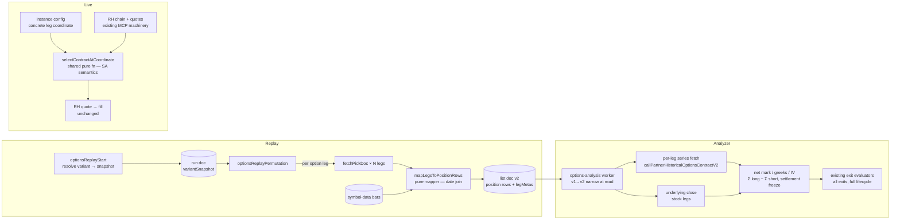

**Topic:** Options Backtest  
**Topic Slug:** options-backtest  
**Thread:** Multi-leg Templates  
**Thread Slug:** multi-leg-templates  
**Issue:** #1485  
**Thread Parent:** #1270  
**Topic Parent:** #1238  
**Domain:** MULTI-LEG-SPREAD  
**Type:** IMPL  
**Status:** Draft  
**Created:** 2026-11-14  
**Last Updated:** 2026-11-14  

# Implementation Plan — BE: Multi-leg Templates

## Architecture Overview

Three bodies of work: (1) the replay pipeline generalizes from one pick-doc coordinate to N legs — the worker joins per-leg pick docs by trading day into normalized position rows; (2) the analyzer consumes position rows — it fetches each leg's contract series, computes the signed net mark (and net greeks/IV) per day, and feeds that single series into the existing exit evaluators; (3) selection convergence — one shared selection contract where historical reads SA's materialized pick doc and live runs the same algorithm against the intraday RH chain, then quotes via RH.



## Modules

### 0. SA pick semantics — CONFIRMED (spike #1496)

Source of truth: `av-proxy-api/.../options-delta-picker.service.ts` `pickCellsForDate` (chain passed verbatim by the materializer — no preprocessing). Per cell, per day, days independent:

1. Filter chain to the cell's option type.
2. **Expiration:** nearest listed expiration to target DTE (calendar days); equidistant → **longer actual DTE**. No fallback to other expirations.
3. **Contract within that expiry:** argmin `|observedDelta − signedTarget|` (put target `-deltaPct/100`, call `+deltaPct/100`); equidistant → **larger |delta|**; residual → **lowest contractId**.
4. **Eligibility:** non-empty `contractID`, parseable `expiration` (dte ≥ 0), parseable `strike`, parseable `delta`. **No mark/liquidity filter** — quote fields omitted (never fabricated) when unparseable.
5. Misses: `no_match` (chain present, no eligible row) / `no_chain` (absent chain — caller-emitted).

**Divergence vs `selectOptionContract`:** SA is two-stage (expiry first, then delta within that expiry); rel-str's scorer is a weighted joint score with a DTE window, `requireMark`, and relaxed fallback. The shared fn implements the SA algorithm exactly — the live adapter supplies candidates with identity fields + delta; mark remains fill-time only.

### 1. `optionsReplayStart` — two-form request (`functions/src/options-replay/start.ts`)

- Resolve `{variantId}` via `getReplayVariant` OR validate inline `legs[]` (structural: on-grid Δ/DTE, ≥1 leg, no dupes — SHARED validator). Exactly one form; `invalid-argument` otherwise.
- Stamp `variantSnapshot {variantId?, name, legs[]}` on the run doc — self-describing record; registry edits post-run can't rewrite history.
- Fanout per symbol unchanged; payload shrinks to `{runId, symbol}`.

**§1 as-built (#1498):** shipped with a **three**-form resolver (legacy `{templateId}` preserved alongside `{variantId}` / `{legs[]}` — exactly one by presence-count, `invalid-argument` otherwise). `resolveRequestVariant` returns `{templateId, variantSnapshot}`: variant → registry id/name/legs; legs → `templateId: 'custom'` sentinel + `variantName ‖ 'custom {n}-leg'` + legs normalized to contract fields with **canonical grid Δ** (e.g. -0.19999 → -0.2 — the stamped value, not just the accepted input); template → `templateToOptionLeg` 1-leg snapshot. Request bounds guard the doc write: legs ≤ 8, `variantName` string ≤ 200 (review thermo-major — an unbounded stamped payload could push the run doc over 1 MiB and fail `createRun` mid-fanout as `internal` with a partial run set). `'custom'` is reserved in `validateVariantRegistry` so no future variant id shadows the sentinel. The structural validator is the shared `validateVariantLegs` (exported from `@options-replay/templates`; the registry drift guard delegates to it — identical messages). `variantSnapshot` is required on `OptionsReplayRunWrite`; pre-model runs may lack it (migration-compat documented on the contract). Worker still resolves `templateId` only — `'custom'`/multi-leg ids fail fast `'Unknown templateId'` until #1499 (verified live: legacy `csp-45-20` run completed; `pcs-45-20-5` + inline runs failed permanently, no retry storm). Unit suite 114 tests via `ReplayStartDeps`; live verify `functions/scripts/verify/options-replay-start-forms-1498.ts` (DRY default fake-deps; `--live` submits real runs — 38/38).

### 2. Position-row mapper (`functions/src/options-replay/pick-doc-mapper.ts`, rewrite — pure)

```typescript
mapLegsToPositionRows(
  legDocs: { coordinate: PickDocCoordinate; doc: PickDocument }[],  // one per option leg, ordered
  stockLegs: StockLeg[],
  tradingDays: string[],
): ContractListRow[]
```

Per trading day: all option legs pick → `position` row (legs[] carry each pick's `PickDocDay` fields + coordinate + side; stock legs carry `underlyingClose` from any leg doc / bars). Any option leg miss → `no-selection` row + `legMisses[]` per failing coordinate. `repeatsPrevious` = every option leg's contractId matches prior position row. Absent-in-range keys / out-of-range behavior inherited from v1 semantics.

**§2 as-built (#1499):** the signature shipped as a **merged declared-order leg list**, not the two-parameter `(legDocs, stockLegs, tradingDays)` shape spec'd above — `mapLegsToPositionRows(legs, tradingDays)` where each leg is `{kind:'option', side, coordinate, doc} | {kind:'stock', side}`. The merged list is required, not cosmetic: a stock leg can sit at declared index 0 and a split signature cannot express that interleaving. `legMisses[]` carry the **absolute declared `legIndex`** + the leg's `PickDocCoordinate` + per-leg miss reason, with roll-up `miss > gap > out-of-range` across the day. `repeatsPrevious` is the all-legs condition (every option leg's contractId matches the prior position row — `positionRepeatsPrevious` helper). Stock legs resolve off any option leg doc's `underlyingClose` (first-doc wins; per-leg docs can't disagree on a symbol-day close in practice — divergence benign, noted in review). Stock-only input throws — there is no option-derived source for the underlying close.

### 3. Replay worker (`permutation.ts`, extend)

`ReplayPermutationDeps.fetchPickDoc` called once per option leg coordinate (parallel, bounded); ordered `legMetas[]` on the list doc; `schemaVersion: 2`; `variantSnapshot` read off the run doc (a missing snapshot = permanent failure — means the run predates the model or was hand-built). Atomicity: one leg's all-404 → list `failed` naming the coordinate, unchanged semantics.

**§3 as-built (#1499):** snapshot legs validated by the shared `validateVariantLegs` before any fetch — missing/malformed/stock-only → permanent `failed` naming the defect (`missing/malformed variantSnapshot`, `variantSnapshot leg N: …`, `no option legs`). Leg fetch is a job-per-option-leg model `{index, coordinate, doc}` under `forEachWithConcurrency` limit 4 — each job carries its converted coordinate and returned doc (no sparse-array bookkeeping); failures annotate `leg N pick doc ({type} Δ{delta} {dte}dte): …` with deterministic earliest-leg ordering; coded partner 404 → permanent `failed` naming the failing leg's coordinate, bare-404/transient → retryable rethrow. `legMetas[]` stamps the **SA-served** coordinate per option leg in declared order; `schemaVersion: 2` is stamped on every worker write including failed stubs. Write hygiene is self-sufficient per write (`Clearable` deletes): `running` clears `pickDocMeta/legMetas/error`, `success` clears `pickDocMeta/error`, `failed` clears `rows/legMetas/pickDocMeta` — no stale provenance of the other schema can merge-survive a redelivery or schema transition. `optionsReplayRetry` deletes `legMetas`/`schemaVersion` on reset and no-ops on snapshot-less/stock-only runs (the same can't-ever-succeed class the corrupt-run guard covers — don't destroy a list doc just to re-fail it). **Downstream gate (review critical):** `optionsAnalysisStart` throws `failed-precondition` on v2 list docs and the analysis worker writes `failed` result docs (permanent, zero fetches) for directly-enqueued v2 tasks — the v1 analyzer's `kind==='pick'` filter would otherwise silently produce empty `success` analyses over `position` rows; leg-aware analysis is #1500. Verify `functions/scripts/verify/options-replay-worker-1499.ts` (DRY fake-deps, run-all safe; `--live` real runs + real SA fetches — 42/42 incl. `pcs-45-20-5` atomic 2-leg rows, `cov-45-20` stock leg, `custom` inline completing).

### 4. Analyzer — position marks (`functions/src/options-analysis/worker.ts`, extend)

- **Read seam:** v1 list docs narrow through `v1PickToPosition` → the analyzer sees only `position` rows.
- **Series construction per position row:** fetch each option leg's series (`callPartnerHistoricalOptionsContractV2`, existing bounded concurrency); stock legs take the underlying close series (already fetched). Per day through the position's life: `netMark = Σ long marks − Σ short marks`; a leg past its expiry contributes its settlement value (frozen); the position lives until the last leg expires.
- **Net greeks/IV:** same signed formula over per-day leg `delta/gamma/theta/vega` + `iv` — all optional string fields; a leg missing the field → that day's net field absent, not zero. Entry-day net greeks/IV are also computable from the row's own `PickDocDay` fields.
- **Exit evaluation:** the single net series feeds the existing exit evaluators unchanged — every registered exit over the full lifecycle, including hold-to-expiry. Position-level `expiry` = max leg expiry; a DTE-based exit compares against the nearest living leg.
- **Records:** `AnalysisTradeRecord` stays a discriminated union keyed `{contractListDocId}_{exitId}`; fields reinterpret per-position (entryMark = net mark; contractId → leg contractIds carried on the record for traceability). Leg-series fetch failure maps to the existing `error` outcome.

### 5. Shared selection contract (`common/`, new pure fn)

```typescript
selectContractAtCoordinate(
  marketDate: string,
  candidates: HistoricalOptionContract[],   // delta + mark + expiry populated
  coordinate: { type: OptionType; targetDelta: number; dte: number },
): SelectedOptionContract | null
```

- Implements SA's pick semantics per module 0's confirmed spec — **concrete cell, no window**. Replaces `selectOptionContract`'s weighted-score/window model on the two engine paths; `selectOptionContract` itself stays for any legacy caller until those paths migrate.
- **Parity harness (the convergence proof):** for coordinate C on day T, run `selectContractAtCoordinate` over the AV EOD chain (`getEodChain(symbol, T)` — the same corpus SA materializes from) and assert `contractId === pickDoc[C].days[T].contractId` across a fixture matrix of cells/days. Divergence = spec drift to reconcile, not silent behavior fork.

**§5 as-built (#1497):** shipped in `shared/options-common.ts` (`@options/common` — not `functions/src/common`, so FE/BE/scripts all reach it via the existing alias). Return type is `SelectedContractAtCoordinate` — a new shape `{contract, contractId, expiration, dte, strike, delta, mark?}` rather than `SelectedOptionContract`: `score` is meaningless under two-stage selection, and the emitted fields mirror SA's `DayPick` (quote fields beyond `mark` are left to the corpus doc — the mapper reads `PickDocDay` there, not off this type). Two review-cycle fidelity fixes vs the first draft: (a) `isValidIsoDate` replicates SA's round-trip calendar check — impossible dates like `'2026-02-30'` throw instead of silently normalizing; (b) the type filter is literal `contract.type === coordinate.type` — adapters feeding non-canonical 'C'/'P' rows must normalize upstream. Unit spec `shared/options-common.spec.ts` (15 tests); live harness `scripts/verify/options-backtest-selection-replay-1497-selection-parity.ts` (run-all registered, needsAdc) — **46/46 live parity** on QQQ × 3 cells × 3 days (contractId + dte + expiration + strike + delta all ≡ corpus).

### 6. Live adapter — engine re-target (`eod-selection-pass.ts`, `expression-fill-pass.ts`)

- `StrategyInstanceConfig` gains the concrete leg coordinate `{optionType, targetDelta, targetDte}` (same vocabulary as `OptionLeg`); `dteMin/dteMax` window dies on pick-doc-driven configs. **Existing instances are deleted and recreated — no migration.**
- `expression-fill-pass`: keep the existing chain machinery (`get_option_chains` → nearest-to-`targetDte` expirations → `get_option_instruments` → `get_option_quotes` — RH quotes already carry delta); swap the band-filter + scorer for `selectContractAtCoordinate`.
- `eod-selection-pass`: same re-target over the AV EOD chain.
- Fill price stays the RH live mark; OCC → RH instrumentId resolution unchanged. Engine stays **single-leg this thread** — multi-leg instance opening is #1483's scope.

### 7. Legacy simulator deprecation note

One comment block on `runBacktestSimulation` + its callable: "superseded by Selection Replay + Backtest Analytics (Threads #1240/#1266/#1270); retained for reference — do not extend." No behavioral change.

## Seams / Testability

- `mapLegsToPositionRows`, `selectContractAtCoordinate`, `v1PickToPosition`, net-series builder — all pure.
- `fetchPickDoc`, series fetch, chain/quote calls behind existing injectable deps (`PickDocTransport`, provider interfaces, `callTool`).
- Parity harness = scripted fixture run, not a scheduled job.

## Out of scope (re-stated)

- Multi-leg paper/live opening, position-group aggregation, multi-leg ledger artifacts — Thread #1483.
- Firestore variant storage — paste-into-registry is the save path.
- Strike-level constraints (min credit, width guards) — not in this thread.
