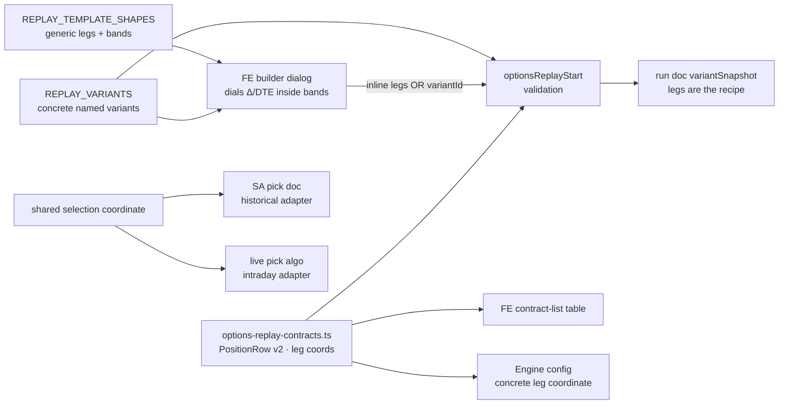

**Topic:** Options Backtest  
**Topic Slug:** options-backtest  
**Thread:** Multi-leg Templates  
**Thread Slug:** multi-leg-templates  
**Issue:** #1485  
**Thread Parent:** #1270  
**Topic Parent:** #1238  
**Domain:** MULTI-LEG-SPREAD  
**Type:** IMPL  
**Status:** Draft  
**Created:** 2026-11-14  
**Last Updated:** 2026-11-14  

# Implementation Plan — SHARED: Multi-leg Templates

## Architecture Overview

Shared contracts for the unified template/variant/instance model: the base-template shape registry, concrete named variants, the normalized position-row schema (v2) persisted under `st-options-*`, the two-form run request contract, and the shared leg-coordinate vocabulary consumed by both historical replay and the live engine's selection paths.



## Modules

### 1. Leg + coordinate contracts (`shared/options-replay-contracts.ts`, extend)

```typescript
/** Concrete option leg — a resolved pick-doc coordinate + direction. */
export interface OptionLeg {
  kind: 'option';
  type: OptionType;                       // 'put' | 'call'
  targetDelta: number;                    // signed, SA convention (-0.20 put)
  dte: number;                            // calendar days, PICK_GRID menu
  side: TradeSide;
}

/** Stock leg — no pick doc; price is the underlying close. */
export interface StockLeg {
  kind: 'stock';
  side: TradeSide;
}

export type VariantLeg = OptionLeg | StockLeg;
```

- `PickDocCoordinate` derivation is mechanical: `OptionLeg` → `{type, targetDelta, expiry:{mode:'nearestDte', dte}}`. Helper `legToPickDocCoordinate(leg: OptionLeg): PickDocCoordinate` keeps the mapping in one place.
- The same `OptionLeg` shape is the **engine's concrete leg coordinate** — `dte` replaces the `dteMin/dteMax` window on pick-doc-driven configs (existing instances are deleted, not migrated, per user decision).

### 2. Base templates (shapes) — `shared/options-replay-templates.ts`, extend

```typescript
/** A leg slot inside a base template — structure + bounds, no values.
    Shipped as a kind-discriminated union (mirrors VariantLeg /
    ManageTemplateLeg): bands are required on option legs and
    unrepresentable on stock legs. */
export interface TemplateShapeOptionLeg {
  kind: 'option';
  role: string;                           // 'short' | 'long' — display + semantics
  type: OptionType;
  side: TradeSide;
  deltaBand: [number, number];            // |delta|% bounds over the 5-step grid
  dteBand: number[];                      // allowed subset of PICK_GRID dtes
}
export interface TemplateShapeStockLeg {
  kind: 'stock';
  role: string;                           // 'stock'
  side: TradeSide;
}
export type TemplateShapeLeg = TemplateShapeOptionLeg | TemplateShapeStockLeg;

export interface TemplateShape {
  id: string;                             // 'put-credit-spread'
  name: string;                           // 'Put credit spread'
  description: string;
  structure: string;                      // 'single' | 'vertical-credit' | 'vertical-debit' |
                                          // 'iron-condor' | 'iron-butterfly' | 'calendar' |
                                          // 'diagonal' | 'straddle' | 'strangle' | 'covered-call' | 'custom'
  legs: readonly TemplateShapeLeg[];
}
```

- Seed catalog per the thread catalog doc: short put, long call, long put, short call; put/call credit + debit verticals; iron condor, iron butterfly; call/put calendar, call/put diagonal; long straddle, long strangle, short strangle; covered call.
- Bands constrain the FE controls only — the BE validates the *concrete* legs, not band membership (bands are authoring guidance; a pasted variant with out-of-band values still validates if on-grid).
- Credit/debit character is derived from leg sides + delta ordering (verticals) or expiry ordering (calendars/diagonals) — no strikes in shapes; selection resolves contracts at run time.

### 3. Named variants — same file

```typescript
/** A concrete, named, reusable configuration. legs are the recipe; id/name are labels. */
export interface ReplayVariant {
  id: string;                             // 'csp-45-20'
  name: string;                           // '45DTE 20Δ put (CSP)'
  description: string;
  structure?: string;                     // which shape it was composed from (or 'custom')
  legs: readonly VariantLeg[];            // concrete — every option leg has Δ/DTE
}
```

- The existing four `ReplayTemplate` entries (`csp-45-20`, `csp-30-30`, `lc-30-20`, `lc-45-15`) migrate verbatim into `REPLAY_VARIANTS` as 1-leg variants — `variantId` keeps working for them (backward compat).
- Registry stays code-curated: the FE builder emits paste-ready JSON; persistence = paste + deploy. No Firestore collection.
- `getReplayVariant(id)` + `getTemplateShape(id)` accessors; `getReplayTemplate` retained as a delegating shim during migration.

### 4. Registry validator (`shared/options-replay-templates.ts`, pure)

`validateVariantRegistry(): string[]` — returns violations, empty when clean:

- unique ids across shapes and variants
- every option leg on-grid: |Δ| multiple of 5 in [5,95]; `dte` in the 10-value menu
- ≥1 leg; stock legs have no `type`/`dte`/`targetDelta`; option legs have all three
- no duplicate legs within a variant (same type+Δ+DTE+side)

Runs in a shared spec so registry drift fails the test suite, not a live run.

### 5. Position-row schema — v2 (`options-replay-contracts.ts`, breaking)

```typescript
/** Resolved option leg on a position row — entry-day pick fields + coordinate + side. */
export interface PositionOptionLeg extends PickDocDay {
  kind: 'option';
  side: TradeSide;
  coordinate: PickDocCoordinate;
}

export interface PositionStockLeg {
  kind: 'stock';
  side: TradeSide;
  underlyingClose: number;
}

export type PositionLeg = PositionOptionLeg | PositionStockLeg;

export interface ContractListPositionRow {
  kind: 'position';
  entryDate: string;
  legs: readonly PositionLeg[];           // ≥1; single-leg = legs.length === 1
  /** Every leg matches the prior position row's — UI label hint. */
  repeatsPrevious: boolean;
}

export interface PositionLegMiss {
  legIndex: number;
  coordinate: PickDocCoordinate;
  reason?: NoSelectionReason;             // 'miss' | 'gap' | 'out-of-range'
}

export interface ContractListNoSelectionRow {
  kind: 'no-selection';
  entryDate: string;
  reason?: NoSelectionReason;             // roll-up: worst miss across legs
  legMisses: readonly PositionLegMiss[];  // per-leg detail — which coordinate failed
}
```

- **Atomicity:** a position row exists iff every option leg resolved for that day; any leg miss → no-selection row with `legMisses` naming each failing coordinate. Partial positions never exist.
- `ContractListRow = ContractListPositionRow | ContractListNoSelectionRow` — the `pick` kind is retired.
- `PickDocMeta` → `legMetas: PickDocMeta[]` on the list doc (one per option leg, legs[i] ordering).
- `OptionsContractListDoc` gains `schemaVersion: 2`. The v1 shapes keep their own names — `ContractListPickRowV1`, `ContractListNoSelectionRowV1`, `ContractListRowV1`, `OptionsContractListDocV1` (v1 doc's `schemaVersion?: never` pins absence = v1) — so existing readers/writers compile untouched against the legacy row contract until their migration tasks land.
- **Narrowing shim (three surfaces):** `v1PickToPosition(row, coordinate)` per row; `v1RowsToPositionRows(rows, coordinate)` normalizes a sequence — `repeatsPrevious` means "the previous row was a position", so gaps/first rows force `false` even when v1 data claims a repeat, and markers gain `legMisses` naming leg 0's coordinate; `v1ListDocToV2(doc)` does the whole doc (`pickDocMeta` → `legMetas[0]`, `schemaVersion: 2` stamped; throws on a merge-Partial stub — callers gate on status). `positionRepeatsPrevious(prevLegs, legs)` pins the all-legs-match semantic for the v2 writer — option legs on kind + side + `contractId`, stock legs on kind + side; marks/Greeks drift, identity can't. `legMisses` is a non-empty tuple — a failed day always names ≥1 leg.

### 6. Request + run-doc contracts

```typescript
export interface OptionsReplayStartRequest {
  variantId?: string;        // Form 1 — registry lookup
  variantName?: string;      // Form 2 label — display only
  legs?: VariantLeg[];       // Form 2 — inline concrete legs
  symbols: string[];
  startDate: string;
}

/** Stamped on the run doc — self-describing; later registry edits can't rewrite history. */
export interface VariantSnapshot {
  variantId?: string;
  name: string;
  legs: VariantLeg[];
}
```

- Exactly one of `variantId` / `legs` required. `variantId` resolves → snapshot; `legs` validates structurally → snapshot. Worker reads `variantSnapshot` — never consults the registry at run time.
- `OptionsReplayPermutationPayload` shrinks to `{runId, symbol}` — everything else comes off the run doc.

## Decisions

- **Positions are the only pick row** — `legs.length === 1` *is* the single-leg case; no parallel `pick` kind survives. Migration = `schemaVersion` + one narrowing shim, not a permanent fork.
- **Resolution is client-side** — the picker owns band knowledge (it renders the controls), so it composes concrete `legs[]`; the callable boundary takes one concrete schema. No server-side `{templateId, params}` path.
- **Structural validation only at the boundary** — any grid-legal `legs[]` runs; the BE doesn't police whether a combo is a "real" spread.
- **Stock legs resolve trivially** — no pick doc, no miss possible; they contribute `underlyingClose` at entry and the underlying series through life.
- **Named variants stay thin** — paste-back-JSON persistence; usage evidence (inline vs variantId submissions on run docs) precedes any saved-variant store.
- **`repeatsPrevious` = all-legs match** — a per-leg repeat flag is noise for v2; the flag survives because the UI hint survives.
