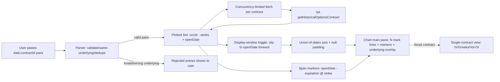

**Topic:** Option Contract Time-Series Viewer  
**Topic Slug:** option-contract-viewer  
**Thread:** Multi-symbol input  
**Thread Slug:** multi-symbol-input  
**Issue:** #1245  
**Thread Parent:** #1244  
**Topic Parent:** #1243  
**Domain:** OPTIONS  
**Type:** PRD  
**Status:** Approved  
**Created:** 2026-10-24  
**Last Updated:** 2026-10-24  

# PRD: Option Chart — Multi-Symbol Input

## Problem Statement

The `/options/chart` page displays exactly one option contract at a time. Comparing the lifecycle behavior of a *group* of contracts — e.g., the strike/expiration ladder produced by a CSP backtest's pick document — requires cycling contracts one at a time with prev/next navigation. There is no way to see many contract mark-price series in relation to each other and to the underlying on a single chart.

Today the user's workaround is copy-pasting contract IDs out of SA pick docs one at a time — useful for inspection, useless for comparison.

## Solution

Extend `/options/chart` so the contract input accepts a **list of `(openDate, contractId)` pairs** — one per line, e.g. `2026-06-15,QQQ260619P00470000` — matching the Contract List row shape (`entryDate → contractId`). Bare OCC IDs (no date) are also accepted. Loading a list renders every contract's mark-price series on the chart's main pane — one line per contract — alongside the existing underlying price overlay. Contracts collect into a **Plotted Set** (see CONTEXT.md): they can be added in batches and removed individually, and clicking a plotted contract returns to the full single-contract view (IV, Greeks, Volume/OI panes) as a drill-down.

Each plotted contract also gets a **position-span marker**: a horizontal line at the contract's strike on the underlying axis, running from its open date to its expiration, with endpoint dots — color-matched to the contract's mark line so the viewer can pair the marker with its series. This is what identifies when each position started and ended, which the overlapping mark lines alone cannot show.

A **display-window toggle** controls whether each series renders its full contract lifetime or is clipped to its position window (open date forward). Many contracts — especially round strikes — accumulate hundreds of pre-entry trading days that are noise for position analysis; clipping hides them. The default is the clipped view when open dates are present.

Multi-contract mode renders the main pane only, with raw mark prices on the primary axis.

All plotted contracts must share the page's underlying symbol — IDs for a different underlying are rejected with a clear message.

## User Stories

1. As an options researcher, I want to paste a list of `(openDate, contractId)` pairs into the chart input so that I can see all their price histories on one chart without loading them one at a time.
   - *Acceptance:* pasting one `YYYY-MM-DD,OCCID` pair per line and loading renders one mark line per contract on the main pane. Bare `OCCID` lines (no date) also load.
2. As an options researcher, I want each contract's line labeled so that I can tell which line is which contract.
   - *Acceptance:* legend/tooltip identifies each series by its OCC ID or a readable strike/expiry/type label.
3. As an options researcher, I want the underlying's close price overlaid so that I can see contract behavior relative to the underlying's movement.
   - *Acceptance:* underlying renders on the opposed Y-axis, matching the series' shared date axis.
4. As an options researcher, I want contracts that don't match the page's underlying symbol rejected so that I don't accidentally chart a cross-underlying mix.
   - *Acceptance:* an ID parsed to a different root symbol is excluded and the user is told which IDs were rejected.
5. As an options researcher, I want to remove individual contracts from the plotted set so that I can declutter the chart without reloading everything.
   - *Acceptance:* removing a contract removes its line, its span marker, and its entry in the plotted set.
6. As an options researcher, I want each contract's raw mark prices on the shared axis so that I can see the actual premium levels it traded at.
   - *Acceptance:* all mark series render at their raw price values on the primary Y-axis; no rebasing or normalization is applied.
7. As an options researcher, I want contracts with different date ranges to align on the same axis so that expired/younger contracts line up by calendar date, not by index.
   - *Acceptance:* the X-axis is the union of all plotted contracts' dates; a contract with no observation on a given date shows a gap, not an interpolated or shifted point.
8. As an options researcher, I want clicking a plotted contract to open the full single-contract view so that I can drill into its IV/Greeks/Volume panes.
   - *Acceptance:* selecting a contract restores the existing single-contract chart for that contract.
9. As an options researcher, I want partial failures handled so that one bad ID doesn't sink the whole list.
   - *Acceptance:* contracts that fail to fetch are reported and skipped; successful ones still render.
10. As an options researcher, I want progress feedback while many contracts load so that I know the page hasn't hung.
    - *Acceptance:* a progress indicator shows loaded/total while fetches are in flight.
11. As an options researcher, I want existing single-contract behavior preserved so that nothing about the current page regresses.
    - *Acceptance:* a single ID loads exactly as today — all panes, catalog, prev/next nav intact.
12. As an options researcher, I want each contract to show a strike-level span marker from its open date to expiration so that I can see when each position started and ended on a crowded chart.
    - *Acceptance:* a horizontal line at the contract's strike on the underlying axis runs from the supplied open date to the contract's expiration, with a dot at each end.
13. As an options researcher, I want each span marker color-matched to its contract's mark line so that I can tell which marker belongs to which series.
    - *Acceptance:* marker and mark line share the same series color; the pairing survives N contracts via palette cycling.
13a. As an options researcher, I want hovering a contract's chip or its series line to emphasize that contract and dim the rest so that I can trace one contract through a crowded chart.
    - *Acceptance:* hovering a plotted-set chip or its chart series dims all other series (and markers) and visually emphasizes the hovered chip; moving off restores all series.
14. As an options researcher, I want contracts pasted without an open date to still render sensibly so that ad-hoc ID lists keep working.
    - *Acceptance:* a bare `OCCID` entry renders its span marker from first observation to expiration.
15. As an options researcher, I want the same contract picked on consecutive days deduplicated so that a repeated pick doesn't render a duplicate series.
    - *Acceptance:* two entries sharing a `contractId` produce one mark series; the marker uses the earliest supplied open date.
16. As an options researcher, I want to toggle between each contract's full lifetime series and a view clipped to its position window so that hundreds of pre-entry observations don't bury the data I care about.
    - *Acceptance:* clipped mode (default when open dates are present) renders each series from its open date forward; full mode renders the complete fetched series. Contracts with no open date show their full series in both modes. The span marker is identical in both modes.

## Implementation Decisions

- **Plotted Set state.** The options contract viewer store holds a `Map<occId, { series: ParsedObservation[]; openDate: string | null }>` (or equivalent keyed structure) of loaded contracts rather than a single contract slot. Existing single-contract fields (focused contract, catalog navigation) remain unchanged.
- **Input shape.** Entries are `(openDate, contractId)` pairs — one per line, date first — matching the Contract List row shape so a future feeder hands rows through unchanged. A bare `OCCID` line is a valid entry with no open date. Commas and whitespace separate the fields.
- **Input parsing.** Tokens are uppercased and validated as OCC IDs (and ISO dates where present). Invalid tokens and wrong-underlying IDs are rejected and surfaced to the user (not silently dropped). Duplicate `contractId`s merge into a single plotted entry keeping the earliest supplied open date.
- **Same-underlying enforcement.** Each parsed ID's root symbol must equal the page's symbol field. Rejected IDs are reported; valid ones still load.
- **Union-of-dates axis.** The chart builds the union of all plotted contracts' observation dates as the category axis (the same pattern `SpreadChartComponent` uses for spreads). Each series is normalized onto that axis with null placeholders for missing dates — empty points render as gaps.
- **Multi-series rendering.** The options contract chart renders one mark line per plotted contract on the main pane, plus the underlying overlay on its opposed axis. The IV, Greeks, and Volume/OI panes render only in single-contract (focused) mode.
- **Position-span markers.** Per contract, a horizontal line at its strike on the underlying axis, drawn from `openDate` (supplied, or first observation when absent) to the contract's expiration (parsed from the OCC ID), with a dot at each end. Pure client-side derivation — strike and expiration come from the parsed OCC ID, nothing is persisted. Marker color matches the contract's mark line. The feature lands on the single-contract chart first, then applies identically per contract in multi mode.
- **Display-window toggle.** Each contract with an `openDate` can render clipped (observations ≥ openDate only) or full (entire fetched series); contracts without an open date are unaffected by the mode. Clipped is the default when any open dates are present. The union-of-dates axis is built over *rendered* dates, so clipped mode shrinks the axis to the union of position windows. Full series are still fetched — clipping is a render filter, not a fetch parameter (keeps the full lifetime available for drill-down without refetching).
- **Scale.** Raw mark prices only — no normalization or rebasing in this thread. A normalized (rebased-to-100) mode is deferred; the spread chart's `absolute | normalized` toggle is the prior art when it lands.
- **Fetch pattern.** One `getHistoricalOptionsContract` call per contract, concurrency-limited, with a loaded/total progress indicator. Per-contract failures are tolerated and reported; the plotted set shows what loaded.
- **Connected hover.** A hovered-contract signal (set from the plotted-set chips, series lines, or legend) recomputes series opacity — non-hovered series and markers dim, the hovered contract stands out. Driven through our own computed series config rather than Syncfusion's highlight APIs.
- **Load limits.** No workflow cap — but a soft warning past ~50 contracts (visual mush beyond that is the user's call) and fetch concurrency is bounded to avoid flooding the callable.
- **Legend/tooltip.** Series are labeled by contract (readable label preferred over raw OCC ID where available). Legend may collapse or scroll at high contract counts; shared tooltip shows each series' value at the hovered date.
- **Deferred machinery.** No URL/query-param transport and no cross-page router-state handoff in this thread — those arrive with the Contract List feeder thread.

## Testing Decisions

- **Seams:** highest-value seam is the store + service boundary (mock the contract service, drive `loadPlottedContracts`, assert plotted-set state) — matching the existing `options-contract-viewer.store` spec pattern. Pure functions get unit tests.
- **Pure functions to unit-test:** `(date, contractId)` pair parser (delimiters, casing, invalid tokens, wrong-underlying rejection, dedupe keeping earliest open date); union-of-dates + null-padding mapper (multiple contracts with disjoint/overlapping ranges); open-date clip filter; span-marker derivation (open→expiration @ strike).
- **Prior art:** `spread-viewer.store.spec.ts`, `options-contract-viewer.store` specs, and the spread chart's seriesData/underlyingSeries mapping logic.
- **A good test** asserts external behavior (state after load, mapped series shape, rejection reporting) — not fetch call counts or internal data structures.

## Technical Context

- Each plotted contract costs one `getHistoricalOptionsContract` callable fetch — a list of N contracts is N fetches, concurrency-limited. There is no batch contract endpoint; load time scales linearly with list size.
- Contract series are daily observations; sparse or gap-laden contracts (the SA coverage issue ADR-002 was built to validate) will show as broken lines — expected, not a rendering bug.
- Date coverage differs per contract (different listing/expiration windows); the union axis means the chart's date range is the earliest-listed through latest-expiring contract in the set.

## Out of Scope

- Catalog multi-select / "chart selected" affordance on the catalog table
- Contract List → chart handoff from the backtest surface, router-state transport, `?contracts=` links
- Cadence/event-based subset selection ("every Wednesday's pick", swing-timed entries)
- Cross-underlying plotting
- IV/Greeks/Volume-OI panes in multi mode
- Normalized / rebased-to-100 display mode (deferred to a later thread)
- Reading pick documents directly
- Multi-leg spreads (the spread viewer already covers this)
- Log-scale Y axis

## Further Notes

This thread is the first deliverable under Topic #1243 and realizes the follow-on ADR-002 explicitly deferred: *"Multi-contract overlay (multiple marks on the main pane, per-contract toggles in lower panes) is a follow-on."* Per-contract lower-pane toggles remain available to a later thread if focused-mode drill-down proves insufficient.

**Future work — normalized display mode:** a rebased-to-100 view where every series starts on a flat line at its entry, enabling relative-performance comparison across contracts at very different price levels. The spread chart's `absolute | normalized` toggle is the prior art. In clipped display-window mode, rebasing should occur at each contract's open date (first *rendered* observation), not first fetched.

## System Context

