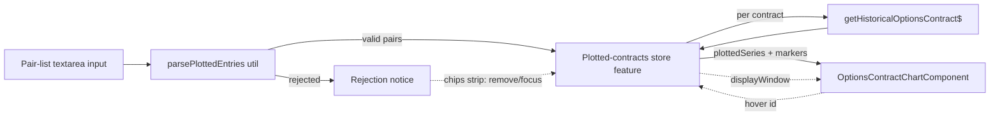

**Topic:** Option Contract Time-Series Viewer  
**Topic Slug:** option-contract-viewer  
**Thread:** Multi-symbol input  
**Thread Slug:** multi-symbol-input  
**Issue:** #1246  
**Thread Parent:** #1244  
**Topic Parent:** #1243  
**Domain:** OPTIONS  
**Type:** IMPL  
**Status:** Draft  
**Created:** 2026-10-24  
**Last Updated:** 2026-10-24  

# Implementation Plan — FE: Multi-symbol input

## Architecture Overview

One new store slice + refactored chart inputs on the existing `/options/chart` page. No backend work — contracts fetch through the existing `getHistoricalOptionsContract$` callable, one call per contract, concurrency-limited client-side.



## Modules

### 1. Pair parser util (`savant-trader/utils/`)

`parsePlottedEntries(text, symbol) → { entries: PlottedEntry[]; rejected: RejectedEntry[] }`

- One entry per line: `YYYY-MM-DD,OCCID` (comma or whitespace separator), or bare `OCCID`.
- Tokens trimmed + uppercased; `parseOccContractId` validates the contract side; ISO-8601 date validated where present.
- Rejection reasons: `invalid-contract`, `invalid-date`, `wrong-underlying` (parsed root ≠ page symbol).
- Dedupe by `contractId` — earliest supplied `openDate` wins; duplicates aren't rejections, they're merges.
- `PlottedEntry { contractId: string; openDate: string | null }` — shared type; lives in `shared/options-contract-contracts.ts` so the future Contract List feeder consumes the same shape.

### 2. Plotted-contracts store feature (`stores/`)

New `withPlottedContracts` custom signal-store feature (same pattern as `contract-catalog-feature.ts`'s `withCatalogMethods`), composed into `OptionsContractViewerStore`.

State:

```typescript
plottedContracts: Record<string, {      // keyed by OCC id (Record not Map — patchState works on plain objects)
  entry: { contractId: string; openDate: string | null };
  parsed: ParsedOccContractId;          // symbol/expiration/type/strike from OCC ID
  status: 'loading' | 'loaded' | 'error';
  data: PartnerHistoricalOptionsContractV2Response | null;  // full fetched lifetime (parsed by renderedSeries)
  error: string | null;
}>
plottedLoadProgress: { done: number; total: number } | null
displayWindow: 'position' | 'lifetime'   // clipped-to-entry vs full series
hoveredContractId: string | null
```

Methods: `loadPlotted(entries)` (concurrency-limited loop over `getHistoricalOptionsContract$`, per-contract failure tolerance, progress updates), `removePlotted(id)`, `clearPlotted()`, `setDisplayWindow(mode)`, `setHoveredContract(id)`, `focusPlotted(id)` (loads that contract into the existing single-contract path for the full-pane drill-down).

Computed:

- `isMultiMode` = non-error count ≥ 2 (counts `loading` so the mode doesn't flicker while fetches are in flight)
- `renderedSeries` = per contract, `series` filtered to `date >= openDate` when `displayWindow === 'position'` and `openDate` present
- `allDates` = union of *rendered* dates (plus each contract's marker span endpoints `openDate`/`expiration`, so markers align to categories even when they fall between observations)

Existing single-contract state (focused contract, catalog, prev/next nav) is untouched — the plotted set is additive.

### 3. Chart component (`options-contract-chart`)

Input changes: `observations`/`xLabels` replaced by `plottedSeries: PlottedChartContract[]` (`{ contractId, label, strike, expiration, openDate, points }[]`) — a 1-element array is today's single-contract case.

- **Main pane** switches from declarative `<e-series>` to a computed `[series]` collection (spread-chart pattern): one mark line per contract + one underlying overlay on the opposed axis.
- **Span markers**: per contract, a 2-point line `{openDate|firstObs, strike} → {expiration, strike}` on the underlying axis with endpoint markers, color-matched to its mark line (shared palette index). Legend entry suppressed for marker series.
- **Lower panes** (IV/Greeks/Vol-OI) render only when `plottedSeries.length === 1` — bound to that contract's observations; hidden in multi mode.
- **Union axis** feeds `xLabels`; existing viewport-snapping (`axisRanges`, `visibleExtents`) generalizes to min/max across all rendered mark series.
- **Connected hover**: `hoveredContractId` input + `hover` output; non-hovered series/markers render at reduced opacity (~0.2) when a hover is active.
- **Marker dates in axis**: `openDate`/`expiration` are included in the category union so marker endpoints land on real categories.

### 4. Page component (`option-chart`)

- OCC input becomes a small multiline `matInput` textarea; still accepts a single ID (preserves current behavior: single load → full pane view).
- Load parses the pasted list → `loadPlotted(entries)`; rejections surface as a notice listing rejected tokens + reasons.
- **Chips strip** above the chart: one chip per plotted contract — color swatch (matching series palette), readable label (strike/expiry/type), × remove, click → `focusPlotted(id)`. `mouseenter/mouseleave` → `setHoveredContract`.
- **Display-window toggle** (`position | lifetime`) shown in multi mode; defaults to `position` when any open dates are present.
- **Progress**: `loaded / total` indicator during fetch; soft warning when list > ~50 contracts (loads anyway on confirm).

## Key Decisions (from planning)

- One component extended, not a second chart — N series is a rendering detail, not a new component's worth of plumbing.
- Clip is a **render filter**, not a fetch filter — full series stay in the store so drill-down doesn't refetch.
- Marker dates join the axis union (openDate may not be an observation date).
- No BE work; no Firestore persistence; no URL transport (deferred).
- Same-underlying enforced at parse time against the page symbol.

## Sequencing

1. Parser util + `PlottedEntry` type (foundation, independently testable)
2. `withPlottedContracts` store feature (load/dedupe/progress/window state)
3. Chart: multi-series main pane + union axis + markers + clip + hover
4. Page: textarea input, rejection notice, chips strip, toggle, progress

## Risks

- **Chart input refactor regression** — `observations` → `plottedSeries` touches every pane binding; mitigated by keeping the 1-element-array shape identical to today's data and gating panes on count.
- **Axis union with markers** — marker dates that aren't observation dates must join the union or endpoints misalign; covered by `allDates` construction.
- **N-contract fetch cost** — ~6 concurrent callable calls, linear in list size; progress indicator covers perceived latency.
