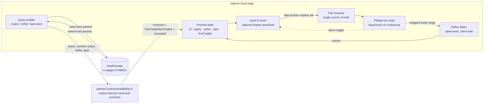

**Topic:** Option Contract Time-Series Viewer  
**Topic Slug:** option-contract-viewer  
**Thread:** OCC Contract String Group Generator  
**Thread Slug:** occ-string-generator  
**Issue:** #1326  
**Thread Parent:** #1325  
**Topic Parent:** #1243  
**Domain:** OPTIONS  
**Type:** PRD  
**Status:** Approved  
**Created:** 2026-10-28  
**Last Updated:** 2026-10-28  

# PRD: OCC Contract String Group Generator

## Problem Statement

Comparing option-contract price behavior across parameter permutations —
strike ladders, expiration months, calls vs. puts — currently means
hand-writing OCC IDs into the pair textarea (as was done repeatedly during
this Topic's UAT: manually constructing `QQQ260515C00540000`–`650000`,
`QQQ260417C00…` lists). Hand-writing is slow, error-prone, and cannot express
data-dependent filters like "only contracts whose first traded date is on or
before March 1" — which can only be guessed at until the chart reveals each
contract's first observation.

The user needs a way to generate large groups of real, canonical OCC contract
IDs from parameters, scoped to the current symbol, preview them before
committing, and send them to the plotted-set chart in one action.

## Solution

A right-side drawer on `/options/chart` — a second `mat-sidenav` in side mode
mirroring the existing left controls panel — containing:

1. **A query builder** for the generation axes: expiration range or explicit
   expirations, strike range + step, call/put/both, scoped to the page's
   current symbol.
2. **A preview table** of the contracts a canonical backend endpoint returns —
   rendered as columns (OCC ID, expiry, strike, type, first traded), not raw
   strings — so the set is inspected before it loads.
3. **Client-side refine filters** — a second, optional set of the same axes
   applied to the returned list — so a coarse over-fetch can be narrowed
   without re-querying. Includes an **"alive across range"** bound: contracts
   must have `firstTraded ≤ rangeStart` and `lastTraded ≥ rangeEnd`.
4. **Chart drag-range study window** — instead of date pickers, the user
   click-drags a range on the chart (over the already-loaded underlying
   series, so the window is chosen against real price action). The dragged
   range feeds the alive-across-range refine filter, and an opt-in toggle
   copies the range's left edge into the open-date field — which always
   remains independently editable.
5. **A send action** with one optional shared position open date, which
4. **A send action** with one optional shared position open date, which
   formats the surviving rows as `date,id` (or bare `id`) lines and replaces
   the current plotted set through the existing `loadPlotted` path, keeping
   the textarea in sync as the single source of truth.
6. **Per-symbol persistence** of the drawer's parameter state in
   `localStorage` (`rs-optgen:{SYMBOL}`, versioned blob per the
   `sandbox-settings.ts` pattern), so reopening the drawer for a symbol
   restores the last query.

The canonical contract data comes from a new backend endpoint (built
externally by SA) derived from actual corpus CSVs and contract time-series
docs — the endpoint returns only contracts that genuinely have data, and each
record carries `firstTraded`/`lastTraded` so client-side date filtering works
without server changes.

## System Context

## User Stories

1. As a trader, I want a drawer that opens from the right edge of
   `/options/chart`, so that I can build contract groups without leaving the
   chart. **Verify:** a toggle opens a right-side panel that pushes the chart
   narrower; the chart re-fits automatically (existing ResizeObserver path);
   closing restores full width.

2. As a trader, I want to specify a strike range and step for the current
   symbol, so that I can generate strike ladders like 540–650 by $10 without
   writing each ID. **Verify:** entering from/to/step yields a preview
   containing exactly the expected strike series.

3. As a trader, I want to select expirations by a date range or an explicit
   list, so that I can span one month or several. **Verify:** an expiry range
   returns only contracts inside it; explicit dates return only those dates.

4. As a trader, I want to choose calls, puts, or both, so that the generated
   set matches the strategy shape. **Verify:** the type selector filters the
   preview correctly for all three values.

5. As a trader, I want the preview to show expiry, strike, type, and first
   traded date per contract, so that I can sanity-check the set at a glance
   rather than decoding OCC strings. **Verify:** preview rows render
   structured columns, not raw ID text.

6. As a trader, I want the endpoint to return only contracts that actually
   have time-series data, so that no generated row loads as an error chip.
   **Verify:** every previewed contract resolves to a plotted mark line (any
   failure is an endpoint corpus gap, flagged to SA — not silent).

7. As a trader, I want to narrow the returned list client-side by the same
   axes (strike, expiry, type, first-traded bound), so that an uncertain or
   coarse backend response can be trimmed without another query. **Verify:**
   applying a refine bound removes non-matching rows from the preview
   instantly with no network call.

8. As a trader, I want to filter displayed contracts by a first-traded-date
   bound, so that "first traded on or before March 1" selections — previously
   unguessable — are exact. **Verify:** setting a bound drops contracts whose
   `firstTraded` exceeds it.

9. As a trader, I want to optionally supply one shared position open date
   applied to every row at send time, so that span markers anchor to the
   strategy date. **Verify:** sending with a date produces `date,id` lines;
   every span marker's left endpoint sits on that date.

10. As a trader, I want sending to replace the current plotted set, so that
    the chart always reflects exactly the previewed set. **Verify:** contracts
    absent from the sent set disappear from chips and chart; surviving
    contracts keep loaded data (no refetch) per `loadPlotted` replace
    semantics.

11. As a trader, I want the generated lines written into the pair textarea on
    send, so that the input box always shows what is plotted and remains
    hand-editable. **Verify:** after send, the textarea contains exactly the
    sent lines in the pair format.

12. As a trader, I want my drawer parameters restored when I reopen it for
    the same symbol, so that iterating on a query doesn't mean re-entering
    every axis. **Verify:** change params, close/reopen the drawer (or reload
    the page) — the last state returns for that symbol only.

13. As a trader, I want each symbol's drawer state kept separate, so that
    QQQ's config doesn't leak into SPY's. **Verify:** configuring under one
    symbol and switching symbols shows that symbol's own saved (or default)
    state.

14. As a trader, I want a warning when the endpoint reports a truncated
    result, so that I know the preview is incomplete rather than silently
    partial. **Verify:** a truncated response shows a visible notice with the
    returned count.

15. As a trader, I want to drag a date range directly on the chart over the
    underlying price, so that I can pick a study window by eye against real
    price action instead of typing dates. **Verify:** click-drag on the chart
    selects an inclusive date window; the surviving preview contains only
    contracts with `firstTraded ≤ rangeStart` and `lastTraded ≥ rangeEnd`.

16. As a trader, I want the dragged range to optionally fill the shared open
    date with its left edge, so that span markers can anchor to the study
    window — while still letting me set the open date independently.
    **Verify:** with the toggle on, the open-date field shows the range's
    left edge and still accepts manual edits; with it off, the range only
    refines the preview and the open date is unaffected.

17. As a trader, I want clear loading, error, and empty states in the drawer,
    so that a slow or failed query is distinguishable from an empty result.
    **Verify:** pending shows progress; endpoint failure shows an error with
    retry; zero contracts shows an explicit empty message.

## Implementation Decisions

- **Form factor:** second `mat-sidenav`, `position="end"`, side mode —
  structural sibling of the existing left controls panel. Chart re-fit is
  free via the `ResizeObserver` + `chart.refresh()` path added under #1321.
- **Endpoint contract (confirmed by SA):**
  `GET /partnerContractAvailabilityV1` with `symbol` (required,
  options-enabled), `expirationGte`/`expirationLte`, `expirations`
  (comma-separated explicit list, **overrides** the range), `strikeGte`/
  `strikeLte`/`strikeStep` (exact-multiple within bounds), `type`
  (`C|P|call|put`, case-insensitive, omitted = both), and
  `firstObservedGte`/`firstObservedLte` (server-side first-observation
  bounds — the FE maps its "first traded" vocabulary onto these).
  Response: `{ ok, symbol, count, truncated, contracts: [{ contractId
  (OCC), expiration, strike, type ("call"|"put"), firstObserved(+Dow),
  lastObserved(+Dow), observationCount, expectedObservationCount,
  contractLengthDays, contractLengthBucket, latest{mark,iv,delta,volume,
  openInterest}, latestDelta, latestIv }], corpusDates[], corpusDateCount }`.
  `truncated` at 2000 contracts, deterministic sort (expiration → strike →
  contractId). Errors: `{ ok:false, error, code }` — 400 invalid/inverted
  ranges, 401 bad token, 403 not allowlisted, 404 symbol not
  options-enabled, 405 non-GET.
- **Field-name mapping:** FE domain vocabulary stays `firstTraded`/
  `lastTraded`; the service maps to `firstObserved`/`lastObserved` at the
  boundary. `contractId` is already OCC-format.
- **`corpusDates` reuse:** the symbol-level corpus date list is the brush's
  valid drag domain and the chart's valid x-axis domain — the drag-range
  snaps to it.
- **Date filtering is dual-path:** the query builder may pass
  `firstObservedGte`/`firstObservedLte` server-side (coarse narrowing at the
  source); the refine section and drag-brush always filter client-side on
  the returned `firstObserved`/`lastObserved` fields.
- **Preview model:** the drawer's working set is the endpoint's contract
  records; refine filters operate on record fields, not string parsing.
- **Study-range brush:** drag-selection on the chart emits an inclusive
  `{start, end}` date pair — implemented as Syncfusion drag-X selection or a
  custom overlay, decided at blueprint. The range always applies as an
  alive-across-range refine bound (`firstTraded ≤ start`, `lastTraded ≥ end`)
  and optionally feeds the open-date field via an explicit toggle; the
  open-date field stays independently editable either way.
- **Send semantics:** replace, identical to `loadPlotted`'s authoritative
  model — the sent lines become the textarea content verbatim, then load
  through the existing path (no second entry point into the store).
- **Persistence:** versioned localStorage blob per symbol
  (`rs-optgen:{SYMBOL}`), the `sandbox-settings.ts` pattern — wrapped
  storage access, version field for future migrations. Persists parameter
  state only; generated lists are never persisted (regenerable).
- **Seam for testing:** the endpoint call sits behind an injectable service
  (same shape as the existing chart data service), so specs stub the
  contract list; refine/emit logic is a pure function over records.

## Testing Decisions

- Pure-function specs for: query-param assembly, refine filtering
  (boundary-inclusive date/strike comparisons), `date,id` line emission,
  per-symbol persistence blob round-trip + version migration.
- Drawer/page specs: open/close, preview render, send → textarea + store,
  truncated warning, error/empty/loading states.
- The endpoint itself is out of scope for FE tests — the service seam is
  stubbed.

## Technical Context

- **External dependency:** the SA endpoint contract is confirmed (above)
  and under construction. Auth is a Google OIDC ID token for an
  allowlisted service account — ST must confirm its SA email(s) are on the
  allowlist (same posture as `partnerContractCatalogV2`). Until the
  endpoint is live, the drawer develops against a stubbed service
  returning fixture contracts — ship gating on the real endpoint is a QA
  decision.
- **Expired contracts:** included when they have data — an `expirationLte`
  default (e.g., bounded at today) is a drawer-level choice, not assumed.
- **Result size:** hard cap of 2000 contracts (`truncated: true`,
  deterministic sort); the UI warns to narrow filters rather than
  paginate.
- **`latestDelta`/`latestIv`:** returned per contract — enough for a
  preview column or a *latest*-delta refine later; delta-*at-date*
  selection still needs endpoint v2.
- **Persistence scope:** localStorage is per-browser — config does not roam
  across devices (accepted for v1).

## Deferred (out of scope for v1)

- Per-row selection / per-row open dates in the preview list.
- Multiple distinct start dates applied within one send.
- Delta-band (at a historical date), DTE-relative, or
  underlying-price-relative generation axes. `latestDelta`/`latestIv` are
  already in the response, so a *latest*-delta refine or preview column is
  cheap if wanted — delta-*at-date* remains an endpoint v2 ask (flagged to
  SA).
- Freeform exclude rules / query-language narrowing.
- Named presets (multiple saved configs per symbol), Firestore persistence,
  config sharing across devices.
- Append/merge send mode.
- Catalog-aware validation beyond what the canonical endpoint already
  guarantees.
