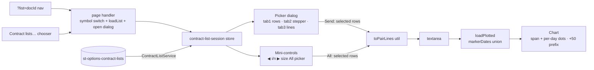

**Topic:** Option Contract Time-Series Viewer  
**Topic Slug:** option-contract-viewer  
**Thread:** Selected Contract List Picker  
**Thread Slug:** contract-list-picker  
**Issue:** #1358  
**Thread Parent:** #1352  
**Topic Parent:** #1243  
**Domain:** OPTIONS  
**Type:** IMPL  
**Area:** FE  
**Status:** Draft  
**Created:** 2026-11-01  
**Last Updated:** 2026-11-05  

# Implementation Plan — FE: Selected Contract List Picker

## Architecture

A **contract-list session** — a page-scoped signal store
(`contract-list-session`) holding `activeList` (listId + symbol +
templateId + `ContractListRow[]` + `pickDocMeta`), `selection`
(`Set<rowKey>`, rowKey = `entryDate`), `chunkCursor`, `chunkSize`, and
`status`. Source-agnostic: replay list docs are the first source; pick-doc
lists slot in later behind the same `ListSource` seam. The store is
*dedicated* — NOT an extension of `option-group-generator` (different
data lifecycle: doc-derived vs query-derived); the two share only the
emit-to-textarea util.

Three surfaces drive the same session: the **picker dialog** (full
editor), the **chart mini-controls** (dumb strip calling identical store
methods), and the **`?list=` navigation handler** (auto-opens the
dialog). Session persists per symbol (`rs-optlist:{SYMBOL}` versioned
blob — `{docId, chunkSize, cursor, selectionKeys}`), mirroring the
`rs-optgen` pattern.

## Task FE-1 — Marker model + decoupled underlying window

**`plotted-contracts-feature.ts` / pair parsing:**
- `PlottedContract.entry` gains `markerDates: string[]` — additive;
  `openDate` remains the derived `min(markerDates)` invariant (grilled:
  additive, not `pickDates[]` replacement).
- `loadPlotted` fold: each `date,id` line contributes its date to the
  contract's `markerDates` union instead of only competing for earliest
  `openDate`. Single-dated entries behave exactly as today
  (`markerDates = [openDate]`); bare `id` lines → `markerDates = []`
  (no markers, unchanged).
- `allDates` computed unions marker endpoints the same way (endpoints =
  every markerDate + expiration — same rule, wider set).

**`options-contract-chart-series.builder.ts`:**
- `SpanMarker` gains `pickDates: string[]` (replaces `start` semantics —
  `start = pickDates[0]`).
- The marker series `dataSource` becomes vertices at **each pick date +
  expiration**, all at `strike` — one Line series renders the span
  (earliest→expiration) *and* a dot per pick day: the dash between
  consecutive dots IS the horizontal line at strike, so a single series
  carries both. No stacked lines.
- `unionAxisLabels` unions all pick dates (not just start/end).

**Decoupled underlying window** (user requirement — underlying data
management is independent of contract series):
- `underlyingWindow: {from,to} | null` — explicit store state set by load
  paths, never re-derived from contract data after the fact.
- Axis domain (`allDates`/xLabels) unions **underlying bar dates**
  alongside rendered dates + marker endpoints — the underlying
  contributes to the domain, so contract-side clipping cannot erase its
  dates from the axis. THIS fixes the observed bug: clip
  (`displayWindow='position'`) filters contract points only; with
  underlying dates in the domain, the axis no longer shrinks to the
  clipped contracts.
- Clip never touches `underlyingBars` or `underlyingWindow`.
- `addPadDays` keeps deliberately widening the window (that is the pad
  button's purpose); `resetPadDays` restores the set-window baseline.
- **+50-session prefix:** on a load carrying marker dates, window =
  `[earliestMarkerDate − ~70 calendar days, latestUnderlyingDate]` —
  ~70 calendar ≈ 50 trading sessions (recorded approximation; exact
  session-count anchoring can use `corpusDates` when a session is
  active). Applied in `loadPlotted` when any entry has dates; bare-id
  loads leave the window unchanged.

## Task FE-2 — Session plumbing + chooser

**`services/contract-list.service.ts`** — injectable seam:
- `getList$(docId): Observable<OptionsContractListUi>` — Firestore doc
  read (rules already allow authed read; reuse the
  `options-replay-firestore-converter` shape or its util if importable
  across feature dirs — otherwise a thin local converter).
- `recentLists$(limit = 50): Observable<OptionsContractListUi[]>` —
  `st-options-contract-lists` root collection, `orderBy generatedAt
  desc`; single-field orderBy needs no composite index. Filtered
  client-side by symbol in the chooser.
- `status === 'success'` only — pending/failed docs excluded (a missing
  `pickDocMeta` is not a usable list).

**`stores/contract-list-session.store.ts`** — page-provided signalStore:
- State: `activeList`, `selection: Set<string>` (rowKey = entryDate —
  unique per row, survives sorts), `chunkSize` (default 10),
  `chunkCursor` (index), `status`, `error`.
- Methods: `loadList(docId)` (fetch → rows → EMPTY selection →
  cursor 0 — a fresh workspace, nothing pre-checked; restored sessions
  keep their saved keys), `selectAll/none/invert/stride(k)/random(n)/dateRange(from,to)
  /contains(text)` (ops over pick rows only; `no-selection` rows are
  unselectable), `step(dir)` / `setChunk(i)` / `setChunkSize(n)`,
  `addChunkToSelection()` / `removeChunkFromSelection()` /
  `toggleChunkAt(i)` (chunk tri-state toggle + cursor jump, one atomic
  patch), `sendSelected()` / `sendAll()` — both produce `string[]`
  `entryDate,id` lines → emit util.
- Computed: `pickRows` (rows filtered to kind='pick'),
  `selectedRows`, `uniqueCount` (distinct contractIds in selection),
  `chunks` (partition by pick days), `currentChunk`, `chunkInfo`
  (`i/n · days · unique`), `emittedLines` (preview = send payload).
- Persistence: `rs-optlist:{SYMBOL}` versioned blob
  `{version, docId, chunkSize, cursor, selectionKeys}` — save on mutation;
  restore on symbol set (same swap hook the generator uses).

**Shared emit util** (`utils/contract-list-emit.util.ts`):
- `toPairLines(rows: ContractListPickRow[]): string` — `entryDate,id`
  lines, duplicates preserved, ordered by entryDate then contractId.
- `rowsToPlottedEntries(rows)` → `PlottedEntry[]` for `loadPlotted`.
- Replaces ad-hoc emission; the generator drawer's `toPairLines` can
  delegate later (not this task's refactor).

**Page wiring (`option-chart.component`):**
- `?list={docId}` query param → `listService.getList$` → if doc.symbol ≠
  page symbol, `onSymbolChange` first → `session.loadList` → open picker
  dialog. Missing/failed doc → named error state, no chart mutation.
- "Contract lists…" button → chooser dialog: recent docs, flat list
  (template name · symbol · run date · picks · date range), sorted symbol
  asc then `generatedAt` desc, default-filtered to current symbol with an
  in-dialog `All symbols` toggle. Select → same handler as `?list=`.

## Task FE-3 — Picker dialog (tab 1 rows + tab 3 lines)

**`components/contract-list-picker/` standalone `mat-dialog`**
(~85vw × 85vh, modal v1):
- Header: list provenance — template name · symbol · run date ·
  `N picks · M misses · first→last · grid vK` (from `pickDocMeta`).
- **Tab 1 — rows:** table with per-row checkbox; columns = ☐ · entryDate
  · contractId · strike · expiry(+Dow) · Δ · IV · mark · underlyingClose
  · `⇄ repeat` badge on `repeatsPrevious` rows. `no-selection` rows
  render disabled/greyed with reason label — visible, unselectable.
  Toolbar: `all · none · invert · stride k ▾(days) · random N ·
  date-range · text filter`. Readout: `N rows selected → M unique
  contracts` — live on every change.
- **Tab 3 — lines preview:** monospace read-only block = emitted lines
  for current selection (same payload Send produces, duplicates
  included) + Copy button.
- **Footer:** `Send N rows to chart` — emits via session store → textarea
  + `loadPlotted`; dialog stays open (stepping live-drives too —
  consistent control surface; close is user-initiated).

## Task FE-4 — Stepper + timeline + mini-controls

**Tab 2 — chunk stepper + timeline:**
- Chunks = sequential groups of X pick **days** (row-count partition —
  marched through time; unique-contract count varies, shown per chunk:
  `chunk i/n · 10 days · 7 unique`).
- Stepping `◀ ▶` moves the cursor — **navigation only, no emit** (see
  Sync model below). "Add chunk to selection" unions its days into the
  persistent selection.
- Timeline strip: horizontal date domain (firstDate→lastDate), one tick
  per pick day, current chunk's span highlighted; custom div/SVG strip
  (no Syncfusion dependency — it's a selector, not a chart).
- Timeline selection shading + chunk-toggle (#1420): ticks carry a
  `selected` class when their day ∈ `selection` (solid accent — accent
  is reserved for checked state only). The cursor is a FILLED mint
  band (#00ff9d, the ds-accents 'mint' id — off the accent family, so
  viewing ≠ selected can never blur; a mint app accent is a documented
  collision, not a broken one).
  A tick click = `toggleChunkAt(chunkIdx)` — tri-state chunk toggle
  (full → clear; partial/empty → fill) and the cursor jump in ONE
  patch+persist (the saved blob can't hold a new selection under a
  stale cursor); nothing emits. Chunk-granular by UAT
  decision: every click is a visible ~N-day change; day-level edits
  stay on the Rows tab. `aria-pressed` reports the chunk's fully-
  selected state (the toggle's target), `.selected` shades per-day.
- Fresh loads open with an EMPTY selection (#1420 UAT): the picker is
  a workspace — nothing is checked until the user selects, so Send can
  never fire a payload the user didn't choose. Restored sessions still
  re-apply their saved `selectionKeys`.

**Mini-controls strip** (page toolbar / chips row, visible only when a
session is active):
- `◀ chunk i/n ▶` · `size` (5/10/20/50 stepper) · `All` · `picker`
  (reopen dialog — same store, cursor preserved).
- Pure dumb surface — every control calls an existing store method; zero
  local selection logic.

## Sync model (#1419)

**`selection` is the single source of truth; the chart only ever plots
`selection`, and only on an explicit Send.** Chosen over (a) syncing
selection to each chunk emit and (b) a plotted-vs-pending two-state UI:

- The dialog covers the chart — emitting behind it was invisible anyway.
- Chunk stepping is workspace iteration; it mutates nothing but the
  cursor. Selection ops (checks, Add-chunk, toolbar ops) mutate
  `selection`. No emit path exists outside `sendSelected`/`sendAll`, so
  plotted == last-sent-selection by construction — the divergence that
  produced this bug cannot re-form.
- Picker `Send` = `sendSelected` + close + `onSend` (close first — the
  >50-confirm/load path must open on a clean page, and a thrown send
  can't strand the picker). `Close`/×/backdrop = close without emitting
  (abort). Mini-controls `◀ ▶` = cursor only; `All` = `selectAll` +
  emit (the strip's one emit action — select-only would be invisible
  with no dialog open).
- `lastEmitted` records the **attempted** handoff, not a committed
  plot — the page can still drop the load (cancelled >50 confirm,
  pending-confirm bail). It's observability-only; nothing UI-visible
  reads it. The chart's source of truth remains the textarea.

## Boundaries / risks

- **Emit seam is the only textarea coupling** — lines write into the
  existing pairs-input + `onLoadPlottedPairs` path; replace semantics
  preserved, textarea stays source of truth (hand-edits + reloads
  reproduce markers because the parser unions duplicates).
- **`rs-optlist` restore vs `?list=` nav** — a restored session re-reads
  the doc (regenerable, fresher); stale docId → status failed state,
  never silent empty.
- **Dialog covers chart** — resolved by the #1419 sync model: nothing
  emits while the dialog is open, so there's nothing to see behind it
  anyway (supersedes the earlier live-drive decision).
- **`options-replay-firestore-converter` reuse** — lives under the
  backtest feature dir; if importing across feature dirs is awkward, the
  list-doc converter is ~20 lines duplicated with a shared-types anchor
  — acceptable; do NOT extract to shared for this alone.
- **All-send scale** — ~250 unique series + spans on one chart;
  renderable but dense — visual judgment call, not engineered against.

## Out of scope (re-stated)

Multi-source merge · pick-doc source group · per-entry spans · editable
lines preview · non-modal dialog · left-panel surgery (#1325) · the send
button itself (#1354, Thread #1240) · BE changes (authed read suffices)
· SHARED changes (`ContractListRow`/`OptionsContractListDoc` already
exist).
