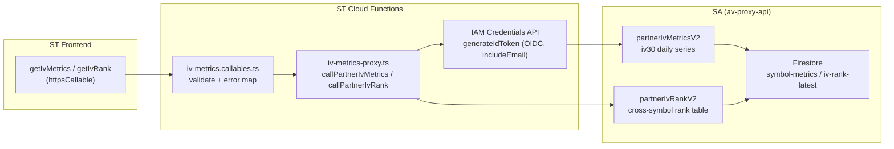

**Topic:** SA IV Data  
**Topic Slug:** sa-iv-data  
**Thread:** IV Metrics Consumer  
**Thread Slug:** iv-metrics-consumer  
**Issue:** #1739  
**Thread Parent:** #1738  
**Topic Parent:** #1737  
**Domain:** IMP-VOL  
**Type:** PRD  
**Status:** Approved  
**Created:** 2026-11-25  
**Last Updated:** 2026-11-25  

# PRD: IV Metrics Consumer

## Problem Statement

SA has deployed two server-to-server IV endpoints — `partnerIvMetricsV2` (the per-symbol daily `iv30` time series) and `partnerIvRankV2` (the cross-symbol latest-IV-rank table) — but ST has no way to reach either one. Symbol-level implied-volatility data exists only upstream: nothing in our backend can fetch the constant-maturity IV series a pricing model consumes, and nothing in the app can see which underlyings have elevated IV right now. Future consumers (a Black-Scholes IV input, IV-rank entry filters, IV-rank UI surfaces) are all blocked on this plumbing existing.

## Solution

Land the partner-integration plumbing as a thin pass-through, following the established partner-proxy convention end-to-end:

- Two typed backend callers — `callPartnerIvMetrics` (per-symbol `iv30` series over a `from`/`to` range) and `callPartnerIvRank` (whole-table screener with `sort`/`dir`/`minN`) — built on the existing `generateIdTokenWithEmail` + `fetchWithRetry` + `PartnerHttpError` infrastructure.
- Two `onCall` wrappers — `getIvMetrics` and `getIvRank` — so browser code can reach the data (the SA endpoints reject Firebase user tokens; all access must go through our backend).
- Shared request/response types so both sides of each callable are typed.
- A `--live` verify leg that exercises both endpoints for real — doubling as confirmation that our caller service account is actually allowlisted upstream.

No caching, no consumers — downstream work (pricing inputs, filters, UI surfaces) becomes later Threads under this Topic.

## System Context

## User Stories

### US-1 — Per-symbol IV series caller

As a backend developer, I want a typed helper that fetches a symbol's daily `iv30` series (with optional rank/percentile/sample-count fields) for a `from`/`to` date range, so that consumers can pull symbol-level implied volatility without knowing the partner transport.

*Acceptance criteria:*
- Calling the helper with a symbol and a `YYYY-MM-DD` range issues `GET {host}/partnerIvMetricsV2?symbol=&from=&to=` with an OIDC bearer token minted via `generateIdTokenWithEmail`.
- The response's `rows[]` are returned typed and verbatim (date-ascending, absent keys stay absent — no synthetic zeros).
- An optional `metrics` whitelist is forwarded as a comma-separated query param; omitted → all fields.
- HTTP failures throw `PartnerHttpError` carrying status + extracted partner `code` (e.g. `OPTIONS_NOT_ENABLED`, `NOT_FOUND`).

### US-2 — Cross-symbol IV rank caller

As a backend developer, I want a typed helper that fetches the whole IV-rank table with optional `sort`/`dir`/`minN`, so that screener-style consumers can get "which underlyings have elevated IV right now" in one call.

*Acceptance criteria:*
- Calling the helper issues `GET {host}/partnerIvRankV2` with an OIDC bearer token; `sort`, `dir`, `minN` are forwarded only when supplied.
- Rows are returned typed, with rank/percentile fields optional (SA withholds `ivRank{W}` when `ivN{W} < 2` — absent key, never `0`).
- Unknown/absent sort values and row ordering semantics are SA's — the helper does not re-sort or re-filter.

### US-3 — Callable access for the browser

As a frontend developer, I want `getIvMetrics` and `getIvRank` callable functions mirroring the two backend helpers, so that FE code can use IV data without ever holding SA credentials.

*Acceptance criteria:*
- Both callables are exported, deployed under `us-central1` with the standard `ST_ALLOWED_ORIGINS` CORS config, and return the partner response payload unchanged.
- `getIvMetrics` rejects a missing symbol or malformed `from`/`to` (`YYYY-MM-DD`, `from <= to`, span ≤ 10 years) with `invalid-argument` before any partner call.
- `getIvRank` rejects a `sort` outside the rank-field whitelist, a `dir` other than `asc`/`desc`, or a negative/non-integer `minN` with `invalid-argument`.
- Partner failures surface as typed callable errors: `OPTIONS_NOT_ENABLED` → `failed-precondition`, `404` → `not-found`, `429` → `resource-exhausted`, `5xx` → `unavailable` (existing `partnerHttpErrorToCallableCode` mapping).

### US-4 — Live verification

As the integrator, I want a verify script that exercises both endpoints for real, so that we confirm the deployed plumbing *and* discover immediately if our caller SA is not allowlisted upstream.

*Acceptance criteria:*
- A `scripts/verify/` script follows the existing convention: dry mode runs handler-level checks with stubbed deps; `--live` performs real calls against both endpoints.
- The live leg calls `partnerIvMetricsV2` for a known-good symbol + range and `partnerIvRankV2?sort=ivRank360&dir=desc&minN=20`, printing row counts and sample fields.
- A 403 on either endpoint fails the leg with a message identifying it as an upstream allowlist/onboarding gap (not a code defect).

## Implementation Decisions

### Architecture

- New dedicated proxy module `iv-metrics-proxy.ts` under the functions source — follows the `spread-proxy.ts` precedent of one endpoint family per small file. Rejected alternatives: `partner-proxy.ts` (already mixes several generic endpoints) and `options-contract-proxy.ts` (contract-granularity endpoints; `iv30`/`ivRank` are symbol-level).
- Callable wrappers in a sibling `iv-metrics.callables.ts` — mirrors the `options-contract.callables.ts` split of proxy helpers vs `onCall` definitions.
- Both callables re-exported from the functions entrypoint like the existing partner callables.

### Partner plumbing

- Two new `PartnerEndpointPath` entries: `partnerIvMetricsV2`, `partnerIvRankV2`.
- Per-endpoint `{ENDPOINT}_URL` / `{ENDPOINT}_AUDIENCE` constants with env-var overrides — identical pattern to existing proxies. Audience defaults to the function URL; SA also accepts the permanent base-host audience, so either works.
- Auth, retry, and error handling reuse `generateIdTokenWithEmail`, `fetchWithRetry`, `PartnerHttpError`, `extractPartnerCode`, `partnerHttpErrorToCallableCode` unchanged.

### API surface

- `callPartnerIvMetrics({ symbol, from, to, metrics? })`; `metrics` is a string array joined to CSV for the query param.
- `callPartnerIvRank({ sort?, dir?, minN? })`; `sort` typed to the rank-field whitelist union; `dir` to `'asc' | 'desc'`; `minN` to a non-negative integer.
- Callable request types mirror the helper params (`metrics` as a string array; `minN` as number).
- Callable names: `getIvMetrics`, `getIvRank`.

### Shared contracts

- New `shared/iv-metrics-contracts.ts` exporting request/response types for both endpoints — the `@options-contract/contracts` convention. Row types mark every rank/percentile field optional and document SA's semantics in comments: absent key = no data (never `0`); `ivRank{W}` requires `ivN{W} ≥ 2`; ranks on historical rows are frozen at compute time (only the newest day, or this endpoint's latest snapshot, is "today's rank").

### Persistence

- None — pure pass-through. SA already materializes both datasets and refreshes them nightly; a cache earns its keep only if a future consumer needs point-in-time screener history or dodges upstream limits. Revisit as a separate Thread if that appears.

## Testing Decisions

### Proxy callers

- Unit tests mock `fetch` at the module seam and pin: exact URL construction (path + query params), optional-param omission, bearer-token header presence, `fetchWithRetry` usage, and `PartnerHttpError` shape on non-2xx including partner `code` extraction.
- Good tests assert external behavior (what request goes out, what comes back/throws), not internals.

### Callable wrappers

- Handler-level tests with the proxy function stubbed at the module seam: validation rejections (`invalid-argument` cases above), success passthrough, and `PartnerHttpError` → callable-code mapping. Prior art: existing partner callable handler tests under `tests/functions/`.

### Live verification

- `scripts/verify/` script with dry + `--live` modes per the established convention. The live leg requires impersonation credentials (`GOOGLE_IMPERSONATE_SERVICE_ACCOUNT`) — the same mechanism `generateIdTokenWithEmail` already supports locally.

## Out of Scope

- **All consumers.** No wiring into the overnight Black-Scholes simulation, strategy entry filters, scanner, or any FE surface — each becomes its own Thread under this Topic (UI scope to be grilled separately).
- **Persistence/caching** of IV data into our Firestore.
- **Replacing the scanner's existing IV-rank fields** (`ivRank`, `iv52weeksHigh/Low`), which come from a different data source — any convergence is a later decision.
- **SA-side configuration** (IAM invoker, `ALLOWED_SERVICE_ACCOUNT_EMAILS`) — owned by the partner; the live verify leg is how we detect a gap.
- Any new endpoint family beyond the two listed.

## Technical Context

- **Freshness:** SA's rank pass runs once per trading day (weekday evenings) — intraday polling returns the same data; consumers should expect daily granularity.
- **Rank freshness:** `ivRank{W}` on historical `iv30` rows is frozen at each day's compute time. Only the newest day's ranks (and the `partnerIvRankV2` table) reflect full later coverage — old rows' ranks are not "the rank today".
- **Data maturity:** `ivN{W}` is the sample-count gate — `ivRank{W}` absent when `ivN{W} < 2`, `ivPct{W}` absent when `ivN{W} = 0`. Thin windows are exposed, never suppressed.
- **Sparse coverage:** missing trading days produce no row (never a zero row); a field absent on a day produces no key.
- **Limits:** `from`/`to` span ≤ 10 years; response ≤ 10 MiB (`413` otherwise); `partnerIvRankV2` returns the whole table (~130 rows, no paging).
- **Browser restriction:** SA endpoints reject Firebase user tokens with 403 — all access must route through our callables.

## Further Notes

### Reference docs (av-proxy-api repo)

- `docs/partner/options-data/iv-metrics-discovery.md` — `partnerIvMetricsV2` contract.
- `docs/partner/options-data/iv-rank-discovery.md` — `partnerIvRankV2` contract.
- `docs/partner/partner-auth-and-audience.md` — dual-auth model and audience configuration.
- SA-side build history: `docs/topics/158-options-data/` (their Topic #158).

### Existing pattern

- `functions/src/partner-infrastructure.ts` — token minting, retry, error types/mapping (unchanged).
- `functions/src/spread-proxy.ts` — closest single-family proxy precedent.
- `functions/src/options-contract.callables.ts` — callable wrapper convention (`{ region: 'us-central1', cors: ST_ALLOWED_ORIGINS }`, validate-then-proxy, typed passthrough).
