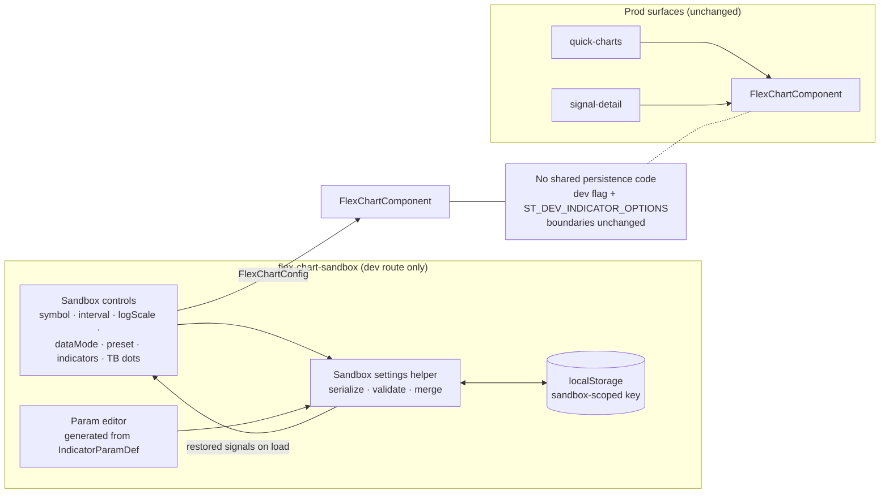

**Topic:** Flex Chart Visual Polish  
**Topic Slug:** visual-polish  
**Thread:** Dev Flex Chart - enable save settings for dev use  
**Thread Slug:** dev-save-settings  
**Issue:** #909  
**Thread Parent:** #908  
**Topic Parent:** #213  
**Domain:** FLEX-CHART  
**Type:** PRD  
**Status:** Approved  
**Created:** 2026-10-07  
**Last Updated:** 2026-10-08  

# PRD: Flex Chart Sandbox — Persisted Settings & Param Editing

## Problem

The flex-chart sandbox (`/dev/flex-chart-sandbox`) is the proving ground for
in-development chart work, but every page refresh resets it to hardcoded
defaults: symbol `QQQ`, daily interval, log scale on, real data mode, the
`wide-ratio` synthetic preset, a fixed enabled-indicator set, and default
indicator params. A developer iterating on an indicator — especially one
parametrized like ZigZag or Anchored VWAP — must rebuild the entire setup
after every reload, and cannot vary indicator math parameters at all because
no editing UI exists for `IndicatorOption.params`.

## Audience

Developers working on flex-chart indicators and chart behavior. This is a
dev-surface-only feature; no production user ever sees it, and no production
flex-chart surface may be affected by it.

## Goals

- Sandbox settings survive page refresh with zero ceremony (auto-save).
- Every indicator that declares params can have its math settings adjusted in
  the sandbox UI, and those overrides persist.
- One-click return to factory defaults.
- Prod instances of flex-chart are unaffected — by construction, not by
  discipline.

## Non-Goals

- Named presets / multiple saved configurations.
- Appearance editing (color, line width, opacity, fill) — math params only.
- Pane reassignment, per-symbol settings, cross-device sync.
- Any persistence inside `FlexChartComponent`, the indicator registry, or
  shared flex-chart services.
- Param-driven changes to backend callable requests (callable indicators like
  Trigger Bands declare no params; nothing to forward).

## User Stories

### US-1: Settings survive refresh

As a developer, when I reload the sandbox page, I want my previous setup
restored — enabled indicators, per-indicator param overrides, symbol,
interval, log scale, data mode, synthetic preset, and the TB-dots toggle —
so I can iterate without rebuilding state.

**Acceptance criteria:**

- Given any combination of the controls above changed from defaults, when the
  page is refreshed, then every control restores to the changed value and the
  rendered chart reflects them.
- Given a fresh browser profile (no stored state), when the page loads, then
  it behaves exactly as today — all current defaults.

### US-2: Edit indicator math params

As a developer, when an indicator is enabled, I want to adjust each of its
declared params (e.g., ZigZag depth/deviation, AVWAP depths, RSI length) so I
can observe how the math responds.

**Acceptance criteria:**

- Each enabled indicator that declares `IndicatorParamDef`s exposes a
  generated editor: number input honoring `min`/`max` for numeric params,
  dropdown for params with `options[]`, checkbox for booleans.
- Indicators with `params: []` (e.g., Trigger Bands, signal dots) show no
  editor.
- Changing a param immediately re-renders the chart via the existing
  `config.params` → calculator path.
- Param overrides persist per indicator id and restore on refresh (covered
  by US-1).

### US-3: Reset to defaults

As a developer, I want a single action that clears all persisted state so I
can return to the factory setup when an experiment is done or the stored
state feels stale.

**Acceptance criteria:**

- A "Reset to defaults" control clears the stored blob; all controls return
  to current-code defaults and the chart re-renders accordingly.

### US-4: Prod isolation

As the codebase owner, I want the persistence and editing machinery confined
to the sandbox feature folder so no production surface can be affected.

**Acceptance criteria:**

- No behavioral or API change to `FlexChartComponent`, `indicator-registry`,
  or any shared flex-chart service; prod callers' configs are byte-identical
  in shape.
- The existing `dev` flag gate and `ST_DEV_INDICATOR_OPTIONS` separation are
  unchanged.
- The stored blob reads and writes only under a sandbox-scoped localStorage
  key.

### US-5: Stale state tolerates code drift

As a developer, when indicators or param keys are renamed/removed between
sessions, I want my stored settings to degrade gracefully rather than break
the page or silently corrupt.

**Acceptance criteria:**

- Unknown indicator ids, unknown param keys, and out-of-range values are
  dropped or clamped against the live registry on load; missing values fall
  back to defaults.
- A stored blob whose `version` differs from the current schema version is
  discarded wholesale and defaults are used.

## Technical Context

- Storage is `localStorage` under a single sandbox-scoped key containing a
  versioned JSON blob: `{ version, symbol, interval, logScale, dataMode,
  preset, triggerBandsDots, enabledIndicators, paramOverrides }`.
- Persistence is auto-save: every control change writes immediately; there is
  no Save button.
- The param editor is generated from each `IndicatorOption`'s
  `IndicatorParamDef[]` — the same contract `buildDefaultConfig` already
  consumes — so new indicators get editing for free.
- localStorage is per-origin per-browser; settings do not follow the user to
  another machine. Acceptable for a dev tool.
- A malformed blob (non-JSON, wrong shape) is treated as a version mismatch —
  discarded, defaults applied.

## System Context

## Open Questions

- None blocking. Storage key name and blob field layout are implementation
  details for the Blueprint stage.
