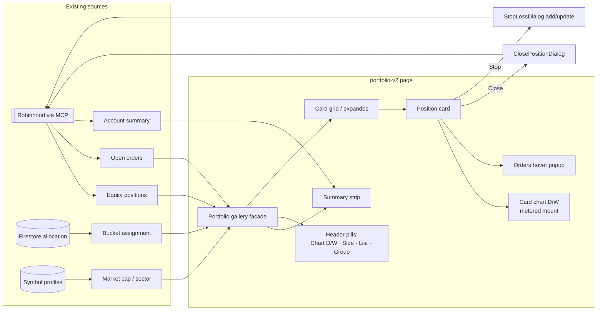

**Topic:** Portfolio Dashboard  
**Topic Slug:** portfolio-dashboard  
**Thread:** Extend Gallery UI to Portfolio Page  
**Thread Slug:** portfolio-gallery-view  
**Issue:** #927  
**Thread Parent:** #926  
**Topic Parent:** #219  
**Domain:** PORTFOLIO  
**Type:** PRD  
**Status:** Approved  
**Created:** 2026-10-09  
**Last Updated:** 2026-10-09  

## Problem Statement

The trading day starts with managing existing holdings, then moves to new signals. Today the holdings half of that workflow lives in the portfolio page's equity/option positions tables — rows of numbers with no chart, where judging a position means cross-referencing another surface. The signal side already proved the better format: a gallery of chart-bearing cards where triage happens in place.

The trader wants positions rendered with the same gallery language — card, chart, meta rows, action buttons, grouping — so the morning position-review pass has the same "see it, decide, act" shape as the signal pass. This is a separate surface on a separate entity: position cards and signal cards never mix, their data shapes differ, and their actions differ. What is shared is the layout and interaction model.

## Solution

A new routed page — `portfolio-v2` — renders live equity/ETF positions as a gallery of position cards. The existing portfolio page is untouched (the stop-add workflow continues there during transition).

Each card shows position economics at a glance (quantity, avg cost, mark, day change, unrealized P&L $/%, market value, days held, allocation bucket) plus a protected/unprotected status derived from the account's open orders — is there an active stop, and at what price. A compact chart renders the same gallery card chart used on the signal side; a **Position Chart** configuration is reserved for later (position-specific overlays such as entry and stop levels) but v1 draws the existing chart unchanged.

Actions land up front: **Close** (whole or partial, via the existing close-position dialog), **Stop** (add or update, via the existing stop-loss dialog), plus **Add** and **Detail** as labeled stubs. A small Orders affordance hovers a read-only popup listing the symbol's resting orders, distinguishing stop-loss protection from open limit orders.

Position cards carry no triage state — no sink, no reject, no reviewed flag. A card exists while the position exists; its state is fully derived from position data plus open orders.

The page scopes to agentic-enabled accounts only — today exactly one account, so no account selector ships; multi-account display is deferred until a second enabled account exists.

## User Stories

1. As a trader, I want a routed `portfolio-v2` page that renders my live equity positions as gallery cards, so that morning position review looks and behaves like signal review.
   - AC: the route is lazy-loaded and auth-guarded like sibling pages; the existing portfolio page is unchanged and reachable.

2. As a trader, I want one card per held equity/ETF position, so that every holding is visible without a table.
   - AC: cards derive from the same positions pipeline as the portfolio dashboard; option positions are excluded entirely (a later Thread); paper positions never appear on this page.

3. As a trader, I want each card to show position economics — quantity, average cost, current mark, day change, unrealized P&L in $ and %, market value, days held, and allocation bucket — so that I can judge the holding without cross-referencing.
   - AC: all fields populate from the existing positions/quotes/allocation pipeline; fields not yet carried by that pipeline are added there, not synthesized card-side.

4. As a trader, I want a protected/unprotected status on each card showing the active stop and its price (and distance from mark), so that "which positions are bare" is answered visually.
   - AC: protection derives from open orders; a position with no live protective stop reads unprotected; positions whose only protection is a `stop_limit` are distinguished if the existing order data supports it.

5. As a trader, I want each card to embed a compact chart (the existing gallery card chart), so that I can see recent price action in place.
   - AC: the chart reuses the gallery card chart configuration and the metered mount queue; off-screen cards mount on scroll-into-view.

6. As a trader, I want a global Daily/Weekly chart pill plus per-card D/W toggles, so that I can flip every chart's interval or override one card.
   - AC: identical semantics to the signal gallery's decoupled chart interval (#838) — global pill syncs all cards; a per-card toggle overrides locally until the pill is clicked again.

7. As a trader, I want to group cards by allocation bucket, sector, industry, or cap tier — or view a flat grid — so that I can review holdings the way positions cluster.
   - AC: the group dropdown lists **Allocation Bucket** first, then Sector / Industry / Cap Tier / None; default is flat (None); expando group panels behave like the signal gallery (#783).

8. As a trader, I want flat view sorted by company market cap, so that the biggest names surface first.
   - AC: flat ordering is market-cap descending; market cap comes from the existing symbol-profile path (cap tier data already in the signal pipeline).

9. As a trader, I want Side (Long/Short) and List-membership filter pills like the signal gallery, so that I can narrow the holdings view consistently.
   - AC: side filters on position side; list filters to positions whose symbol belongs to the selected symbol list; no signal-timeframe pill exists (positions have no timeframe).

10. As a trader, I want a header summary strip — total equity, day P&L, cash/buying power, and count of unprotected positions — so that the account headline is visible above the cards.
    - AC: the strip derives from the same account data the dashboard uses; the unprotected count matches rule #4.

11. As a trader, I want a manual refresh that re-pulls positions, marks, and open orders, so that post-trade or post-fill state is a click away.
    - AC: refresh reloads the same data the dashboard's refresh does; no auto-polling in v1.

12. As a trader, I want Close on a card to open the existing close-position dialog (whole or partial), so that exiting a position is one gesture from the card.
    - AC: the dialog works unchanged; dismissal refreshes the page data.

13. As a trader, I want Stop on a card to open the existing stop-loss dialog in add or update mode depending on whether protection exists, so that I can protect a bare position or tighten an existing stop.
    - AC: add mode when unprotected; update mode (with picker when multiple updatable stops exist) when protected — same behavior as the positions table.

14. As a trader, I want Add and Detail as visible stubs, so that the action row communicates the full future surface without shipping half-built dialogs.
    - AC: both buttons render disabled/stubbed with affordance consistent with the gallery's stub pattern; Detail's eventual destination (page or dialog) is a later decision.

15. As a trader, I want an Orders affordance on each card that hovers a read-only popup of the symbol's resting orders — stop-loss orders distinguished from open limit orders — so that I can see what's working without leaving the card.
    - AC: the popup lists live orders for the symbol with type clearly separated (stop vs limit, buy vs sell); it is read-only (no cancel/modify actions in v1).

16. As a trader, I want clear loading, error, and empty states, so that the page's health is unambiguous.
    - AC: distinct states for loading, load failure (with message), and "no positions".

17. As a trader, I want the position card model kept strictly separate from the signal `GalleryCard` model, so that the shared layout doesn't force either entity into the other's shape.
    - AC: position cards have their own data type and component; shared code is layout-level (grid, group expandos, header chrome, chart mount) rather than a unified card model.

## System Context

## Technical Context

- **Data pipeline unchanged.** Positions, quotes, open orders, and account summary come from the same RH-MCP / store plumbing the portfolio dashboard uses today. Bucket assignment comes from the allocation pipeline (Topic #576). Any fields the card needs that the pipeline doesn't carry (e.g., days held, market cap) are added to the pipeline/model, not computed ad hoc in the component.
- **Agentic-enabled accounts only.** The page reads the enabled-account set the same way the agent surfaces do; today exactly one account is enabled, so no selector ships. Multi-account display (merged vs per-account vs selector) is a deliberate deferral, not an accident.
- **No triage model.** Unlike signal cards there is no sink/reject/decision persistence. Card state = f(position, open orders). This deliberately removes `StOccurrenceDecision`, the sunk section, and ordering-by-action-time from this surface.
- **Chart = existing card chart.** The metered chart-mount queue (#860), `@defer (on viewport)` mount, and per-card + global D/W toggles (#819/#838) carry over directly. The reserved **Position Chart** configuration is a named future indicator/overlay set (e.g., entry price and live stop drawn on the chart); v1 does not implement it.
- **Open orders data already flows** to the dashboard's open-orders table and the protection selectors (`isProtectiveStopOrder`, `updatableStopsBySymbol`); the card's stop badge, Stop dialog mode, and orders popup consume the same selectors.
- **Stale-view discipline:** the existing dialogs already return a refresh-required flag after any submission attempt (#887 review); the page honors the same contract.

## Implementation Decisions

- **Separate card type, shared layout language.** A new `position-card` component and `PositionCard` model — deliberately NOT a specialization of the signal `GalleryCard`. Shared with the signal gallery: grid/expando shell pattern, header chrome, chart mount queue, D/W toggle wiring. Not shared: data model, actions, status model.
- **New page, existing page untouched.** `portfolio-v2` is additive; the existing portfolio dashboard keeps its tables and the in-progress stop workflow.
- **Group dropdown reordered.** Allocation Bucket first, then Sector / Industry / Cap Tier / None; default = None (flat), matching the signal gallery's flat default (#820).
- **Flat sort = market cap descending**, same key the signal flat view uses.
- **Side + List filters kept; signal-timeframe pill dropped** — positions have no detection timeframe; the Chart pill alone controls D/W.
- **Actions reuse existing dialogs.** Close → `ClosePositionDialogComponent`; Stop → `StopLossDialogComponent` (add/update mode resolved from protection state); Add and Detail are stubs.
- **Orders popup = read-only** hover surface listing resting orders with stop-vs-limit distinction; actions may come later.
- **Refresh = manual only.** No polling; freshness is on mount + refresh button.

## Testing Decisions

- **Seams:** a feature facade/store over positions, quotes, orders, and allocation — the same pattern as `signal-review.facade.ts` / `gallery.facade.ts`. Tests target that seam plus the card component's rendered behavior; dialogs are exercised through their existing component contracts.
- **Prior art:** gallery specs (`gallery.facade.spec.ts`, `gallery-ui.store.spec.ts`), `equity-positions-table.component.spec.ts`, `portfolio-dashboard.store.selectors.spec.ts` establish the style (jest-preset-angular, `jest.fn()`, stub Firebase providers, macrotask flush).
- **What good tests look like here:** card-model derivation (position + orders + bucket → card), protection-badge correctness (stop present/absent, price, distance), group/sort/filter behavior including bucket-first ordering and flat default, Stop dialog mode resolution (add vs update vs picker), stub-button behavior, and empty/error states.

## Out of Scope

- Option positions and spreads (a later position-card variant).
- Paper positions (a separate analog page later; never mixed into this view).
- Mixed signal+position surfaces — the two never comingle on one page or in one model.
- Multi-account display and account selectors.
- The **Position Chart** indicator/overlay configuration itself — name reserved, v1 renders the existing card chart.
- Add-to-position order flow and the Detail surface (stubbed; destinations undecided).
- Bulk actions, selection model, or any triage/decision persistence on positions.
- Retirement or redirect of the existing portfolio page, `signals/review`, or `trading/live`.
- Intraday quotes/marks on cards beyond what the existing pipeline already provides.
- Actions on the orders popup (cancel/modify).

## Further Notes

- This Thread is the "positions first" half of the daily-workflow transition described in ADR-009: morning = manage holdings, then move to new signals. Signal-review and signal-order remain reachable; phasing them out is a later Topic-level decision, not part of this Thread.
- New durable concepts: none — the page introduces no new persisted state. `CONTEXT.md` should gain the **Position Card** / **Portfolio Gallery** definitions at ship time.
- If auto-paper lands (Topic #553), a paper analog of this page is the expected follow-on — same layout, paper store, separate route.
