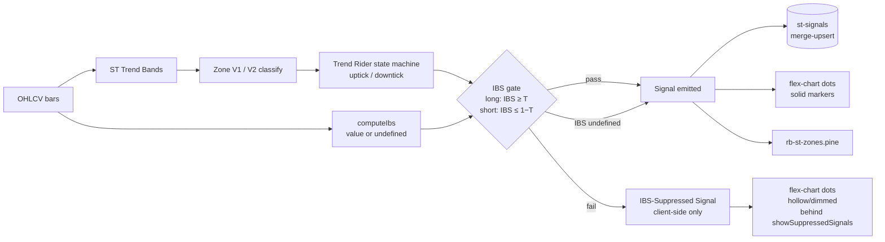

**Topic:** Trading Indicator Library  
**Topic Slug:** indicator-lib  
**Thread:** Intraday Bar Strength (IBS)  
**Thread Slug:** intraday-bar-strength  
**Issue:** #1666  
**Thread Parent:** #1665  
**Topic Parent:** #261  
**Domain:** INDICATOR-LIB  
**Type:** PRD  
**Status:** Approved  
**Created:** 2026-11-21  
**Last Updated:** 2026-11-21  

# PRD: Internal Bar Strength (IBS) filter for ST Trend Rider zone signals

## Problem Statement

ST Trend Rider signals (zone V1 and V2, daily and weekly) fire purely on zone state transitions — a zone uptick while the window is open emits a long, a downtick emits a short — with no check on the signal bar's own momentum. As a result, a long can fire on a bar that closed in the *lower* half of its range (a weak, seller-controlled close), and a short can fire on a bar that closed in the *upper* half. These contradicting-close signals are a meaningful share of total signals — estimated 10–25% — and dilute signal quality.

The user wants the signal algorithm to refuse signals whose bar close contradicts the signal direction: don't throw a long when the bar closes in the lower half of its range, and vice versa.

## Solution

Add an **Internal Bar Strength (IBS)** gate inside the ST Trend Rider signal algorithm — not a standalone oscillator, not a chart pane — applied identically across the three surfaces that detect or display trend-rider signals:

1. **Backend signal detection** (`functions/src/st-cloud-function/strategies/signal-detection.ts`) — the `detectAllStTrendRiderSignals` state machine that emits `D_/W_ ST_TREND_RIDER_V{1,2}_{LONG,SHORT}` strategy signals persisted to `st-signals`.
2. **Frontend chart dots** (`st-trend-rider-dots.indicator.ts` → `detectZoneUptickDots`) — the client-side mirror of the same state machine that renders entry markers on the flex-chart.
3. **Pine export** (`rb-ps/rb-ta/ind/rb-st-zones.pine`) — the TradingView port, kept in parity.

The gate reads the signal bar's IBS — `(C−L)/(H−L)`, a 0–1 measure of where the close sits within the bar's range — and suppresses the signal when the close contradicts the direction: a **long requires IBS ≥ `ibsThreshold`**, a **short requires IBS ≤ `1 − ibsThreshold`** (symmetric, inclusive boundaries, default `0.5`).

Because the IBS of a *developing* bar is meaningless early in its period, the IBS function has an **availability** semantics: it returns `undefined` while the current bar is too young (a daily bar before the configured activation time, default `12:00` ET; a weekly bar before the configured mid-week day, default Wednesday). `undefined` means "filter not applicable" — the signal passes unfiltered, so early scheduled runs behave exactly as they do today.

Suppressed signals are never emitted or persisted — but on the chart they are visible on demand: each ST Trend Rider dots indicator gains a `showSuppressedSignals` config (default off), and the flex-chart sandbox gets a UI toggle, rendering suppressed candidates as hollow/dimmed markers so the filter's kill rate can be evaluated visually.

## System Context



## User Stories

### US-1 — IBS value per bar

As the signal engine, I want a pure function that computes `(close − low) / (high − low)` for a bar, so that every downstream consumer shares one definition of bar-close momentum.

*Acceptance criteria:*
- Returns `close` at the high → `1.0`; at the low → `0.0`; at the midpoint → `0.5`.
- Zero-range bar (`high === low`) returns `0.5` (neutral) — never `NaN`/`Infinity`.
- No smoothing, no lookback — raw single-bar IBS only.

### US-2 — Long signals gated on upper-half closes

As an ST signal consumer, I want a long trend-rider signal to be suppressed when its bar closes below the `ibsThreshold` line of its own range, so that longs never fire on weak closes.

*Acceptance criteria:*
- A qualifying long uptick on a bar with `IBS < T` produces no emitted signal (BE) and no solid dot (FE).
- `IBS ≥ T` → signal emits. `IBS = T` → emits (inclusive).
- Applies identically to V1 and V2.

### US-3 — Short signals gated on lower-half closes

As an ST signal consumer, I want a short signal suppressed when its bar closes above the `1 − T` line of its range, so that shorts never fire on strong closes.

*Acceptance criteria:*
- A qualifying short downtick on a bar with `IBS > 1 − T` produces no emitted signal and no solid dot.
- `IBS ≤ 1 − T` → emits; at exactly `1 − T` → emits.

### US-4 — Early intraday runs behave as today

As the system operator, I want runs that execute before the daily activation time to emit signals unfiltered, so that thin developing-bar IBS values don't gate signals on meaningless data.

*Acceptance criteria:*
- When the last bar is the current developing daily bar and ET time < activation (default `12:00`), `computeIbs` returns `undefined` → signals pass unfiltered.
- At/after activation on the same day, the developing bar's IBS is defined and the filter applies.
- The activation time is configurable, not hard-coded.

### US-5 — EOD and historical bars always filtered

As a backtester/replay consumer, I want the filter to apply to every completed bar, so historical signal sets reflect the filtered algorithm consistently.

*Acceptance criteria:*
- Any bar whose date is in the past (or whose period is complete) returns a defined IBS → filter always applies.
- Historical replay emits only IBS-passing signals.

### US-6 — Weekly signals filtered with weekly availability

As an ST signal consumer, I want `W_` trend-rider signals gated by the weekly bar's IBS under the same shape of rule, so weekly longs/shorts also respect bar-close momentum.

*Acceptance criteria:*
- A developing weekly bar's IBS is `undefined` before the configured weekday (default Wednesday) and defined from that day onward; completed weekly bars are always defined.
- Filter rule identical: long needs `IBS ≥ T`, short needs `IBS ≤ 1 − T`.

### US-7 — Suppressed signals visible on demand

As the user evaluating this filter, I want to toggle a view that shows which signals *would* have fired without the IBS gate, so that I can judge the filter's impact (~10–25% estimate) without permanently cluttering the chart.

*Acceptance criteria:*
- The ST Trend Rider V1/V2 dots indicators accept a `showSuppressedSignals` config (default **off**).
- When on, suppressed candidates render as visually distinct markers (hollow/dimmed) at the position the dot would have occupied.
- The flex-chart sandbox exposes a UI toggle that flips this config — using the existing sandbox param-override/debug-toggle machinery.
- Suppressed markers are computed client-side only; nothing about them is persisted to `st-signals` or anywhere else.

### US-8 — Threshold is configurable

As the strategy operator, I want the IBS threshold to be a strategy config parameter rather than a constant, so it can be tuned (e.g., 0.5 → 0.6) without code changes.

*Acceptance criteria:*
- Threshold resolves from strategy `config` with a `0.5` default; the long bound is `T`, the short bound is `1 − T`.
- The FE dots detection honors the same threshold (via indicator params or the shared config path).

### US-9 — Pine parity

As a TradingView user, I want `rb-st-zones.pine` to apply the same IBS gate to its signal markers, so the Pine plots match the web signals.

*Acceptance criteria:*
- Pine computes IBS per bar (zero-range → 0.5) and suppresses signal markers identically (long `IBS < T` suppressed, short `IBS > 1 − T` suppressed).
- Pine inputs expose the threshold; an input toggles suppressed-marker display for evaluation.

### US-10 — Already-emitted early signals are never deleted

As the system operator, I want signals emitted before activation to remain untouched when a later run's filtered detection doesn't re-emit them, so the record of what actually fired stays truthful.

*Acceptance criteria:*
- Suppression is a write-suppression only: no deletion or revocation path is added.
- A signal persisted at an early run remains in `st-signals` even if the same day's later run would have suppressed it.

## Implementation Decisions

### IBS computation — one function, availability built in

A single pure function owns both the formula and the availability rule:

```text
computeIbs(bar, { now, activateAtEtMin, activateAtWeekday }) → number | undefined
```

- `bar`: `{ high, low, close, date }` of the signal bar.
- `now`: the evaluation instant (injectable for tests; defaults to wall clock).
- Returns `undefined` when `bar` is the *current, still-developing* period bar and `now` is before the activation point for its timeframe — daily: `activateAtEtMin` (default `12:00` ET); weekly: `activateAtWeekday` (default Wednesday). Returns the IBS value otherwise, including every completed bar.
- The strategy/detection layer never needs to know the run schedule — availability is encapsulated here ("the value is absent, not bypassed").
- `now` in ET via `America/New_York` conversion; the bar's date is the market date already used throughout the pipeline.

### Filter placement — inside the existing state machines

- BE: `detectAllStTrendRiderSignals` evaluates the IBS gate at the point it would push a signal — the `ltfBars` it already receives supply `high`/`low`/`close`.
- FE: `detectZoneUptickDots` applies the same check at dot-emission time, and partitions its result into emitted vs suppressed points (each suppressed point carries enough info to render the hollow marker).
- Both V1 and V2 paths, `D` and `W` timeframes, route through the gate — no per-path exceptions.

### Configuration

- `ibsThreshold` — strategy `config` bag entry (the existing `StrategyConfig` heterogenous-params slot, unused today), default `0.5`. Short bound derived as `1 − T`.
- Activation params — `activateAtEtMin` (daily, default `12:00` ET) and `activateAtWeekday` (weekly, default Wednesday) as config with sane defaults.
- `showSuppressedSignals` — boolean param on `ST_ZONE_V1_UPTICK_DOTS_INDICATOR` and `ST_ZONE_V2_UPTICK_DOTS_INDICATOR`, default `false`; sandbox toggle rides the existing param-override / debug-toggle machinery (same mechanism as the AVWAP params and the Trigger Bands dots toggle).

### Emitted-signal metadata

- When a signal emits, its `indicators` payload includes the bar's `ibs` value, so emitted signals are auditable against the threshold.
- Suppressed signals leave no persisted trace — evaluation is exclusively through the chart toggle.

### Pine port

- `rb-st-zones.pine` gains an `ibsThreshold` input and the same suppression logic; Pine's `barstate`/session awareness stands in for `now` where Pine can support it — semantics adapted to what Pine can express, flagged during blueprint if parity diverges.

## Testing Decisions

### Seams

1. **`computeIbs` pure function (highest-value seam)** — table-driven unit specs: formula at high/low/mid, zero-range → 0.5, availability per timeframe (developing daily pre/post activation, developing weekly pre/post weekday, completed bars, `now` injected).
2. **State-machine seam** — `detectAllStTrendRiderSignals` and `detectZoneUptickDots` with synthetic zone arrays + synthetic bars: signal emitted when IBS passes, suppressed when it fails, pass-through when `undefined`; emitted-vs-suppressed partition on the FE result.
3. **Config/rendering seam** — `showSuppressedSignals` on → hollow/dimmed markers in the dots output; off → suppressed set excluded from rendering.
4. **Pine** — manual UAT only, consistent with every prior indicator Thread.

### What makes a good test here

Assert on *emitted vs suppressed outcomes* and the `undefined` availability contract — not on internal state-machine steps. Synthetic bars with hand-computed IBS values at the boundaries (`T`, `1−T`, just inside/outside) are the interesting cases; a spec at exactly `0.5` pins the inclusive semantics.

### Prior art

- `functions/` indicator specs: `tests/functions/` suites for st-trend-rider / signal-detection (state-machine specs over synthetic arrays).
- FE indicator specs: `src/app/features/shared/components/flex-chart/indicators/*.spec.ts` (e.g., `st-trend-rider-dots` detection specs).
- `functions/scripts/verify/` — a verify script replaying a real symbol's bars showing emitted vs suppressed counts is the natural manual-check vehicle.

## Out of Scope

- A standalone IBS oscillator / lower-pane chart indicator — IBS is a gate, not a display.
- Developing Daily IBS session tracker and smoothed IBS variants — the filter uses raw single-bar IBS only.
- Deleting or revoking signals emitted before activation (US-10 documents this as intended behavior).
- Persisting suppressed signals (Firestore docs, filtered flags, or any server-side record).
- Combining IBS with RSI(2)/ATR filters, or backtesting filter efficacy — the chart toggle is the evaluation vehicle.
- Changes to `st-signals` schema — the `ibs` metadata rides inside the existing `indicators` payload.

## Technical Context

- Scheduled runs before the daily activation time (default `12:00` ET) emit zone signals **unfiltered** — this is deliberate: a developing daily bar's IBS is too noisy earlier in the session.
- A signal emitted at an early run and later invalidated by the filter remains in `st-signals`; suppression blocks new writes only.
- On intraday runs the last bar in the cached series *is* the developing daily bar — no additional data plumbing is needed for IBS.

## Further Notes

### Reference semantics (from the Idea issue, #1666)

- Classic IBS literature treats extreme readings as *mean-reversion* signals (IBS < 0.2 → buy). **This Thread uses IBS the other way**: as a momentum *confirmation* gate — a long is only valid when the close finished in the bar's upper region. Same formula, opposite employment. The reference TS/Pine implementations in #1666 carry the zero-range guard and smoothing variants; only the raw-bar core is adopted.
- Edge cases pinned by the reference material: zero-range bars → `0.5`; lookahead bias rules for any future intraday backtesting of completed daily IBS.

### Domain terms added to CONTEXT.md

`Internal Bar Strength (IBS)`, `IBS Availability`, `IBS-Suppressed Signal` — appended during this planning session; the `_Avoid_` lines pin the "absent, not bypassed" and "never emits, not revoked" semantics.
