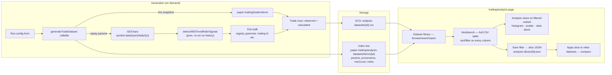

**Topic:** Paper Trading Infra  
**Topic Slug:** paper-trading-infra  
**Thread:** Trade Analysis & Forensics  
**Thread Slug:** trade-analysis  
**Issue:** #1060  
**Thread Parent:** #1059  
**Topic Parent:** #553  
**Domain:** PAPER-TRADING  
**Type:** PRD  
**Status:** Approved  
**Created:** 2026-10-17  
**Last Updated:** 2026-10-17  

# PRD — Trade Analysis & Forensics

## Problem

Paper trading now produces real signal outcomes — ~220 live auto-paper trades (growing nightly) plus historical replay that regenerates signals from bars and walks them through exit rules (~50 occurrences per symbol over ~4 years). But there is no surface for answering the questions this data exists for: *which entry conditions actually work?* Does zone-4 entry bleed vs zone-3? Do V2 shorts outperform V1? Is the trailing-8 giveback acceptable? Today the only way to answer is ad-hoc scripts and manual pandas sessions — no repeatable workflow, no way to take a finding from one symbol and test it across the universe.

## Concept

A **CSV-native analysis pipeline** feeding an in-app forensics surface:

1. **Datasets are files.** A generation pass produces one CSV per run — one row per trade, full lifecycle plus signal dimensions and computed context — written to Cloud Storage and indexed in a metadata collection. No Firestore materialization of trade rows; the CSV *is* the queryable substrate.
2. **Generation is on-demand.** Two producers: a **live snapshot** (export current `paper-trading/trades/items`) and a **parameterized replay** (regenerate signals from SDS bars, walk them through configurable exit rules). Runs are user-triggered from a run-config form; there is no nightly pass — snapshots are versioned, never overwritten.
3. **The app reads the file.** A new `trading/analysis` surface browses the dataset library, opens a dataset into a workbench (full-CSV sortable/filterable table), and runs analysis views — histogram, scatter, summary stats — on the **filtered subset** of rows.
4. **Slices travel.** A named filter set ("V2 longs, zoneV2=4") saves as a reusable object applied to any dataset — the workflow for testing whether a single-symbol finding generalizes.
5. `trading/paper` itself evolves toward the same row model — a sortable/filterable trades table on the live ledger.

## System context

## User stories

### US1 — Live snapshot dataset

> As the analyst, I can generate a snapshot dataset of current paper trades on demand, so the library always offers a fresh view of live outcomes without waiting for a scheduled pass.

Acceptance criteria:

- A "Generate live snapshot" action runs the export over `paper-trading/trades/items` and produces one CSV + index entry tagged `origin: 'live'`, with generated-at timestamp and row count.
- Each snapshot is a **new dataset entry** (e.g., `live-2026-10-18`), never an overwrite — the library accumulates versioned history.
- The export includes every trade row with signal-linked trades carrying `signalType`/provenance/`ind.*`/`strength.*` fields; manual trades carry an empty signal block.
- **How to verify:** run the action twice on the same day → two dataset entries, second shows today's new closes; open a snapshot → row count matches the index doc.

### US2 — Parameterized replay dataset

> As the analyst, I can launch a replay run with explicit conventions — symbol scope, signal types, bar range, entry/exit rules — so I can test hypotheses under different assumptions and compare the outputs.

Acceptance criteria:

- A run-config form exposes: symbol scope (single / list / all tracked), signal-type selection (V1/V2 long/short), bar-range, entry convention (signal-day close; extensible), exit rule expressed in the **existing exit-registry grammar** (`trailing-{pct}`, `time-{N}d`, `initial-stop-{pct}`), max hold days.
- The run regenerates signals from SDS daily bars via `detectAllStTrendRiderSignals` — no dependence on persisted signal history — and walks each forward per the chosen exit rule on daily closes.
- Large scopes (e.g., all symbols) run as a background task; the dataset index entry appears on completion with params recorded as provenance.
- The params that produced a dataset are visible from the library and on the open dataset.
- **How to verify:** run AMAT with defaults → dataset matches the validated prototype output (~99 trades, live-signal cross-check); rerun with `trailing-5` → second library entry with visibly different params and different outcomes.

### US3 — Dataset library

> As the analyst, the library lists every dataset with its provenance — origin, params, symbol scope, row count, generated date — and accepts tags/notes, so hundreds of runs stay navigable.

Acceptance criteria:

- Library enumerates all index docs with the fields above; searchable by symbol/name/tag.
- Each entry supports editable `tags` and `notes` (recorded on the index doc, not the CSV).
- Deleting a dataset removes CSV + index entry together.
- **How to verify:** seed 3+ datasets with different params → library distinguishes them at a glance; add a note, reload, note persists.

### US4 — Workbench table

> As the analyst, opening a dataset shows the complete CSV as a table where I can sort and filter on **every column** — outcomes, indicators, strength context, provenance — and the filtered subset is what downstream views see.

Acceptance criteria:

- All ~45+ columns render (identity, provenance, `ind.*`, `strength.*`, excursion fields); column visibility is user-togglable.
- Filtering supports: categorical multiselect (`signalType`, `direction`, `captureList`, `sector`, `ind.zoneV2`…), numeric ranges (`strength.diHist`, `daysHeld`, `mfePct`…), and date ranges; filters compose (AND).
- The filtered row count is always visible; "reset" clears all filters.
- **How to verify:** open a dataset → filter `direction=long` + `ind.zoneV2=4` → table, count, and downstream views all reflect exactly that subset.

### US5 — Filtered-subset analysis views

> As the analyst, the filtered subset drives three live views — a return histogram, a generic scatter (any column on x/y/color), and a stats block — so I can see the distribution and hunt for entry-condition tendencies without exporting anything.

Acceptance criteria:

- **Histogram**: `tradeRetPct` distribution of the filtered subset with adjustable bin width, win/loss coloring, mean/median markers; overlays a second cohort (e.g., long vs short) on request.
- **Scatter**: x/y/color pickers over any column; jitter toggle for discrete x (zone values); points are identifiable (hover → tradeId).
- **Stats block**: count, % profitable, avg/median return, avg win/loss, payoff ratio, profit factor, expectancy, max consecutive W/L, avg daysHeld, avg MFE/MAE, giveback — recomputed live as filters change; also broken down per `signalType`.
- **How to verify:** on the AMAT replay dataset the stats block reproduces the prototype's numbers (98 closed, 32.7% profitable, payoff 1.30); filter to `zoneV2=4` → views narrow accordingly.

### US6 — Saved slices + cross-dataset application

> As the analyst, a filter set saves as a named slice and applies to any dataset, so a finding on one symbol ("zone-4 longs lose") becomes a one-click test across a multi-symbol run.

Acceptance criteria:

- "Save as slice" serializes the current filter state to `analysis-slices/{id}.json` with name + optional note; the library/workbench lists available slices.
- Applying a slice to a different dataset filters that dataset identically; incompatible predicates (missing column) are skipped with a visible notice.
- **Compare mode**: same slice applied to two datasets renders overlaid histogram + side-by-side stats.
- **How to verify:** on AMAT save `signalType=V2_LONG & zoneV2=4`; apply to an all-symbols dataset → filtered subset shown; compare mode overlays both histograms.

### US7 — Closed-cohort analysis

> As the analyst, analysis views compute on **closed trades only** — open trades are present in the data but quarantined — so premature, unfinalized outcomes never contaminate conclusions.

Acceptance criteria:

- Rows carry `status`; analysis views (histogram/scatter/stats) restrict to `status=CLOSED` by default, with an explicit opt-in to include open rows marked provisional.
- The workbench table can still display open rows (they're informative — entry context, age); a banner/column distinguishes them.
- **How to verify:** on a live snapshot, stats block counts equal the closed subset only; toggling "include open" visibly changes the cohort and marks it provisional.

## Technical context

- **Row schema** is the shared flat CSV contract already proven in prototypes (~45–49 cols): identity/provenance, `signalBarDate`/`entryDate`/`exitDate`, `entryPrice`/`exitPrice`, `tradeRetPct` (direction-aware), `symbolMovePct` (direction-neutral), `daysHeld`, excursion (`mfePct`/`maePct`/dates/`daysToMfe`/`givebackRatio`/`excursionSource`), `ind.*` signal snapshot, `strength.*` computed context (diPlus/diMinus/diHist/adx). Percentages are percent-units (1.5 = +1.5%), not fractions.
- **Observed vs modeled**: live rows carry ledger-observed entry/exit/marks; replay rows observe only OHLC + regenerated indicators — entry/exit/outcomes are modeled under the run's stated conventions, recorded as dataset provenance.
- **Analysis cohort = signal-linked equity trades.** Manual trades and option-expression rows (premium-basis % — a different denominator) stay in the file but are excluded from signal stats.
- **`ind.windowZone`** (renamed from `windowV2`) is the directional gate zone — identical to the watched zone today; meaningful once a higher-timeframe gate exists.
- **Context features** (`strength.*`) are computed at generation time from bars, not stamped at signal time — the pattern for adding more dimensions (e.g., zigzag segment context) without touching signal writers.
- **Cost**: on-demand generation reads SDS bars only for replay runs; no scheduled job exists — a live snapshot is a seconds-scale export.

## Non-goals / radar

- **Equity curve / portfolio simulation** — requires sizing + capital + overlap modeling; a different feature (system simulation), deferred deliberately.
- **Daily per-trade mark history charting** — the future second artifact (one series per trade) for trade-detail charts; SDS holds the data.
- **Materialized Firestore analysis collection** — explicitly rejected; the CSV contract is designed so a storage swap remains possible if scale/freshness ever demands it.
- **Zigzag-segment filtering** — computed context feature for a follow-up.
- **Options capital-basis normalization** — deferred until options paper trading is addressed (premium-basis % is not position-capital %).
- **Monte Carlo / order-randomization robustness** — future report feature.
- **Live ledger page rework beyond the trades table** — `trading/paper`'s account/positions views are untouched here.

## Open questions resolved in grilling

See Idea #1060 for the raw list; resolved — CSV-native storage (GCS + index, no Firestore row materialization), on-demand generation (no nightly pass), versioned snapshots, run-config UI with exit-registry grammar, closed-cohort analysis, distribution-first views (equity curve shelved), GCS-backed slices, indicator dims (zone V1/V2 + trend strength; zigzag deferred), `trading/analysis` as a new route beside `trading/paper`.
