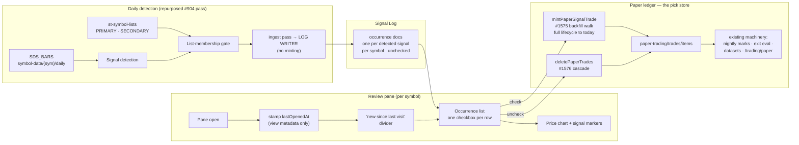

**Topic:** Paper Trading Infra  
**Topic Slug:** paper-trading-infra  
**Thread:** Signal Selection  
**Thread Slug:** signal-selection  
**Issue:** #1120  
**Thread Parent:** #1117  
**Topic Parent:** #553  
**Domain:** PAPER-TRADING  
**Type:** PRD  
**Status:** Approved  
**Created:** 2026-11-20  
**Last Updated:** 2026-11-20  

# PRD — Signal Selection

## Problem

Auto-paper ingest (Thread #904) mints a `PaperTrade` for every qualifying
signal on PRIMARY/SECONDARY list members — the ledger is the *unfiltered
universe* of detected signals, not a curated record of "trades I would have
taken." The questions this topic exists to answer — *would I have taken this
signal? how would my picks have done? what pattern did the ones I skipped
share?* — cannot be asked of an uncut ledger. Curation today means hunting
~300 minted trades across ~200 symbols and deleting the ones you don't want:
reject-by-deletion, exactly backwards for a keep-only workflow, and the
ledger already carries ~60 stray NEW-list captures that slipped the
membership config before #1576 tightened it.

Meanwhile the capture machinery is the right shape and the wrong output.
`runAutoPaperIngestFill` already detects every eligible signal occurrence
every day — its value was never "a trade exists without review," it was "no
signal escapes the net." And `backfillSignalTrade` (#1575) already proves a
trade can be minted arbitrarily late with a complete lifecycle: entry at
signal-bar close, marks replayed from stored bars, exits evaluated forward
to today. If a late mint is equivalent to a day-of mint, minting everything
on detection buys nothing — it only manufactures trades that mostly get
deleted.

The user reviews symbol-by-symbol, non-linearly — recent signals first, or
a specific stretch — and cannot (and need not) review daily. Paper trading
is for data collection; selection latency is irrelevant.

## Concept

1. **The Signal Log is the capture net.** Each eligible symbol owns an
   accumulating log of every detected signal occurrence. The daily ingest
   pass is repurposed from trade-minter to **log writer** — same detection,
   same PRIMARY/SECONDARY membership gate, output = occurrence records
   instead of trades. A symbol outside those lists joins the log universe by
   being promoted onto one. The log never forgets: unchecked occurrences
   persist forever, constituting the *unselected cohort* — the substrate
   for later kept-vs-unselected pattern analysis.

2. **Checkbox = ledger membership.** One affordance, total semantics. A
   checked occurrence means a `PaperTrade` exists for it; an unchecked one
   means none does. **Checking mints** via the #1575 backfill machinery —
   backdated entry, replayed marks, exits walked to today, curated
   governing dims (#1573). **Unchecking deletes** via `deletePaperTrades`
   (#1576) — full cascade: trade doc, marks, runs, request artifacts,
   account counters. There is no kept flag, no shadow selection set, no
   parallel universe: the ledger *is* the pick store.

3. **Review is free-form, per symbol.** A pane pairs the symbol's
   occurrence list with a price chart carrying signal markers. The user
   browses any region in any order — no cursor, no commit range, no
   rejected state. Each toggle acts immediately and independently. A
   per-symbol `lastOpenedAt` stamp drives a "new since last visit" divider
   so returning sessions can see what accumulated since they last looked;
   it gates nothing.

4. **The legacy minted ledger is wiped.** All auto-minted signal trades —
   including the ~60 NEW-residue strays — are deleted through the #1576
   cascade before this flow goes live. Post-wipe, a `PaperTrade` exists
   only because a human kept a signal. Every wiped trade's occurrence
   remains logged, so the delete is lossless in aggregate.

## System context

## User stories

### US1 — The log accumulates without me

> As the user, the system records every qualifying signal occurrence on
> PRIMARY/SECONDARY symbols every day, whether or not I ever open the
> review pane — so no signal is ever lost to a day I didn't log in.

Acceptance criteria:

- The repurposed ingest pass writes one occurrence record per detected
  signal on list-member symbols — same detection and membership gate as
  today; **no `PaperTrade` is minted by the pass.**
- Occurrence records dedupe identically to the old mint path — a
  re-detection does not duplicate a logged occurrence.
- Occurrences carry a stable identity joinable to a later-minted trade
  (same deterministic id lineage as #1573's live⇄mint determinism).
- **How to verify:** after a daily pass, each list-member symbol's log
  holds docs for that day's qualifying signals; a symbol demoted off
  PRIMARY/SECONDARY stops accumulating (promoting it resumes logging).

### US2 — Open a symbol, see its whole signal list

> As the user, I pick a symbol and see every occurrence it has accumulated —
> list beside a price chart with markers — so I can review signals in
> whatever region and order I choose.

Acceptance criteria:

- A pane pairs the per-symbol occurrence list with a price chart; each
  occurrence renders a marker at its signal bar.
- The list renders every occurrence for the symbol — fresh or old —
  unchecked unless a `PaperTrade` exists for it (checked).
- Rows carry enough context to decide without leaving the pane: signal
  date, type/direction, signal snapshot dims.
- Selecting a row (or chart marker) focuses that signal region.
- **How to verify:** open a symbol with N logged occurrences → N rows,
  all unchecked; check one → reopen → that row renders checked.

### US3 — Check = mint the trade

> As the user, checking an occurrence mints a real `PaperTrade` for it —
> backdated to its signal bar with the full lifecycle replayed to today —
> so late selection produces the same record as day-of selection.

Acceptance criteria:

- Checking invokes the #1575 mint path: entry at signal-bar close,
  marks replayed from stored bars, governing-exit walk per the curated
  variant set (#1573) — a trade whose governing exit fired in history
  lands CLOSED; a still-open one joins live daily management.
- Re-checking an already-minted occurrence is a no-op (deterministic id
  dedupe, same as the existing live⇄mint collision path).
- The minted trade carries the occurrence's provenance and is
  indistinguishable in the ledger from any other signal trade.
- **How to verify:** check a 30-day-old occurrence → one `PaperTrade`
  exists with entry on the signal date and marks through today;
  uncheck+recheck → same single trade.

### US4 — Uncheck = delete the trade

> As the user, unchecking a checked occurrence deletes its `PaperTrade`
  completely — trade, marks, artifacts, counters — so reversing a pick is
  one toggle.

Acceptance criteria:

- Unchecking routes through `deletePaperTrades` (#1576 cascade) —
  trade doc, `rq-*` request artifacts, `pap_{tradeId}` ticket, and
  `openTradeCount` rewind all apply.
- The occurrence row remains in the log (unchecked) — deleting the
  trade never deletes the signal record.
- Unchecking an occurrence with no trade is a harmless no-op.
- **How to verify:** check → uncheck → `paper-trading/trades/items`
  contains no doc for that occurrence; the log row persists unchecked.

### US5 — See what's new since I last looked

> As the user, the pane marks occurrences logged since my last visit to the
> symbol, so a return session can pick up where attention left off —
> without the system imposing a review order.

Acceptance criteria:

- Opening a symbol's pane stamps `lastOpenedAt` (view metadata; no
  ledger consequence).
- A "new since last visit" divider or badge visually separates
  occurrences logged after the previous `lastOpenedAt`.
- The divider is informational only — review order stays free-form.
- **How to verify:** open a symbol, close it, log a new occurrence,
  reopen → the new occurrence renders on the "new" side of the divider.

### US6 — The ledger starts clean

> As the user, every auto-minted trade is deleted before this flow ships —
> so the ledger contains only trades a human kept, and "checked" always
> means "chosen."

Acceptance criteria:

- A one-shot wipe deletes all signal-source `PaperTrade`s via
  `deletePaperTrades` (batched under its 50-item cap), including the
  ~60 NEW-residue strays censused under #1576 — ledger empties of
  auto-minted trades entirely.
- Signal Log occurrences are unaffected by the wipe (they are not
  trades).
- Strategy/manual/`accept`-flow trades are out of scope and untouched
  (the cascade already refuses non-signal trades).
- **How to verify:** post-wipe, `listPaperTrades` returns zero
  signal-origin trades; each deleted trade's symbol still shows its
  occurrence in the log.

### US7 — Pick which symbol to work on

> As the user, I can see which symbols have accumulated occurrences (and
> how many, including how many are new since my last visit), so I can
> choose my next review target without opening each symbol blind.

Acceptance criteria:

- A symbol picker/queue lists symbols with logged occurrences, with
  per-symbol counts (total; new-since-last-visit).
- Symbols with no logged occurrences don't clutter the picker (or
  render distinctly empty).
- **How to verify:** after daily logging, the picker's counts match
  the occurrences actually in each symbol's log.

## Technical context

- **Existing machinery this reuses:** signal detection + membership gate
  (`auto-paper-ingest-pass.ts`), backfill mint (`backfillSignalTrade`,
  #1575 — replaySignalToRow walk, `commitBackfilledTrade`),
  cascade delete (`deleteTradeCascade` / `deletePaperTrades`, #1576),
  curated variant dims + governing policy (#1573), nightly marks/exit
  eval + ledger reads + `/trading/paper` + analysis datasets
  (`paper-trading/trades/items` consumers unchanged).
- **New machinery:** the occurrence-log document model (collection shape,
  doc identity — anchored `st-`-prefixed collection per repo convention;
  schema at blueprint), the ingest pass's write path swap (mint → log
  write), the review pane (new surface — route/layout at blueprint;
  reuses chart + `signal-marker-converters` infrastructure), per-symbol
  `lastOpenedAt` metadata, and the one-shot legacy wipe.
- **Deterministic identity:** occurrence ids must share the #1573 sig-origin
  id lineage so `tradeId`/occurrence joins and mint dedupe work without a
  lookup table.
- **Decision record:** `docs/adr/ADR-012_signal-selection-ledger-membership.md`.
- **Glossary:** `CONTEXT.md` — *Signal Log*, *Selected Signal*,
  *Signal Selection*, *Hindsight Review*.

## Non-goals / radar

- **Real-time execution** — paper trades are data collection; selection
  latency is by design irrelevant. Real-trading signal flow is untouched
  (this changes nothing about `paperSignalOrder` / accept-flow paths).
- **Kept-vs-unselected comparison surface** — the log *preserves* the
  unselected cohort; the analysis surface comparing cohorts (the idea's
  "filterable pattern" payoff) is a follow-up, likely under the analysis
  workbench (#1059) or a later task in this thread.
- **Log depth/backfill policy** — how far back a first-opened symbol's
  log reaches (full SDS_BARS history vs bounded window vs forward-only
  plus on-demand backfill) is deferred to blueprint; the default intent
  is "as much detectable history as is practical."
- **Options/CSP expression replay** — #1119.
- **Time-series position analysis / equity curves** — #1118.
- **Signal detection changes** — the pass detects exactly what it detects
  today; universe changes happen via list membership, not here.
- **Scanning/filtering as the selection mechanism** — selection is
  deliberate manual picks; the pane is not a screener.

## Open questions resolved in grilling

- **One list, not two.** No separate historical vs live signal lists —
  one accumulating per-symbol log; a never-reviewed symbol's first session
  simply shows its whole history.
- **Keep-checkbox for all.** All occurrences start unchecked; the user
  only ever checks (never mass-unchecks). Mint-all-then-delete and
  kept-flag-parallel-to-membership were both rejected.
- **Auto-ingest → log writer.** Stops minting; writes occurrences. No
  data-collection loss — backfill mint replays the full lifecycle on
  check, whenever it happens.
- **No cursor.** The linear `[cursor, seal]` commit model (designed, then
  discarded) forced front-to-back review the user doesn't do; free-form
  per-occurrence toggles replace it. No rejected state — unchecked is
  just unchecked.
- **Checkbox = ledger membership.** Check mints, uncheck deletes; each
  toggle is independent; nothing is staged.
- **Universe = PRIMARY/SECONDARY.** The log covers exactly the
  auto-paper-eligible universe; promote a symbol to include it.
- **Legacy ledger wiped.** ~300 auto-minted trades bulk-deleted; the log
  is the sole source going forward.
- **"New since last visit" kept.** `lastOpenedAt` survives the cursor
  deletion as pure view metadata — informational divider only.

## Deferred to blueprint

- Occurrence-doc schema + collection topology (anchored `st-` root per
  repo convention), `lastOpenedAt` storage location.
- Log depth/backfill mechanics for never-logged history.
- Pane route, layout, symbol-picker surface, and whether it extends or
  replaces any existing review surface.
- Batch vs per-toggle callable shape for mint/delete behind the checkbox.
- Session-record granularity beyond `lastOpenedAt` (if any).
- Wipe sequencing vs deploy ordering.
