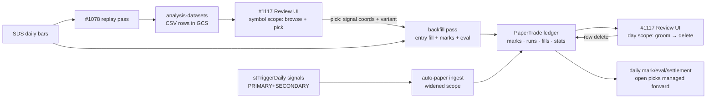

**Topic:** Paper Trading Infra  
**Topic Slug:** paper-trading-infra  
**Thread:** Historical Signal Replay  
**Thread Slug:** historical-signal-replay  
**Issue:** #907  
**Thread Parent:** #906  
**Topic Parent:** #553  
**Domain:** PAPER-TRADING  
**Type:** PRD  
**Status:** Approved  
**Created:** 2026-11-13  
**Last Updated:** 2026-11-17  

# PRD: Paper Trading Infra — Historical Signal Replay

## Problem Statement

Thousands of ST signals fired before the live auto-paper stream (Thread
#904) existed, and the signals that keep firing land in two different
worlds depending on when they arrived: live ones become real ledger
positions; historical ones exist only as summary rows in a replay
dataset. A trader doing hindsight review wants ONE thing — "these are
the signals I would have taken, managed like trades" — but the current
shape splits it: browsable rows for history, ledger positions for the
present, and (in earlier drafts of this plan) a third artifact for the
picked subset.

That third artifact was the mistake. A parallel "selected signals"
collection reinventing marks, exits, and lifecycle outside the ledger
creates duplicate position-shaped universes — the same machinery built
twice, the same lifecycle understood two ways. The ledger already does
everything a picked signal needs: entry fills, daily marks, multi-run
exit tracking, close/cancel lifecycle.

This thread unifies on the ledger: **picked signals become real
`PaperTrade`s — backdated ones for history, auto-captured ones for the
live stream — and "selection" is just grooming the ledger.** One
position-shaped universe, one set of machinery, one review surface.

## Solution

Two ingestion paths feed ONE ledger, groomed by ONE review surface:

- **Historical path (symbol-by-symbol).** The review UI browses a
  symbol's signal history from the replay dataset (#1078). The user
  hand-picks the signals they would have taken. Each pick mints a real
  `PaperTrade` — backdated entry at signal-bar close, daily `PaperMark`s
  backfilled from stored bars, exit runs evaluated forward through
  history. The trade lands CLOSED if its exit would already have fired,
  or OPEN if the signal is still live — in which case the daily engine
  passes take over its management from there, the "history into live"
  bridge.
- **Live path (day-by-day).** Auto-paper ingest widens: every signal
  on the PRIMARY and SECONDARY capture lists instantiates a ledger
  entry when it fires — ingest wide, not just the currently-qualifying
  subset.
- **Grooming.** The user periodically reviews the entered trades and
  deletes the ones they wouldn't have taken. Deletion is real — the
  trade doc and its artifacts are removed, not tombstoned. What
  survives grooming IS the selection; there is no separate pick store
  and no provenance flag needed — surviving docs are the cohort, and a
  trade's origin is already readable from its fills (live quote vs
  backfilled bars).

The workflow converges naturally: as each symbol's historical curation
finishes, its surviving backdated picks already live in the ledger —
and that symbol joins the live grooming stream. Review surface is
shared: same list + price chart + signal markers + pick/delete
actions, scoped per-symbol (historical) or per-day (live).

## User Stories

### US-1 — Pick historical signals into the ledger

As a trader doing symbol-by-symbol hindsight review, I want checking a
signal to create a real paper trade with its full history, so that my
picks live in the same world as live positions.

*Acceptance criteria:*
- A generate request carrying an explicit list of `{symbol,
  signalBarDate, signalType}` coordinates (the `stSignalOccurrenceId`
  tuple) plus a governing exit variant mints one `PaperTrade` per
  item: backdated entry fill at the signal bar's close
  (`signal-bar-close`, matching replay rows).
- Each minted trade is walked forward over stored bars — a `PaperMark`
  written for each trading day, its exit runs evaluated — landing
  CLOSED with a real exit fill when the governing rule fires in
  history, or OPEN at the last stored bar when it hasn't.
- An OPEN-at-mint trade joins the live daily passes and is managed
  forward like any live position — no special-casing downstream.
- Trade ids are deterministic on the signal key — re-generating the
  same pick is a no-op, not a duplicate.
- The callable requires an authenticated request; a signal whose bars
  are absent produces a per-item error in the response, not a failed
  call.

### US-2 — Widen live ingest to the capture lists

As a trader, I want every signal on my PRIMARY and SECONDARY lists to
instantiate a ledger entry automatically, so that live selection is
grooming, not pre-filtering.

*Acceptance criteria:*
- The auto-paper ingest creates a `PaperTrade` for every signal fired
  on symbols in PRIMARY or SECONDARY — the live-date gate and
  deterministic dedupe behavior unchanged.
- Today's qualifying-only gates become list-scoped breadth (the exact
  qualifying rules vs "every signal" boundary is pinned at blueprint —
  the PRD intent is: list membership admits the entry; quality stays a
  grooming decision).

### US-3 — Groom by deleting

As a trader, I want to delete trades I wouldn't have taken, so that
the ledger holds only my selected set.

*Acceptance criteria:*
- A delete request by trade id removes the trade and its associated
  artifacts (marks, runs, order/ticket records per the existing
  cascade conventions); deleting a missing id is a safe no-op.
- Deletion is an explicit row action in the review surface — never a
  checkbox toggle.
- Surviving docs are the selected set; analysis reads post-groom, so
  deleted rejects never reach a snapshot generated after removal.

### US-4 — One review surface, two scopes

As a trader, I want the same review UI for symbol-scoped historical
picking and day-scoped live grooming, so that one workflow serves both.

*Acceptance criteria:*
- The review surface (built under Thread #1117) renders the same
  signal list + price chart + markers + pick/delete actions in both
  scopes — symbol scope browses dataset rows and mints trades on pick;
  day scope lists newly-ingested entries and deletes on un-pick.
- No second review UI exists for either workflow.

### US-5 — Reuse the real machinery end to end

As a maintainer, I want backfill to consume the same bars, exit
registry, and entry convention as the shipped replay pass, so that a
minted trade's history agrees with what replay already computed.

*Acceptance criteria:*
- Backfill evaluates exits through the same `evaluateVariant` seam and
  grammar `replaySignalToRow` uses.
- Marks come from the same cached-bars loader replay uses; entry is
  the signal bar's close.
- No signal is re-detected — the requested coordinate is authoritative.
- A spec asserts a minted trade's terminal outcome under its governing
  variant agrees with the replay row for the same signal (same return,
  same exit reason).

## Implementation Decisions

- **No new collection** — the artifact is the existing `PaperTrade`
  plus its marks/runs/fills. The pick set is a ledger query, not a
  separate store. This is a deliberate reversal of the earlier
  selected-signals design: one position universe, not two.
- **Backfill machinery** — a synthesis pass that, given a signal
  coordinate + governing variant, writes the entry fill, walks stored
  bars writing `PaperMark`s, and runs the exit eval per day — the
  same walk the daily passes perform, executed in one shot over
  history. Mark provenance is readable from the write path (the
  eval-pass already notes `PaperMark` lacks a provenance field — this
  thread is where that field may finally land, marking bars-sourced
  vs live-quote marks).
- **Deterministic trade ids** — derived from the signal key so
  re-picks are no-ops and the historical pick ↔ live capture can never
  double-mint the same signal.
- **Live ingest widening** — the ingest pass's list scope extends to
  SECONDARY; breadth is a config/scope change, not a new pass. The
  live-date gate stays: historical runs never auto-ingest — the only
  path from history to the ledger is an explicit pick.
- **Groom-delete is a cascade** — removing a trade removes its marks,
  runs, and ticket records; semantics follow the existing
  close/cancel lifecycle where applicable, extended to real deletion.
- **No provenance flag** — the ledger is not split into "real" vs
  "review" cohorts; surviving docs are the cohort by definition, and
  origin is recoverable from fill/mark provenance. Analysis is
  always post-groom.
- **Stats participation** — backfilled and groomed-surviving trades
  participate in stats like any position: they ARE the selected set.
  (Rejects are deleted before analysis; the "pollutes stats" objection
  dies with them.)
- **Still-open minted trades join live management** — the daily
  mark/eval passes see them as ordinary open positions; no replay
  special-casing in the engine.
- **One shared review surface** — Thread #1117's UI serves both
  scopes; no duplicate review UI.

## Testing Decisions

- **Backfill core specs** — fixture bars + hand-computed expectations:
  entry fill at signal-bar close, mark per trading day, governing
  exit firing mid-history → CLOSED with exit fill, never-fires →
  OPEN at last bar, deterministic id no-op re-run.
- **Callable core specs** — fake deps capturing writes: auth guard
  first, validation error codes, per-item error vs call failure,
  idempotent minting, delete-cascade coverage, delete no-op on
  missing id. Prior art: `tests/functions/options-replay/` suites —
  same `(request, deps)` + `node:test` + `assert` convention.
- **Ingest scope specs** — SECONDARY-list signal produces an entry;
  non-listed symbol still skipped; historical-date gate unchanged.
- **Consistency pin** — minted trade outcome == replay row outcome
  for the same signal under the same variant (return + exit reason).
- **No emulator, no live Firestore** — every effect behind deps.

## Out of Scope

- **The review UI itself** — list, chart markers, pick/delete
  affordances, both scopes. Thread #1117's entire reason to exist.
- **Unbounded historical auto-ingest** — every signal on PRIMARY +
  SECONDARY over history minting a ledger entry is deliberately
  rejected (doc proliferation for unread artifacts); historical
  picks are human-gated.
- **A separate selected-signals collection** — rejected: duplicate
  position-shaped universe.
- **Equity curves / cumulative P&L** — #1118's open question.
- **Pattern mining / upfront filters** — a #1117 surface concern.
- **Options expressions** — CSP/vertical modeling is #1119; this
  thread is equity signals only.
- **ZigZag-segment filtering** — deferred at the topic level.
- **Analysis slices as the pick store** — rejected: a slice is a
  saved predicate; a pick is a position.
- **On-demand stateless mark synthesis** — rejected: the ledger IS
  the artifact; a recomputed shadow would be the parallel universe
  we're eliminating.

## Technical Context

- Backfill depth is bounded by SDS daily-bar history — a signal older
  than the bar cache produces a per-item error, not a partial trade.
- Live ingest volume is bounded by daily signal flow on the two
  capture lists — a few-to-dozens per day, a groomable list.
- Groom-before-generate ordering matters for datasets: analysis
  snapshots are immutable once written — a deleted trade still appears
  in snapshots taken before its deletion. The convention: groom, then
  generate.
- Minted trades are indistinguishable from organic ones downstream —
  that's the point. Origin is recoverable via fill/mark provenance
  if ever needed for reporting.
- Deletion semantics for a mid-flight open trade follow the
  close/cancel machinery extended to real removal — blueprint-level
  detail.

## System Context

## Further Notes

The original idea (#907) predates the #1078 replay ship. Planning moved
through three architectures:

1. **Selected-signals collection** — a new doc kind carrying modeled
   mark series, the doc doubling as the pick. Rejected when it became
   clear it was a shadow `PaperTrade` — same lifecycle, rebuilt beside
   the real one.
2. **On-demand stateless synthesis** — recompute the day-by-day walk
   per view, store nothing. Rejected: no stable artifact, no
   annotation surface, and it didn't resolve the parallel-universe
   problem — it just made the parallel universe ephemeral.
3. **Ledger-seeded replay (this PRD)** — picked signals mint real
   `PaperTrade`s; selection is grooming the ledger; one universe, one
   machinery set. The "ledger = what actually papered" concern that
   originally argued against synthetic positions resolved on a
   product decision: the user owns grooming, analysis is
   post-groom-only, and fill/mark provenance already distinguishes
   origin — so the ledger as a curated workbench is honest, not
   polluted.
