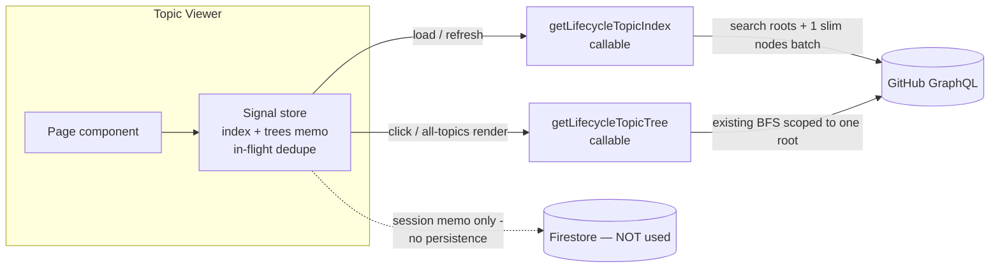

**Topic:** GitHub read-only issue UI  
**Topic Slug:** `gh-issues-ui`  
**Thread:** Lifecycle tree fetch performance & caching  
**Thread Slug:** `lazy-loading`  
**Issue:** #1624  
**Thread Parent:** #1609  
**Topic Parent:** #619  
**Domain:** DEV-TOOLS  
**Type:** PRD  
**Status:** Approved  
**Created:** 2026-11-18  
**Last Updated:** 2026-11-19  

# PRD — Topic Viewer: lazy loading (index + on-demand subtrees)

## Problem Statement

The Topic Viewer takes 30–60 seconds to load. The reason is structural,
not incidental: `getLifecycleTree` walks the **entire issue corpus** —
every descendant of every topic root — in one monolithic fetch before
the page can show anything. Each node carries the full `ISSUE_FIELDS`
expansion (`labels(first:50)` + `projectItems(fieldValues(first:20))` +
`subIssues(first:100)` paged to completion), so a single page load burns
thousands of GraphQL points. During #1531 QA the deployed callable
returned `API rate limit already exceeded` — the hourly budget is spent
by a handful of page loads.

The user does not need the whole corpus up front. They need the topic
list fast, then the one tree they actually click.

## Solution

Split the monolith into a layered fetch:

- **Layer 0 — topic index.** A new callable returns only topic-root
  nodes with slim fields (no `subIssues` expansion) — enough for the
  left pane's grouping, sort, stage chips, search, and closed styling.
  The page becomes interactive in ~1–2 seconds.
- **Layer 1 — per-topic subtree.** A second callable runs the existing
  BFS machinery scoped to a single topic root. A topic's tree is fetched
  only when the user clicks it — behind a skeleton — and is then
  **memoized in the store for the rest of the session**. Re-clicking
  costs zero.
- Closed topics are fetched only when actually needed (selection, or
  all-topics rendering them) — never on page load.
- No server-side cache, no TTLs, no prefetch of the corpus. GitHub spend
  per page visit drops from "the entire corpus" to "the topics the user
  actually looked at." The prior rate-limiting failure mode mostly
  disappears because there is no longer a bulk fetch to rate-limit.

## System Context

## User Stories

### US-1 — See the topic list fast

As a developer, I want the topic list to render within a few seconds of
opening the page, so that the tool is usable at all.

*Acceptance criteria:*
- On page load, the left pane renders topic rows (number, title, stage
  chip, closed styling) from the index callable alone — no subtree
  fetch is required to display the list.
- The index response contains no `subIssues` expansion per topic.

### US-2 — Click a topic, get its tree

As a developer, I want a topic's hierarchy to load when I select it, so
that I only pay for what I inspect.

*Acceptance criteria:*
- Selecting a topic with no memoized tree fires exactly one subtree
  fetch; the right pane shows a loading state until it lands.
- The rendered tree is identical in shape and metadata to what the
  monolithic fetch produced for that topic (same nodes, order, labels,
  status).

### US-3 — Revisit a topic for free

As a developer, I want already-loaded trees to stick around for my
session, so that navigating back and forth doesn't refetch.

*Acceptance criteria:*
- Selecting a previously fetched topic renders instantly with zero
  network calls.
- Memoization is session-scoped (signal store only) — no Firestore or
  localStorage persistence.

### US-4 — Duplicate requests never fire

As a developer, I want concurrent triggers for the same topic to share
one in-flight request, so that clicking during a load doesn't
double-spend.

*Acceptance criteria:*
- A second trigger for a topic already in flight does not issue a new
  callable invocation.

### US-5 — Browse every topic at once

As a developer, I want all-topics mode to fill in progressively, so I
can scan the whole project without waiting for a monolith.

*Acceptance criteria:*
- Enabling all-topics renders a skeleton per filtered-but-unfetched
  section and queues subtree fetches at bounded concurrency (~4 in
  flight).
- Each section renders as its fetch lands; a failed section shows a
  retry affordance without affecting its neighbors.
- Disabling/re-enabling all-topics reuses the memoized trees — the
  queue doesn't refetch what the session already holds.

### US-6 — Closed topics stay lazy

As a developer, I want closed topics' subtrees fetched only when I
actually view them, so that dead work never burns quota.

*Acceptance criteria:*
- `show closed` affects the index-level filter immediately (index
  carries `state`); no subtree fetch is triggered by the toggle alone.
- A closed topic's subtree fetches only on selection or when all-topics
  mode needs it rendered.

### US-7 — Refresh honestly

As a developer, I want the refresh button to update what I can see —
not to silently re-download the corpus.

*Acceptance criteria:*
- Refresh re-runs the index callable (topic list, stages, closed state
  all update).
- Refresh drops the memoized trees and refetches only the currently
  rendered set — the selected topic normally, the filtered set in
  all-topics mode.

### US-8 — One topic's failure doesn't take the page down

As a developer, I want a per-topic fetch failure to be isolated, so one
bad subtree can't brick the viewer.

*Acceptance criteria:*
- A failed subtree fetch marks that topic's pane/section as errored
  with a retry; other topics are unaffected.
- A rate-limit-class error halts the all-topics queue instead of
  erroring every remaining section.

## Implementation Decisions

### Backend

- **Two new callables** alongside the existing `getLifecycleTree`
  (retained, unused by the FE — zero-risk rollback; retirement is a
  separate cleanup decision):
  - `getLifecycleTopicIndex(request: LifecycleRepoRequest)` →
    `{ topics: LifecycleTopicMeta[] }` where each entry is the slim
    root record (number, title, state, labels, updatedAt, url, project
    Status) — produced by `searchTopicRoots` + one `nodes()` batch with
    a field set that omits `subIssues`.
  - `getLifecycleTopicTree(request: LifecycleRepoRequest & { topicNumber: number })` →
    the same `LifecycleTreeResponse` contract as today, scoped to the
    one root. The existing BFS (`NODES_BATCH` + `collectSubIssues` +
    truncation guard) is reused unchanged with `frontier = [topic]`.
- The monolith's truncation guarantee is preserved per-topic: a
  partially walked subtree throws rather than returning incomplete data.
- Callable names registered in the FE `CallableName` surface to keep
  the deploy-name parity check green.

### Store

- State gains: `topicIndex: LifecycleTopicMeta[]`, `trees: Map<number,
  LifecycleTreeResponse>` (the memo), `treeLoading: Set<number>` /
  `treeError: Map<number, string>`, plus the queue bookkeeping for
  all-topics.
- `visibleTopics`/`groupOrder` derive from `topicIndex` — the left pane
  contract is unchanged; it just reads the index instead of the
  monolith's `topics` array.
- Selected-tree derivations (`treeRows`, `matchInfo`, etc.) read the
  memo entry for `selectedTopic()` — `undefined` while loading.
- In-flight dedupe: a `Map<number, Promise>` keyed by topic number;
  every trigger joins the in-flight entry instead of firing a new call.
- All-topics queue: FIFO of the filtered-but-unfetched topics,
  concurrency 4; a rate-limit error drains the queue and marks the
  page, non-rate-limit errors mark their own section.

### Page

- Left pane unchanged (already renders `visibleTopics`).
- Right pane: selected topic not yet in the memo → skeleton/spinner
  state; errored → message + retry button. All-topics: each unfetched
  section renders its own skeleton.
- The as-of/freshness text reflects the index fetch (and, when present,
  the selected tree's own fetch time can be shown secondarily — copy
  decision at impl).
- Refresh button reuses the existing control; semantics per US-7.

## Testing Decisions

- **Backend:** the existing `Gql` injection seam — drive
  `getLifecycleTopicIndex` and `getLifecycleTopicTree` with fixture
  pages exactly as `fetchLifecycleData` is spec'd today. Cover: slim
  index fields (no subIssues queried), single-root BFS scoping,
  truncation guard firing per-topic.
- **Store:** spec the memo map (serve-without-refetch), in-flight
  dedupe (one call for concurrent triggers), all-topics queue
  (bounded concurrency, per-section errors, rate-limit drain), refresh
  semantics (index + rendered set only), closed laziness.
- **Page:** spec the skeleton/error/retry states per pane and per
  all-topics section.
- Prior art: `topic-viewer.store.spec.ts` already stubs the service —
  the new specs extend the same seam.

## Out of Scope

- **Firestore/any persistence cache** — explicitly deferred. The
  closed-immutable / per-node `updatedAt` diff designs from the grilling
  session remain on the table as a possible fast-follow if quota still
  hurts; the doc layouts sketched there need no rework.
- **TTLs, stale-on-error serving** — session memo only.
- **Eager prefetch of open topics** — rejected: it re-downloads the
  open corpus per load, defeating the quota fix.
- **Query-shape reduction (Fix B: `first:` shrink)** — per-topic fetches
  are small by construction; revisit only if fat topics still cost too
  much.
- Label write paths, repo picker mechanics, tree rendering — unchanged.

## Technical Context

- The quota is a **rolling 60-minute GraphQL budget**, not a daily cap —
  the goal is gentleness, not minimal spend. Occasional expensive views
  are fine; what must die is the *involuntary* corpus fetch on every
  page load.
- GitHub GraphQL point cost scales with `first:` per node — the
  monolith's `subIssues(first:100)` + `projectItems` expansion on every
  descendant of every topic is what burned the budget. The index query
  expands ~10–30 roots with no `subIssues`.
- A clicked topic's subtree is still the existing BFS (fat parents
  page to completion) — per-topic latency should be a few seconds.
- All-topics + show-closed remains the most expensive view by design;
  it is an explicit user action.

## Further Notes

- The FE `CallableName` parity check and deploy-name registration are
  part of the BE task's definition of done.
- Fast-follow candidates if this lands well: persist closed topics
  (never refetched — reopen detection via index `state`), per-node
  `updatedAt` diffing for open subtrees, per-topic `lastFetchedAt`
  shown in the UI.
- **Corpus grooming (future idea, not this thread):** the issue list
  itself carries deadwood — stale open topics, abandoned threads,
  issues that should be closed. Weeding it shrinks every fetch
  structurally and makes the quota problem smaller regardless of
  caching. Worth its own idea/thread when the time comes.
