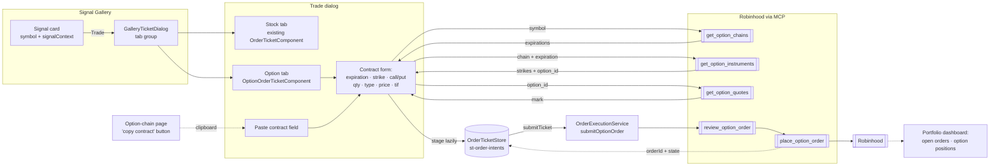

**Topic:** Options Trading Support  
**Topic Slug:** options-trading-support  
**Thread:** Single-leg option orders  
**Thread Slug:** single-leg-option-orders  
**Issue:** #944  
**Thread Parent:** #943  
**Topic Parent:** #942  
**Domain:** OPTIONS  
**Type:** PRD  
**Status:** Approved  
**Created:** 2026-10-09  
**Last Updated:** 2026-10-11  

## Problem Statement

A signal in the gallery can justify more than a stock position. Sometimes the right expression of a signal is a leveraged ETF; sometimes it's a long call or put — defined-risk directional exposure without tying up full notional. Today the Trade action on a signal card opens a dialog containing only the stock/ETF order ticket, so the only position a signal can produce is an equity one. The Robinhood MCP surface already supports single-leg option orders end-to-end (`get_option_chains`, `get_option_instruments`, `get_option_quotes`, `review_option_order`, `place_option_order`), and the portfolio dashboard already reads option positions, orders, and quotes — but there is no write path from a signal to an option order.

## Solution

Add a tab group to the gallery Trade dialog. The existing stock/ETF order ticket stays in the **Stock** tab, unchanged. A new **Option** tab hosts a single-leg option order ticket scoped to the same signal card: the underlying symbol is fixed from the card, and the user picks the contract either through compact selects (expiration → strike → call/put) fed by live chain data, or by pasting contract details copied from the option-chain page — plus order terms (quantity, limit or market, price, time-in-force). No presets or smart defaults in v1.

The option ticket is a first-class `OptionOrderTicket` in the existing order-ticket store: it carries the same signal provenance (`signalContext`, `decisionIds`) so the gallery card reflects its state, and it keeps the bucket picker for allocation attribution consistency. Submission runs the same review-then-place pattern as equity — `review_option_order` preflight, then `place_option_order` with the ticket's `ref_id` for idempotency — and lands in the same downstream surfaces (portfolio open-orders, order history, option positions) that already read option data.

v1 is deliberately narrow: **long calls and puts only** (buy-to-open, `position_effect = open`), regular market hours, single leg. Sell-to-open, multi-leg spreads, exercise, option stops, paper trading, and option-chain-page launches are all deferred.

## User Stories

1. As a trader, I want the gallery Trade dialog to show Stock and Option tabs, so that one signal card can produce either kind of position.
   - AC: clicking Trade on a signal card opens a dialog with a tab group; the Stock tab renders the existing order ticket exactly as today (same staged ticket, same behavior); the Option tab renders the option ticket form; switching tabs does not lose form state within a dialog session.

2. As a trader, I want the Option tab to offer two ways to choose a contract — compact selects in the dialog for quick picks, and a paste field that accepts contract details copied from the option-chain page — so that I can grab a contract fast or bring one I already researched on the full chain.
   - AC: on first activation of the Option tab, expirations populate from `get_option_chains`; selecting an expiration populates strikes via `get_option_instruments`; call/put is a toggle; a paste/import field accepts contract details (OCC symbol or strike/expiration/type triplet) copied from the option-chain page and resolves it the same way; loading and failure states are visible inside the tab and do not disrupt the Stock tab; a "copy contract" affordance on the option-chain page produces the pasteable payload.

3. As a trader, I want any contract selection — from the selects or from a paste — to resolve to an actual Robinhood option instrument (`option_id`), so that the ticket is orderable.
   - AC: the resolved contract displays its identity (underlying, expiration, strike, call/put); the ticket holds the Robinhood `option_id`, not just the OCC symbol; both entry paths converge on the same resolved contract and quote; an unresolved or stale selection blocks submit with a visible message.

4. As a trader, I want to see the option's current quote (mark/ask) once a contract is resolved, so that I can price my limit order.
   - AC: `get_option_quotes` runs for the resolved `option_id`; the form shows mark and the estimated premium cost (price × quantity × 100); the quote refreshes on contract change.

5. As a trader, I want to enter quantity (contracts), order type (limit or market), limit price, and time-in-force (gfd/gtc), so that I control the order terms.
   - AC: quantity is a positive integer in contracts; market orders are regular-hours/gfd-only per RH constraints; market hours is fixed to `regular_hours`; validation blocks submit on missing/invalid fields.

6. As a trader, I want buy-to-open only in v1, so that the form can't produce an order the account can't support.
   - AC: the only offered position effect is open and the only side is buy (long call or long put); sell-to-open and close are not rendered as choices.

7. As a trader, I want the option ticket linked to the signal I'm acting on, so that the card reflects the ticket and provenance survives.
   - AC: the persisted `OptionOrderTicket` carries `signalContext` and `decisionIds` matching the equity ticket's semantics; the gallery card shows the option ticket's state the same way it shows the stock ticket's.

8. As a trader, I want the bucket picker on the Option tab, so that allocation attribution stays consistent across instrument types.
   - AC: the option ticket form offers the same bucket selector as the stock ticket; the choice persists on the ticket document.

9. As a trader, I want submission to run review-then-place like equity orders, so that the broker's preflight catches problems before a live order exists.
   - AC: submit calls `review_option_order` then `place_option_order` with the ticket `ref_id`; the review summary is surfaced (confirm dialog or equivalent); the dialog closes on SUBMITTED exactly as the stock flow does; failures land in the existing dead-state/unconfirmed classification and are visible on the ticket.

10. As a trader, I want a fatfinger check on option orders, so that a wildly oversized order is blocked before it reaches the broker.
    - AC: submission is blocked when estimated premium (quantity × price × 100) exceeds a configurable percentage of available cash — a new `TradingConfig` field (e.g. `optionMaxPremiumCashPercent`, default 25%); no units/allocation-percent guardrails apply; equity dedupe (symbol+side) does not apply — each option ticket stages fresh per contract choice.

11. As a trader, I want submitted option orders to appear in the places I already look, so that nothing is invisible after submit.
    - AC: the option order appears in the portfolio dashboard's open-orders (cancelable via `cancel_option_order`) and order-history surfaces without new backend work; a filled option order produces an option position row; the ticket's stored state reflects the broker response.

12. As a trader, I want clear errors when option trading isn't available on the account, so that a blocked order isn't mysterious.
    - AC: if the account lacks `option_level_2` or RH rejects for permission/margin reasons, the error surfaces in the dialog/tab — not silently dropped.

## System Context

## Technical Context

- **Contract identity is two-step.** RH order tools need a UUID `option_id`, not an OCC symbol. Resolution: `get_option_chains` (symbol → chain + expirations) → `get_option_instruments` (chain + expiration → strikes/types → `option_id`). The existing Savant Partner option-chain pages use OCC contract ids — a different namespace; they are not a source of `option_id`s and are not the launch surface for v1.
- **Account gating.** `place_option_order` requires `option_level_2` + `agentic_allowed`. Long calls/puts are L2 territory; the form should gate or surface the upgrade path (`get_option_level_upgrade_info`) when the account lacks it.
- **Option pricing semantics.** Prices are per-contract premium; cost = qty × price × 100. No fractional, no dollar-amount sizing — `defaultDollarAmount` does not map onto options and is not used.
- **Market orders** are single-leg, `regular_hours`, `gfd` only per RH; limit orders allow `gfd`/`gtc`.
- **Idempotency** is the ticket `ref_id` on `place_option_order`, same as equity.
- **Provenance linkage** is what puts the option ticket on the gallery card: `signalContext`/`decisionIds` matching the equity ticket is a requirement, not an ornament.
- **Existing read path reused.** Open-orders/order-history merge of `get_option_orders`, option positions + quotes + P&L, allocation leg expansion (×100) — all already exist; this Thread adds the write path and the dialog UI.

## Implementation Decisions

- **Tabs on the existing dialog**, not a new dialog or page — one Trade action, one surface, instrument chosen by tab.
- **Option ticket stages lazily.** The equity ticket is staged at Trade-click as today; the option ticket is staged into `OrderTicketStore` when the Option tab's form reaches a submittable state (or on submit) — staging two tickets eagerly per Trade click would orphan one in the queue.
- **Ticket model rework (additive).** `OptionLeg` gains `optionId` and `positionEffect: 'open' | 'close'`; the OCC `symbol` stays for display/grouping. Order-level fields: `quantity` (contracts), `type` (limit/market), `price`, `timeInForce` (gfd/gtc), `marketHours` fixed `regular_hours`. Old option docs don't exist in `st-order-intents`, so no migration.
- **New `submitOptionOrder` in `OrderExecutionService`** mirroring `submitEquityOrder`: `review_option_order` preflight → `place_option_order` with `ref_id`, same error classification (dead-state/unconfirmed). `cancelOptionOrder` already exists. Equity stop-update logic stays equity-only.
- **Separate component for the option tab** (`OptionOrderTicketComponent` or equivalent) rather than growing option branches inside `OrderTicketComponent` — the equity form's quantity/dollar-amount/stop-loss logic doesn't translate.
- **Guardrails:** the only pre-submit block is premium (qty × price × 100) vs a configurable share of available cash (new `TradingConfig` field, default 25% — the fatfinger guard). Units, allocation %, and equity dedupe don't apply to options.
- **Card statusing must include options.** `findCardTickets` currently filters `instrumentType === OPTION` out entirely (written when option tickets couldn't come from signals). It must accept option tickets carrying `signalContext`/`decisionIds` so the card reflects resting/settled/failed like the equity path — otherwise the card stays 'pending' after an option submit.
- **Two contract-entry paths, one resolution.** Compact selects (expiration → strike → call/put) for in-dialog picks, plus a paste field accepting contract details copied from the option-chain page; a "copy contract" affordance is added to the chain page. Both resolve to `option_id` via `get_option_instruments`.
- **Option-order lifecycle reconciliation is an open seam.** Ticket→FILLED reconciliation (`reconcileTerminalStatuses`) currently lives on the retiring signal-order page and reads `get_equity_orders` only. In v1 a submitted option ticket leaves the card at 'resting'; the live order is fully visible/cancelable in the portfolio dashboard via `get_option_orders`. Reconciling option orders to terminal card states belongs wherever post-retirement reconciliation lands — noted here so blueprint doesn't assume it exists.
- **No dedupe by symbol+side** for option tickets — two different contracts from one card are legitimately two tickets; `ref_id` protects submit retries.
- **Confirmation shows contract terms** — the confirm dialog must render contract identity, position effect, contracts × premium, and debit amount — not just `legs[0].symbol`.

## Testing Decisions

- **Seams:** option ticket component specs; a staging util mirroring `signal-order-staging.util` for option tickets; `OrderExecutionService.submitOptionOrder` specs (review→place happy path, review rejection, retry/unconfirmed classification); MCP client parser specs for `get_option_chains`/`get_option_instruments`/`get_option_quotes`.
- **Prior art:** `order-ticket.component.spec`, `order-execution.service.spec`, `signal-order-staging.util.spec`, `robinhood-mcp-client.service.spec` establish the style (jest-preset-angular, `jest.fn()`, stub Firebase providers, macrotask flush for async).
- **What good tests look like here:** contract-resolution chain (symbol → expiration → strike → `option_id`), form validation (integer qty, limit-required price, market-order TIF constraints), provenance carried onto the staged ticket, premium-vs-cash block boundary, submit classification parity with equity, and the Stock tab regression (unchanged behavior).

## Out of Scope

- Sell-to-open, buy-to-close, sell-to-close (long-only open for v1); covered calls / cash-secured puts.
- Multi-leg spreads and any multi-leg UI — the `legs[]` shape stays, but v1 always sends exactly one leg.
- Option exercise (`exercise_option`), assignment handling.
- Option stop-loss orders and trailing-stop protection of option positions.
- Paper trading of option tickets (`isPaperEligibleTicket` stays equity-only).
- Launching orders from the option-chain pages (OCC↔RH bridging is a later Thread; #571's contract selection feeds it).
- Presets, smart defaults, or strategy suggestions on the option form.
- Equity guardrails (units, allocation %) applied to options.
- Any changes to the retiring signal-order page.
- Option-position management actions in the portfolio view (close/roll/exercise buttons) — Threaded separately under Topic #219.

## Further Notes

- This Thread delivers the first write path under Topic #942. The portfolio-side management work (close from the option positions table, exercise affordances) is flagged for a Thread under #219; chain-page launching and multi-leg are natural follow-on Threads under this Topic.
- The `OptionLeg.symbol` field keeps OCC formatting for display and gallery-card grouping while `optionId` is the ordering identity — worth a CONTEXT.md term to keep the two namespaces distinct.
- New durable concepts: **Option Order Ticket** (a `st-order-intents` ticket whose instrument is a single RH option contract) and the **Contract Picker** form. `CONTEXT.md` should gain these at ship time.
