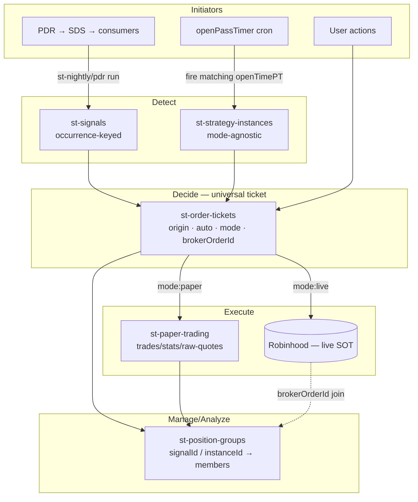

**Topic:** ST Firestore Reorg  
**Topic Slug:** st-firestore-reorg  
**Thread:** Data Plane Consolidation  
**Thread Slug:** data-plane-consolidation  
**Issue:** #986  
**Thread Parent:** #985  
**Topic Parent:** #984  
**Domain:** DATA-PIPELINE  
**Type:** PRD  
**Status:** Approved  
**Created:** 2026-10-14  
**Last Updated:** 2026-10-14  

# PRD — Data Plane Consolidation

## Problem

The ST data plane grew organically and no longer tells a coherent story:

- **A signal has no single identity.** One signal occurrence is fragmented across `run-ids`, `signal-history`, `occurrence-decisions`, `order-intents`, and paper-trade docs using three different ID formats. "What happened to signal X?" cannot be answered by one query.
- **Interim signals evaporate.** `signal-history` is written by nightly runs only; signals detected by intraday/PDR runs exist only in `run-ids` and are effectively un-analyzable.
- **Three action paths bypass the ticket model.** Auto-paper, strategy-instance opens, and user paper orders each create trades by different means, so "what did we do and why" has no single record.
- **Time-based strategies are second-class.** Program records are split across `options-strategy-instances` and an empty `paper-trading/instances` anchor; programs have no live-execution path and no unified management record.
- **The console is unreadable.** Roots span three naming eras (`rh-agent-*`, `savant-trader/data/*`, `paper-trading`/`portfolio`/`backtest-*`), so related data doesn't group visually.
- **`jobs` accumulates forever.** ~926 docs per run, 1.24M total, read by exactly one consumer during the run itself.

## Concept

Reorganize the ST data plane around four canonical entities with one join key (per ADR-009):

1. **`st-signals/{SYM}_{barDate}_{signalType}`** — one document per signal occurrence, written on every run, upgrading INTERIM→CONFIRMED. The aggregate that everything downstream references.
2. **`st-order-tickets/{liv|pap}_{id}`** — the universal action record. Every action — signal-driven, program-driven, manual, or position-management — in either mode — emits a ticket before execution. Ticket existence *is* the accept decision.
3. **`st-position-groups/{id}`** — the management/analytics aggregate grouping all positions spawned from a signal or strategy instance (absorbs paper `cohorts`, extends to live via `brokerOrderId`).
4. **`st-strategy-instances/{id}`** — mode-agnostic program records consolidating legacy split storage; `mode` flips a program between paper and live.

Plus a clean `st-`-prefixed root tree, a 7-day TTL on `jobs`, and minted-at-fill trade IDs that carry symbol + origin + resolved contract (`{SYM}-{YYMMDD}-{sig|prg|man|mgmt}-{expr}-{exp}-{strike}-{NN}`) so the console shows meaningful IDs at a glance and symbol-prefix scans group a symbol's trades chronologically — matching `st-signals/{SYM}_{barDate}_{type}` ordering.

## User stories

### US-1: Canonical signal occurrence

**As a** developer/analyst, **I want** every signal occurrence persisted to one occurrence-keyed document on every run, **so that** interim and confirmed signals have a single identity and I can trace downstream actions.

Acceptance criteria:

- [ ] After any ST run (nightly, pdr, manual, symbol-added), each signaled symbol has a doc at `st-signals/{SYM}_{barDate}_{signalType}` with `status`, `sourceRunId`, payload, and `runIds[]`.
- [ ] **One doc per occurrence, updated on re-detection** — a signal detected at intraday, again post-close, and again nightly is the same doc: `runIds[]` accumulates each detecting run, `status` upgrades INTERIM→CONFIRMED. No duplicates.
- [ ] A signal first detected interim and later confirmed shows `status: CONFIRMED` with both runIds recorded.
- [ ] `run-ids` and `signal-history` writes stop; equivalent data exists on the canonical doc.
- [ ] Verification: for any run, every `{SYM, signalType, barDate}` occurrence it produced exists in `st-signals` — zero occurrences missing, zero duplicates.

### US-2: Universal order ticket

**As a** developer, **I want** every action — signal, program, manual, or management — in live or paper mode — to emit a `st-order-tickets` doc before execution, **so that** "what did the system do and why" is one collection.

Acceptance criteria:

- [ ] Auto-paper ingest writes a ticket (`origin.type:signal`, `auto:true`, `mode:paper`) before creating the trade.
- [ ] `openPassTimer`-driven opens write a ticket (`origin.type:program`, `auto:true`, `mode` from instance).
- [ ] Manual order actions write tickets (`origin.type:manual`, `auto:false`).
- [ ] Position-management actions (stop loss, fractional close) write tickets (`origin.type:management`).
- [ ] Live tickets record `brokerOrderId` at submit; `refId` maps 1:1 to RH's server-enforced `ref_id` idempotency key.
- [ ] Live tickets record `reviewSnapshot` (order_checks, collateral e.g. CSP `cash.amount`) when a `review_*` call precedes submit.
- [ ] On observed fill, live tickets record `fillSummary: {averagePrice, filledQty, filledAt}` — self-contained outcome data without an RH round-trip.
- [ ] Tickets record `lastError: {category, message}` using RH's `rh_error_category` taxonomy on failures.
- [ ] Ticket `terms` supports `dollarAmount` (fractional/dollar-based equity orders — enables equal-dollar-weighted sizing).
- [ ] Ticket state machine includes `cancel_pending` — RH cancel accepts asynchronously and a fill can race.
- [ ] No per-submit tradability/buying-power pre-check — submit rejection surfaces via `lastError`; tradability is a periodic universe sweep, not a per-ticket check.
- [ ] `occurrence-decisions` writes stop; no new docs appear (ticket existence = decision).
- [ ] `order-intents` readers/writers cut over to `st-order-tickets`.

### US-3: Pending intent as ticket, trade minted at fill

**As a** user browsing Firestore, **I want** expression trades to materialize only when a contract is actually selected, with the contract in the doc ID, **so that** pending intent is distinct from holdings and IDs are self-describing.

Acceptance criteria:

- [ ] Signal-order accept creates staged tickets, not PENDING trades.
- [ ] The fill pass reads staged tickets and mints trade docs `{SYM}-{YYMMDD}-{origin}-{expr}-{exp}-{strike}-{NN}` where `origin` ∈ `sig|prg|man|mgmt` (equity trades omit the contract segments).
- [ ] Legacy engine position IDs (`{date}-{SYM}-{strat}-{delta}-{dte}-{freq}-{HHMM}`) migrate to the same convention (`{SYM}-{date}-prg-…`).
- [ ] `st-paper-trading/trades` contains no `PENDING`-status docs.
- [ ] Cancelling a pending expression cancels the ticket (`state: cancelled`), not a trade.
- [ ] Multiple same-template trades on one symbol/day get distinct `{NN}` suffixes.

### US-4: Position groups

**As a** user managing hundreds of positions, **I want** a `st-position-groups` doc grouping everything spawned from a signal or program, **so that** I can track/manage/analyze related positions as a unit.

Acceptance criteria:

- [ ] Paper: signal-order accept creates a group `{SYM}-{YYMMDD}-grp-{NN}` with `memberTicketIds[]`/`memberTradeIds[]` (absorbing today's cohort role).
- [ ] Live: tickets carry `positionGroupId`; equity positions join deterministically via the RH `tax_lots[].order_id` → `brokerOrderId` chain; option positions join via `option_id`/`chain_id` on orders vs positions.
- [ ] Groups record `origin` (signalId or instanceId), `mode`, status, and rollups.
- [ ] All trades spawned by one signal acceptance share a `positionGroupId`.

### US-5: Mode-agnostic strategy instances

**As a** user running time-based strategies, **I want** program records in `st-strategy-instances` with a `mode` field, **so that** the same program definition drives paper or live execution.

Acceptance criteria:

- [ ] Existing `options-strategy-instances` docs (4) migrated to `st-strategy-instances` with `mode` set.
- [ ] `openPassTimer`/`runOpenPass` reads the new collection unchanged in behavior.
- [ ] A `mode:live` instance's open pass emits live-mode tickets (execution wiring may remain paper-behind-flag initially).

### US-6: Collection consolidation + st- prefixing

**As a** user of the Firebase console, **I want** all ST-domain data under `st-` roots, **so that** the domain groups visually and collection names reflect ownership.

Acceptance criteria:

- [ ] `paper-trading/*` → `st-paper-trading/*`; `portfolio/*` → `st-portfolio/*`; `backtest-*` → `st-backtest-*`.
- [ ] `savant-trader/data/*` fully replaced (symbols→`st-symbols`, symbol-lists→`st-symbol-lists`, trading-config+status→`st-config`, order-intents→`st-order-tickets`, review-list→dropped, occurrence-decisions→dropped, run-ids+signal-history→`st-signals`).
- [ ] All FE surfaces reading `review-list` are removed or rewired — no dead "needs review" UI (marker, badges, filters, facades) left pointing at a deleted collection.
- [ ] No reads/writes reference removed paths after cutover (grep-verified per surface).
- [ ] `rh-agent-*` archived/diffed then deleted.

### US-7: jobs retention

**As an** operator, **I want** `st-runs/{id}/jobs` docs deleted after 7 days, **so that** the collection stops growing unboundedly.

Acceptance criteria:

- [ ] Scheduled cleanup deletes job docs older than 7 days.
- [ ] Auto-paper ingest and run-progress UI unaffected (they only read jobs during/immediately after the run).
- [ ] Existing 1.24M backlog purged once.

### US-8: NEW-list backfill

**As a** user triaging symbols, **I want** every tracked symbol with zero exclusive-list membership filed into `NEW`, **so that** "not triaged" is a real list membership backend processes can see.

Acceptance criteria:

- [ ] One-shot migration **adds** zero-membership tracked symbols into `{uid}_NEW` — strictly additive; no existing list memberships are removed or modified.
- [ ] Auto-paper scope `["PRIMARY","SECONDARY","MONITOR","NEW"]` then covers all desired symbols without `NO_MEMBERSHIP` support.

## Technical context

- **RH is source of truth** for live orders/positions/fills — nothing local mirrors live position state; lineage lives on tickets (`brokerOrderId`).
- **Volume asymmetry**: thousands of paper tickets/trades vs hundreds of live — `liv_`/`pap_` ID prefixes keep browsing sane.
- **Migration risk**: `st-signals` dual-write must be verified against existing `signal-history` before cutover (counts, IDs, INTERIM coverage).
- **Pass families stay separate** this thread (deferred to Thread #987) — only path constants and ticket emission change.
- **Firestore doc IDs are immutable** — minted-at-fill is required for contract-bearing trade IDs.
- **`st_review_list`-era FE references** must be removed along with the collection.
- **RH MCP quirks the ticket state machine must honor** (per topic #657 probe captures):
  - Resting *option* orders report `state:"unconfirmed"` — opposite of equities' `confirmed`; state mapping must not treat `unconfirmed` as an error.
  - Cancel is async — `accepted:true` ≠ cancelled; poll `get_*_orders` for terminal `cancelled`.
  - Place responses never show the fill — filled option orders return `unconfirmed` + `processed_quantity:"0"`; fill detection requires polling positions/orders.
  - **No multi-leg option orders via MCP** — `place_option_order` rejects spreads outright; live expressions are single-leg only today.
  - No `trailing_stop` equity order type — cancel/replace workaround only.
- **Live outcome data without local snapshots**: `get_pnl_trade_history` (per-trade `realized_gain`) and `get_realized_pnl` (windowed aggregates) support group rollups on demand — no local position mirroring required.
- **`placed_agent` field** (`user` vs `agentic`) distinguishes app-placed orders from hand-placed — useful when joining RH orders back to tickets.

## Out of scope

- Pass-family semantic merge (Thread #987).
- Alert-backed position management — RH alerts as management mechanism, trailing stops, fractional exits (Thread #989).
- Earnings-date entry gating (Thread #990).
- RH watchlist sync / scanners / historicals-as-data-source (Threads #991/#992/#993 under Topic #657).
- Live-position snapshots/history (RH stays SOT).
- Per-submit tradability/buying-power validation (periodic sweep instead).
- `NO_MEMBERSHIP` scope support in auto-paper (obviated by US-8).
- RS-domain collections (`pairs-*`, `rs-*`, `spread-*`) — separate domain.
- Input-plane renames (`symbol-data`, sync telemetry) — unchanged.

## System context

## Open questions (impl-time)

- Exact `staged→submitted→(cancel_pending)→filled` transition set per mode, including fill-detection cadence (submit-time poll vs periodic sync).
- `expression-fill` consumer shape when reading staged tickets.
- Whether any FE surfaces read `review-list` that need UI removal, or it silently dies.
- Whether `fillSummary`/`reviewSnapshot` stamping happens inline at submit, via a scheduled sync pass, or on-demand — cost vs freshness trade-off.
